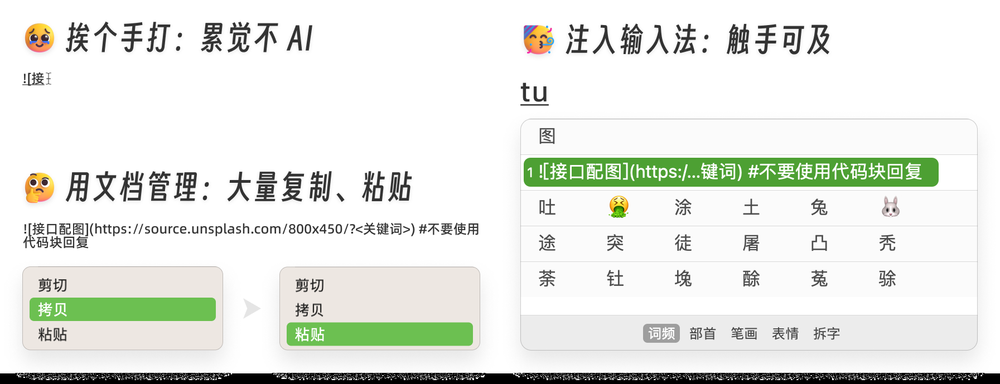
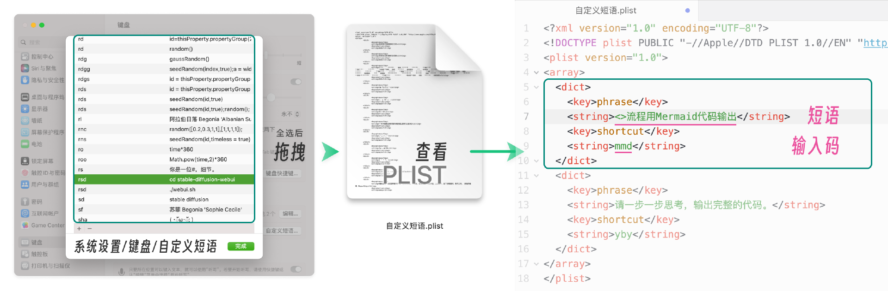
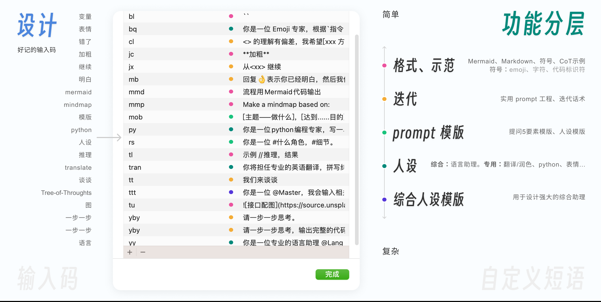
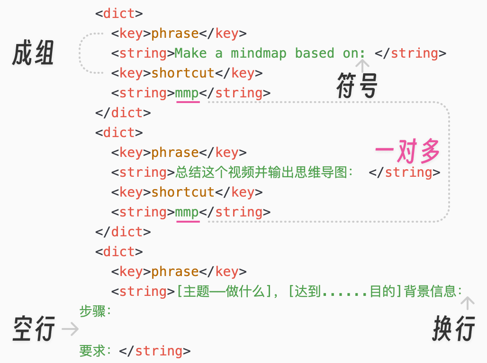
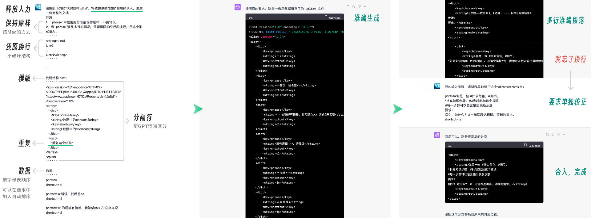
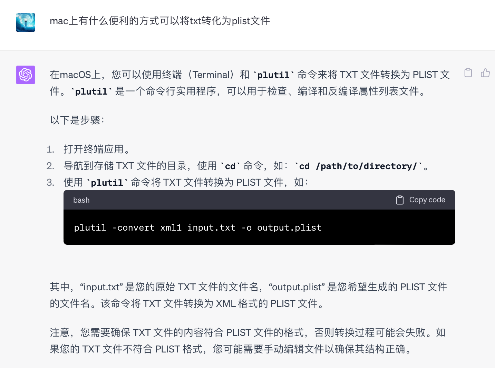
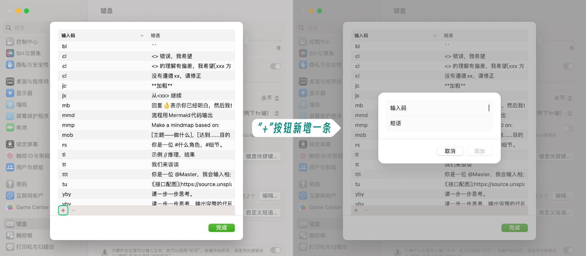
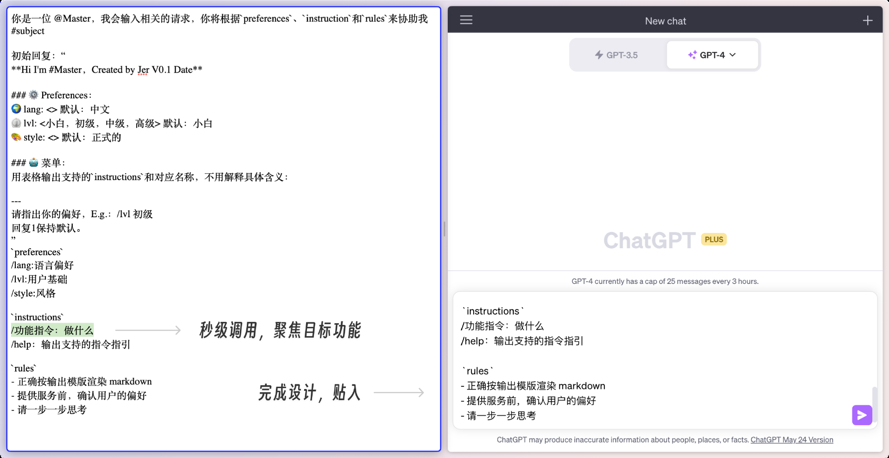
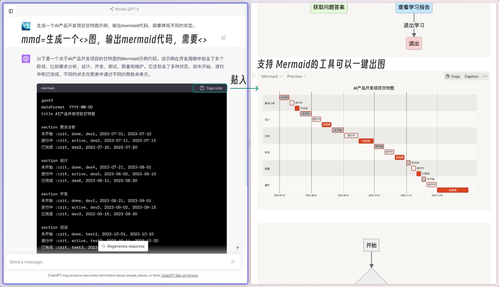

# 10 | 触手可及：万能助手随叫随到

你好，我是键盘，我们继续驯服 GPT。

不知不觉来到了黄金密钥模块的最后一课，相信你已经基本熟悉了以 ChatGPT 为 C 位的人智协作新方式，摸清了 GPT 的底色和它能够给你带来的可能性。你会更注重思考，使用专业的提问来释放人力；可能会关注熵减，大幅减少各种工具和搜索的使用，让工作和生活变简单。

这节课，本质还是熵减。

我们会整合课程中已经掌握的方法和模版，寻找一个合适的移动百宝箱把它们放进去。不仅如此，你手上新增的实用设计也能方便地存进去，所有的设计都能实现秒速级的调用和管理。

百宝箱？看起来似乎要借助一个第三方工具，通过复杂的人力定义和不断地复制粘贴来实现。其实，只要把系统输入法升级成智能输入法就可以了，免费又好用。

## 诉求：让人智交流变简单

开始整活之前，我们拆解一下这个智能输入法需要覆盖的核心功能点。

1. 内置模版，方便套用和设计。

智能输入法需要融合之前设计的 prompt。所谓的内置模版包括两类，基础模版和人设模版。

基础模板用于基础支撑，把提问 5 要素收进去即可。

- prompt：提问 5 要素

```
做<*数量份>主题，细节，方式，格式
```

收录 5 要素模板，是因为它可以轻松延伸为任何一个具体任务 prompt，比如这个填充的实例，里面包含数量、主题、细节、方式、格式，细致又完善，非常好用。

```
提取以下会议纪要的要点，用Markdown代码块输出1份思维导图，用简洁的语言，重点加粗。
```

人设模版是在这个基础上的衍生。可以分为聚焦于通用任务的“通用人设模版”和应对复杂任务的“综合人设模版”。

- prompt “通用人设模版”（你要做什么助手）

```
[做什么]，[达到x目的] 背景信息：
```

- 步骤：要求：

- prompt “综合人设模版”

```
你是一位 @Master，我会输入相关的请求，你将根据`preferences`、`instruction`和`rules`来协助
初始回复：“
**Hi I’m #Master，Created by Jer. Ver Date**
### ⚙️ Preferences：
-  lang: <> 默认：中文
- ⏲️ lvl: <小白，初级，中级，高级> 默认：小白
- 🎨 style: <> 默认：正式的
### 🤖 菜单：
用表格输出支持的`instructions`菜单，不用解释具体含义：
—
请指出你的偏好，E.g.：/lvl 初级
回复1保持默认。
”
`preferences`
/lang:语言偏好
/lvl:用户基础
/style:语言风格
`instructions`
/功能指令：做什么
/help：输出支持的指令指引
`rules`
- 正确按输出模版渲染 markdown
- 提供服务前，确认用户的偏好
- 请一步一步思考
```

2. 注入实用人设，应对日常重复工作。

上面的单一模版可以延伸为各类实用人设。不过，如果你已经写出了常用的人设，不妨也把它们放入百宝箱。这里有几个我常用的人设，非常实用，都放进来。

首先，新手阶段帮我优化 prompt 的新手万能助理，等学有所成之后可以让它退下。

其次，英语是精进 AI 的基础，安排一位搞定英语翻译和润色的轻量翻译和润色人设。有时候还想系统学习其他“语言”，就请出综合语言大师 Lang Master。

还有，针对日常各种自动化和批处理，配备一个专用于设计 Python 解决方案的 Python 脚本人设。我合入了上一节课的 Script Master ，设计成容纳各平台和编程语言的 CodeMaster，不局限于长图切割处理。

最后，非专业玩家的用图需求，使用 MJ 提词器就可以躺着输出。

除了最后一节课才会分享的提词器，其他的人设我都讲过。更多的人设需求根据实际情况量身定制即可。

3. 收录常用的输入，压缩机械的人力重复输入。

除了人设，还有一些小细节。如果你不想一遍一遍地打出重复的句子或段落，找各种符号，也可以把它们存进去。

```
比如用于激活慢思维的 请一步一步思考。 ，用于强调的分割符  <> ， Emoji 设置项🎯
learn: <> 默认：English ，还有用于突出标题和列表的智能符号 ✦ 等等。
```

4. 打通不同终端，随叫随到。

输入法是随身的，但我们更需要一个跨终端的、打通个人数据的输入法，彻底告别冗长、重复的输入以及不同终端同步不便的烦恼。即使是近千字的人设，随时随地敲两下就能唤出。请注意，这里的“两下”是精确量化，不是比喻。

对于苹果用户，苹果的原生输入法依靠 iCloud 覆盖“全家桶”，加上自带的“自定义短语”功能就可以满足要求。Win 用户需要一个有“用户词典”和“账户”的输入法，这样 PC 端和移动端也能打通。这种输入法市面上不少，用自己习惯的就行。



最后，我希望这个百宝箱兼具灵活的管理和备份功能，不需要依赖管理文档就能迭代新的收获。

下面我会以自己常用的 Mac 来分享，方法共通。

## 一步一步思考，打造一个“智能”输入法

先来实现最核心的功能：把数据存到输入法里面。这些数据就是你和 AI 的交流和协作信息，包括符号、迭代话术、prompt 话术、模版、人设等等。

Mac 系统自带的“自定义短语”就非常好用，大量的冗余都被它的巧妙设计熵减了，可以让你在和 AI 交流的时候聚焦目标，忘了输入这件事。

这个“百宝箱”的界面上有添加按钮，但只能一个一个地写入。这是我们想要的吗？不是！为了避免低效的人力录入，我们必须找到捷径。我尝试“全选自定义项 + 拖拽”，生成了一份“自定义短语.plist”文件。我们打开这个文件看看葫芦里卖的什么药！



OK，是一份很规整的 XML，分析它的规律之前，我们还需要了解一些重要概念。

### 了解映射：短语和输入码

“自定义短语”通过 phrase（短语）和 shorcut（输入码）的组合来映射一个信息块，比如在

```
ChatGPT 中常用的配图接口，短语![接口配图]
(https://source.unsplash.com/1600x900/?<关键词>) #不要使用代码块回复 就可
以映射为tu这样的快捷输入码。
```

### 准备工作：设计输入码

短语就是要存入的数据，这个我们已经有很多储备了。接下来要解决输入码的设计，我主要使用以下 3 个方法。

- 方法 1：贴合自己的习惯来设计，要能够毫不费劲地记住，最佳长度是 2-3 位。

我给你举几个例子。

```
cl = <>错误，我希望<> ，“cl”取自“错了”的拼音。
yby = 请一步一步思考 ，“yby”取自“一步一”的拼音。
mmd = <>流程用Mermaid代码输出 ，“mmd”取自“Mermaid”的音节，也可以使用“流程”的拼
```

- 音“lc”，但是用“mermaid”或者“asdfg”这种乱码就没必要了。

- 方法 2：输入码应该规避和常用的文字输入冲突，否则很容易变成干扰。

```
假如你经常打mb来输入“模版”，那么人设模版的输入码最好就不要设为mb，它可以是增加 1
位来减少冲突的“模版”拼音mob、取自“人设”拼音的rs、或者取自“template”的简拼tpl 。
```

- 方法 3：不方便的通通写入。

不方便手打的，你就写进去，比如 prompt 段落和一些实用符号“✦”“⭐️”，一个图标就找半天，不如存进输入法。

另外建议你在一个清晰的框架下进行设计，以后数量多起来也不会乱套。下图中我根据成果截图做了聚类的注解，通常都是保存这些类别的内容，你可以参考着整理自己需要的功能。



然后你就可以造出一份下面这样的数据文档，也可以通过示范你的习惯让 ChatGPT 补全细节。

- 数据：

```
phrase=``
shortcut=bl
phrase=<>错误，我希望<>
shortcut=cl
......
```

### 分析规律

观察这份“自定义短语.plist”文件，我们来提取规律，为下一步实现自动填充和注入输入法做准备。



```
每一组快捷输入映射，由短语 phrase 和输入码 shorcut 两部分组成。
```

- 一对多：同一个输入码可以对应多个短语。

- 符号、空行和换行，所见即所得。

```
多行文本的两端会被 <string></string> 结构包裹。
```

- 输入码按字母表顺序，而且是先排少位的，再排多位的。比如：a ▸ ab ▸ acc。

```
半角逗号 , 会被识别为切割，比如“a,b”会被切割成短语“a”和短语“b”两组快捷输入，用全角
```

- 逗号 ， 替换即可。

### 实现自动填充

根据以上的设计方法和文档规律，现在我们就可以设计 prompt，让 GPT 帮我们把需要的内容自动写进去了。这个“分析规律 ▸ 拆解设计 ▸ 实现自动化”的推演方法基本适用于任何拆解。

- prompt 模版

```
请按照下方的“代码结构.pllist”，将我提供的“数据”按规律填入，生成一份完整的文档:
```

- 注意：

```xml
1、`phrase`中使用的符号请保持原样，不要转义。
2、当`phrase`涉及多行的情况，保留里面的空行和换行，用这个形式填入：
--------
<string>Line1
Line2
…
LineN</string>
--------
代码结构.plist：
--------
<?xml version="1.0" encoding="UTF-8"?>
<!DOCTYPE plist PUBLIC "-//Apple//DTD PLIST 1.0//EN" "http://www.apple.com/DTDs/P
<plist version="1.0">
<array>
 <dict>
   <key>phrase</key>
   <string>数据中的phrase</string>
   <key>shortcut</key>
   <string>数据中的shortcut</string>
 </dict>
 <dict>
   “重复这个结构”
 </dict>
</array>
</plist>
--------
```

- 数据：

```
--------
phrase=``
shortcut=bl
phrase=<>错误，我希望<>
shortcut=cl
#[注] 以下重复省略
```

从“请按照”开始，就是具体的任务要求，第一条代表短语的标点符号不要改动，第二条代表还原短语的断行方式，具体的代码填充格式也给出了参考（5-10 行代码）。我们只需要填写第 29行数据：之后的内容，就可以给 GPT 派活了。

```
数据里面是我整理的短语phrase和对应的快捷输入码shortcut，用参数赋值的形式列给
```

GPT。

```
这个案例的核心就是重复录入不同的<dict>自定义短语</dict>。你在要求 ChatGPT 输出
```

多组包含多个模块的信息时也可以使用。比如推荐 3 本重磅好书，每一个输出都要包含封面、概要信息表格、推荐语等等的完整结构。

```
# 示范段行格式
Line1
Line2
…
LineN
# 重复填充词典
```

- 结构

```
"重复这个结构"
```

- 🤖️ ChatGPT



可以看到，GPT 能够准确地按要求办事。我比较关注的多行段落也没有翻车，因为这种情况会破坏整个 prompt 的书写结构，一定不能乱套。整体过完一遍，发现中间还是有一段在粘贴文本的时候换行解析出了问题，于是要求 GPT 帮忙修正，把更新的代码片段覆盖到.plist 中。

你还可以继续问 GPT，还有哪些实用的 prompt 写法，根据上面提到的规律自动扩展更多的短语映射。你再判断一下，合适的就合入。这里可以用前面的“判断”+“/ 子功能”方法自动实现。比如回“1”就代表采用，最后把它们整合起来。

接下来，把这份 plist 拖到系统的“自定义短语”中，如无意外就收工了。但是我拖入的时候居然装死不动了，怎么办呢？

```
先说原因，除了“自定义短语.plist”这份 XML 文档和纯文字的编码差异导致解析出错，还有<>
这对符号检查不仔细的问题。它们在 XML 中被转义为&lt;&gt;的形式，可以看出是用来规
避和<标记符>的冲突，所以原 prompt 的“注意”项 1 应该修订为：
`phrase`中使用的符号，<>请转义为&lt;&gt;，其他的保持原样。
```

解析的问题，最直接的方式就是让 GPT 解决，打开终端敲两行代码即可，首先 cd 到目标路径，选中 ChatGPT.txt，自动转化为 ChatGPT.plist。

- 💻 终端命令

```bash
cd /Users/jer/Desktop/
plutil -convert xml1 ChatGPT.txt -o ChatGPT.plist
```

- 🤖️ ChatGPT



更取巧的方式是在“自定义短语”中先拖出一份 plist，再贴入 GPT 生成的代码覆盖。

好了，现在把修正的 ChatGPT.plist 拖进“自定义短语”，搞定。如果后面你想单独新增，点击

```
左下角 “+” 按钮就可以，这种情况下所见即所得，<> 这种符号不需要额外的转义操作。“-”按
```

钮则对应删减。通过迭代里面的“短语”，把输入法打磨成一把辅助高效交流的利器，而不是一个 prompt 存储空间。比如“新手助理人设”，完成新手阶段的辅助使命之后，完全可以“下架”。



Windows 上的处理方式，按照“分析规律 ▸ 拆解设计 ▸ 实现自动化”这个推演方法来处理写入即可。只要你的输入法有“用户词典”文件或者导入按钮，这个事情就很好办。至于“个人账号”，主要作用是把你在电脑端处理好的数据同步到账号所覆盖的各个终端。

## 应用：唯快不破

把模版、常用的 prompt 和符号都注入输入法之后，我们来看实际应用，怎么让“人智交流”变简单。

- 召唤综合人设，搭配分屏功能快速规划 prompt 设计。

```
首先是综合人设，输入定义好的输入码 ttt，回车。以前你需要打一串的文本才能进入节
奏，现在直接聚焦思考你想解决的问题，在  /功能：是什么 部分设计细节就可以了。
```

下图左边是一个用于规划的轻量网页记事本，系统记事本也可以用。



网页记事本链接（复制可用）：data:text/html;base64,PGh0bWwgY29udGVudGVkaXRhYmxlPmVkaXQgbWU8L2h0bWw+

- 高频 prompt，信手拈来，不用再重复打完。

用你熟悉的“代号”召唤它们，具体的场景我举几个例子。

```
著名的 Zero-Shot CoT 请一步一步思考。肯定是榜上有名的，用输入码 yby 来映射，利用
```

- 输入码可以“1 对多”的能力，再定义一句 请一步一步思考，输出完整的代码。 ，用于编码场景。

```
日常使用中，ChatGPT 的输出相比 GPT-4 是非常啰嗦的。你可以定义 jjd 对应请用简洁
的语言，注意正确渲染markdown 之类的短语，让输出更简洁、更专业。
```

3. 如果你还想通过 GPT 生成代码，在支持 Mermaid 的工具中转换成各种图表，那么这一行prompt 就很炸裂，它还可以变成流程图、树状图、用户旅行图、时序图等等，覆盖分析和研究的方方面面。（图稿中使用的工具是 Notion）

```
输入码 = mmd
短语 = 生成一个<>图，输出mermaid代码，需要<>
```



ChatGPT 做好的“自定义短语”文件我放在了Github，供你参考。

## 扩展：放眼智能领域，思路打开

除了已经覆盖的需求，这个输入映射方法可以扩展的用法实在太多了，AI 领域里相关的词典都可以纳入，甚至，你的一些常用代码、API token 和个人号码，在确保个人数据安全的情况也能放进去。我再举几个例子，帮你打开思路。

学习交流的时候，常用的名称懒得完全手敲。

```
cha = ChatGPT
sd = Stable Diffusion
mjr = Midjourney
```

本地运行 Stable Diffusion（Run SD），两个命令行。

```
rsd = cd stable-diffusion-webui
rsd = ./webui.sh
```

常用的智能绘图后缀或组合，比如在 MJ 中采用 2:1 宽画幅和高风格化 s750。（这套课程的头图就是这么来的）

```
hz = --ar 2:1 --s 750
```

在 MJ 风景构图中，干掉碍眼的人和电线。

```
fj = --no human powerlines
```

## 小黑板

这节课是对基础速通和黄金密钥两个模块的花式总结。我们都知道，所谓的人智协作，其实就是最大限度发挥人类思考的价值，有效且高效地指挥 AI 来完成你想做的事情，释放掉低价值的人力劳作。

驯服 ChatGPT，主要靠的就是 prompt 的交互。所以要让人智交流变得简单，就得想办法来减少输入 prompt 过程中的冗余、重复和各种输入的不便利。随身的输入法可以依靠“打通终端，随叫随到”来帮我们实现。

我把已经分享过的 prompt 方法和模版划分为 5 层，融合到了智能输入法的核心功能点里面。然后我们展开一步一步的分析和设计，成功让 ChatGPT 填充了一份“智能词典”。这是一种典型的通过提取规律来指挥 AI 做事的方法。说到规律，不可避免地会遇到一些“重复示例”的问题，我分享了 2 种可复用的写法，有效应对。


现在，你的万能助手也就以专业团队的形式正式入驻输入法了，随时随地，触手可及。它还能覆盖日常 prompt 的方方面面，不止于快速调用和灵活管理，希望思路扩展部分的例子能够给到你灵感。

本节课我们也学习了一种通用的推演方法。只要能揪出事物中的规律，prompt 这把黄金密钥就一定能打开面前那扇激动人心的大门。


要点：


## 踏浪扬帆

咱们就试试还能拓展什么进去，不止于技术层面。比如说，多按两下就能自动将输入的文本传到 OpenAI 接口进行翻译，再通过让 ChatGPT 写一个脚本把翻译结果传过来，覆盖原来的输入。

上完这一节，你还觉得需要多一个所谓的 AI 输入法或者管理 prompt 的工具吗？期待在评论区看到你的思考或感受分享，也欢迎你将这节课分享给感兴趣的朋友们，戳此加入课程交流群，我们下节课进入综合实战。
