# 15 | 数据分析：数据洞察和可视化，0开发基础也能打

你好，我是键盘，我们继续驯服 GPT。

普通人想要做数据分析，没有专业的技术和知识是很难拿出成果的。你需要掌握基础的函数运算，了解适用的图表和分析方法，最后再整合有效的数据洞察。

数据分析有哪些常见的场景呢？统计账单，获悉钱是怎么被大风刮来（或者刮走）的；分析投放活动的点击率，调整方法和预算；观察舆情指数，抓运营热点；组建量化投资策略，让资金增值……

应用场景这么多，想想都很激动呢！但是有四座大山无情地拦在了小白面前。


- 手里没数据，要不就是拿不到数据，难道要分析空气吗？

- 有了数据，分析却无从下手。

- 运算麻烦。没有技术基础，虽然想到 Python 的可能性，却倒在安装环境这一步。

- 没有方便的综合解决方案，学习用 BI（一种数据分析技术）吧，BI 是啥？还得学？

那有没有一条平凡之路，可以跨越山和大海呢？有，GPT 让很多不可能的事情成为了可能。

这节课，我会给你分享一个人人能用的数据可视化分析方案，带你实现人民币汇率和上证指数的相关性分析，并通过可视化分析寻找决策建议。如果你对金融领域不感兴趣，只要聚焦于数据获取、智能运算、数据导出、可视化、智能分析和建议、发布报告这一整套流程即可。

假如你是 ChatGPT Plus 会员，用 GPT-4 联动 Noteable 插件的效果是最好的。普通ChatGPT 用户可以使用 Noteable 网页服务，搭配 newBing 来做平替。newBing 可以给你时效性数据和 Noteable 的代码参考。放心，不用自己编程。

## 智能分析中各角色的核心价值

先来了解一下这组联动方案里面的 4 个角色，GPT、Noteable、Akshare 和指挥官。指挥官就是我们自己，主要负责在一旁打字活派，拍拍手拿结果。

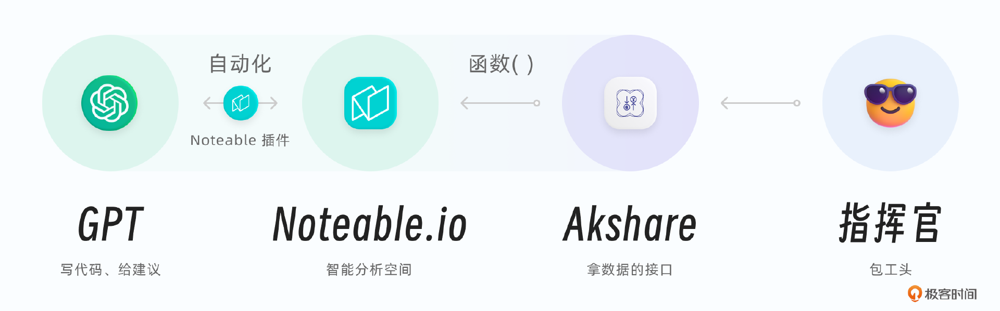

- 智能分析 4 角色

我们按照从获取数据到处理数据的顺序讲解其他 3 个角色。

### Akshare：获取海量数据

Akshare 是一个开源财经数据接口库，可以实现对股票、期货、期权、基金、债券、外汇等金融数据的采集、清洗和下载。用它来捞数据非常方便。

```
打开接口库，比如我想找“消费者信心指数”，搜索发现对应的函数是 macro_china_xfzxx
。我们到 Noteable.io 中运行接口示例代码，图稿中的 print( ) 就会按照官方设计好的参
```

数和规格，将目标数据输出。（任何支持 Python 的工具都可以运行）

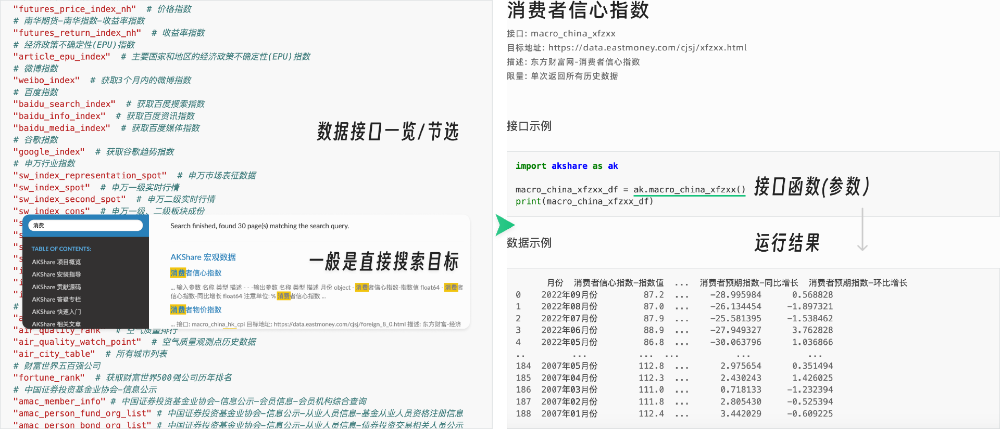

- Akshare 数据接口和函数写法

### GPT：数据洞察

知道怎么调用数据之后，我们还要针对获取的数据做计算、输出可视化和分析。用于计算的编码工作可以交给 GPT。编程只是基础操作，提供数据洞察才是 GPT 最核心的价值。

另外补充一点，GPT 最擅长的是给建议而不是计算，“建议”对应 SII 框架中的数据洞察（Insight）和决策参考（Impact）。我不建议在 GPT 窗口中执行数据运算，而是联动工具来做这件事情，这个工具就是 Noteable。这样的搭配更快、更有效。

### Noteable：整合报告

网页端的 Noteable.io 是一个类似 Google Colab 的协作数据笔记本，可以结合 Python、SQL 等代码和交互式可视化功能进行数据的分析和转换，打开即用。插件端则可以联动 GPT-4 自动将代码写进网页项目中。

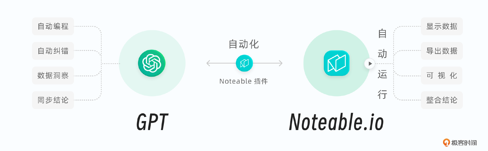

具体怎么实现 GPT 和 Noteable 的协作呢？关键在于交出项目权限。我们先新建一个项目（Project）中的笔记（Notebook），点击 Create 提交确认。然后点击 Share，将项目权限设置为 Public，再选择 Contributor，让你的老伙计 GPT 可以编辑和分享。

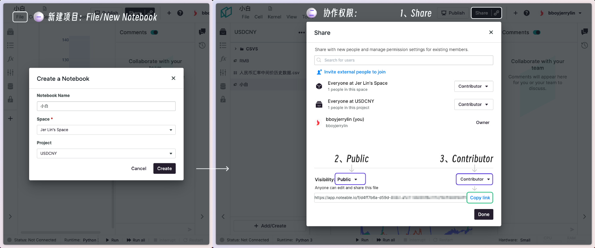

- 交出协作权限

交出权限时候，一定要确保 GPT 要么开着 Noteable 插件，要么开了联网插件，比如WebPilot。

最后，炸裂的全自动流程就搭建好了。Noteable 插件作为 GPT-4 内部自动编程和纠错的桥梁，而 Noteable 网页端会自动运行 GPT-4 写入的代码，运行结果包括显示数据、导出数据、提供可视化图表，还有最终的分析结论。这一切在 GPT 窗口中就能完成整合。

假如你有本地数据想放进来分析或者作为补充，也很简单，点击项目中的 Add files，拖入就好。注意，如果原始数据为 Excel 默认格式，先在 Excel 里导出为 CSV 再上传，这样才不会乱码。

这里我们还需要新建一个目录（Folder）来接收后续代码输出的数据文件。比如下图中的“CSVS”就是后面导出的上证指数数据的存放目录。

本地数据上传之后，数据的权限也要交给 GPT，否则 GPT 看不到里面具体的字段和数据。参考前面说的协作席位操作，我们提前复制好项目和数据的协作地址，备用。

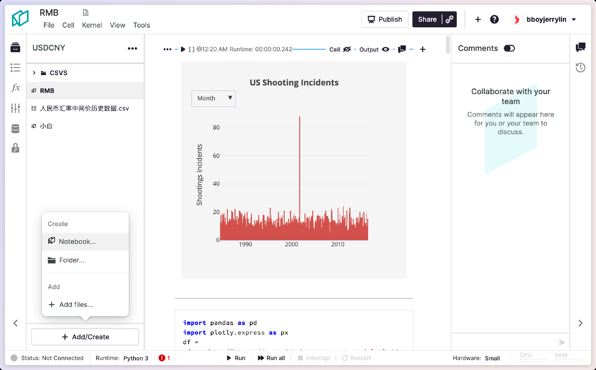

- 导入本地数据、新建子目录

来看一个具体的例子。我上传了一份 newBing 提供的“2023 年 0101 到 0628 期间的人民币汇率中间价历史数据”。这里可以看到系统提供的 0 代码可视化入口，点击界面右上角的Visualize 按钮，就能根据数据绘制出图表。这份数据最适用的是 K 线图，在图表类型里下拉，切换、选择自己认为更合适的形式就好。

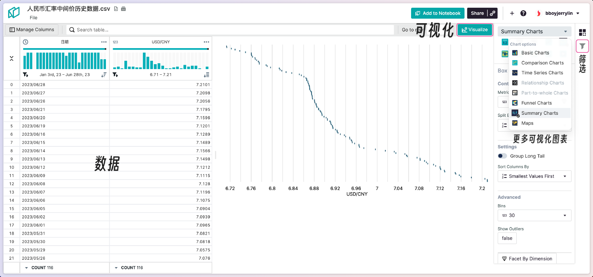

- Visualize：0 代码可视化入口

不过，这个 0 代码可视化作为数据表的另一种直观查看方式就好，后面我们会让 GPT 自动写出更高级的可交互图表，不需要手动去切换。

## 先让 GPT 给参考

那现在开始派活了吗？不是的。获取数据、Noteable 数据分析及可视化，这两件事我们都没做过，怎么办？别急，先让 GPT 给参考，让你明白具体可以怎么做。

数据分析通常是有时效性的，对于没有联网插件的朋友，newBing 就是最佳平替。这里有 2个核心的联动应用场景，获取数据和实例参考。

- 场景一，NewBing 获取数据

先不谈数据接口，离普通人最近的就是搜索获取。比如图稿中我想获取人民币汇率数据，哪亮点哪就可以。

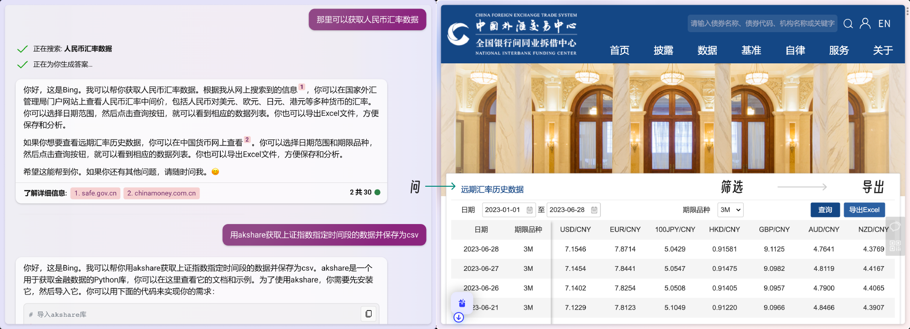

- newBing：数据传送门

- 场景二，提供一个 Noteable 数据分析实例

让 newBing 创建一个可视化实例参考，了解实现的流程和效果是怎么样的。有的同学可能会被输出的代码吓到，不过别忘了，只要是自带“复制”按钮的结果，粘贴大法总能解决问题。

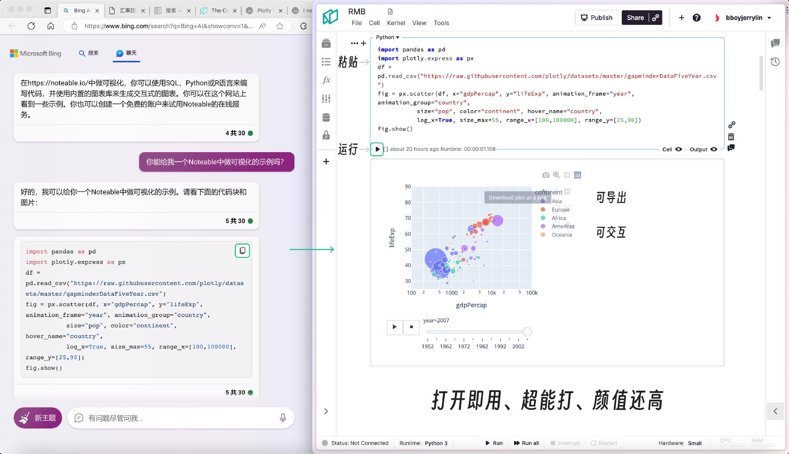

- 原则：Talk is cheap, show me your code.

自带的可交互图表也足够惊艳，我挨个测试了一轮，2D、3D 和动画应有尽有。怎么用呢？你

```
动口，让 GPT 动手。比如 用饼图来……。
```

- 智能画大饼

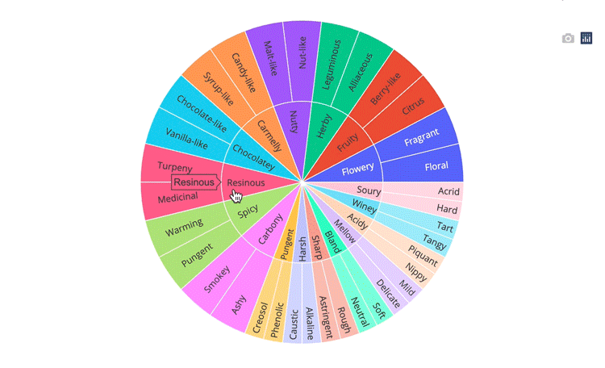

- 复合饼图的下钻（内置的可交互图表方案）

## 梦幻联动：GPT x Noteable x Akshare

下面进入可视化分析流程，具体实现有自动化和 newBing（newBing 的内核是 GPT-4）辅助两种方式。

### ✦ 首选：GPT-4 x Noteable 插件自动化组合

- 💬 Prompt 套路

```
https://app.noteable.io/f/xxx/xxx.ipynb #你的项目地址
```

- 做什么

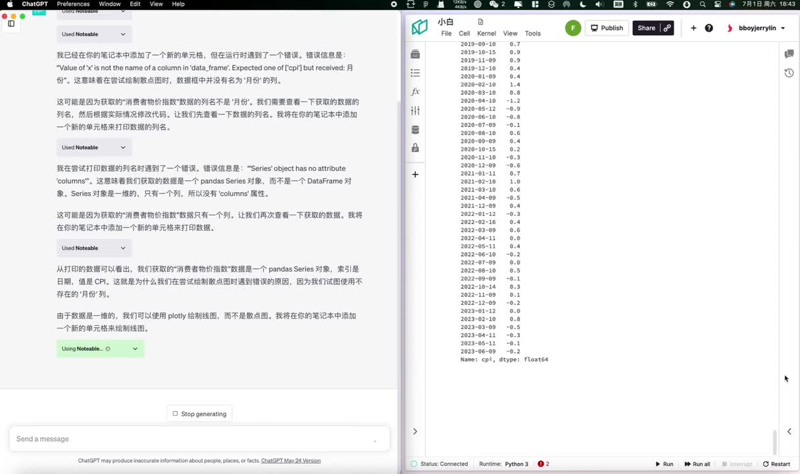

这是最梦幻的组合了，把项目地址和权限交给 GPT-4，Noteable 插件就会自动把代码写到Noteable 网页端的项目中并运行。假如运行出错，Bug 会被自动修正，输出的数据和图表也会自动同步。初次体验的时候，这些功能给我秀得一愣一愣的。

### ✦ 平替：Noteable 项目主场，newBing 辅助

平替组合适合没有插件的朋友，我们把主战场转移到 Noteable.io 的项目空间。人民币汇率数据已经有了，想分析汇率和上证指数的相关性，还要拿到上证指数的数据。到这一步，Akshare 可以上场了。

```
首先用 !pip install 命令安装 Akshare，这是一次性操作，点击代码块（Cell）中的 “▸”
```

按钮运行即可。

```
!pip install akshare
```

- Noteable 运行结果

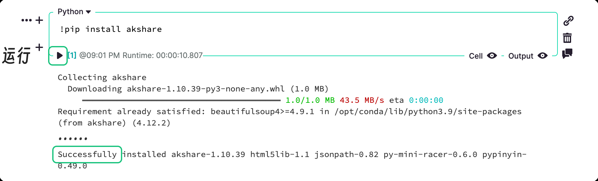

下面会看到 “Successfully” 提示，可以开始调用接口来干活了。

接下来调用数据有 2 种方便的做法。要么到 Akshare 文档中复制范例，要么让 newBing写。后者的 prompt 套路如下。

- 💬 Prompt

```
如何在Noteable.io中用Akshare调用xxx数据，我想做一个xxx分析。
```

获取上证指数全数据，运行的 Notebook 代码如下。

```python
import akshare as ak
stock_zh_index_daily_df = ak.stock_zh_index_daily(symbol="sh000001")
print(stock_zh_index_daily_df)
```

激荡 33 年的数据，转眼到手。Noteable 用带序号的表格输出了从 1990-12-10 至今上证指数的开盘价（open）、日内最高价（high）、日内最低价（low）还有日交易量（volume）所有这些数据。

- Noteable 运行结果

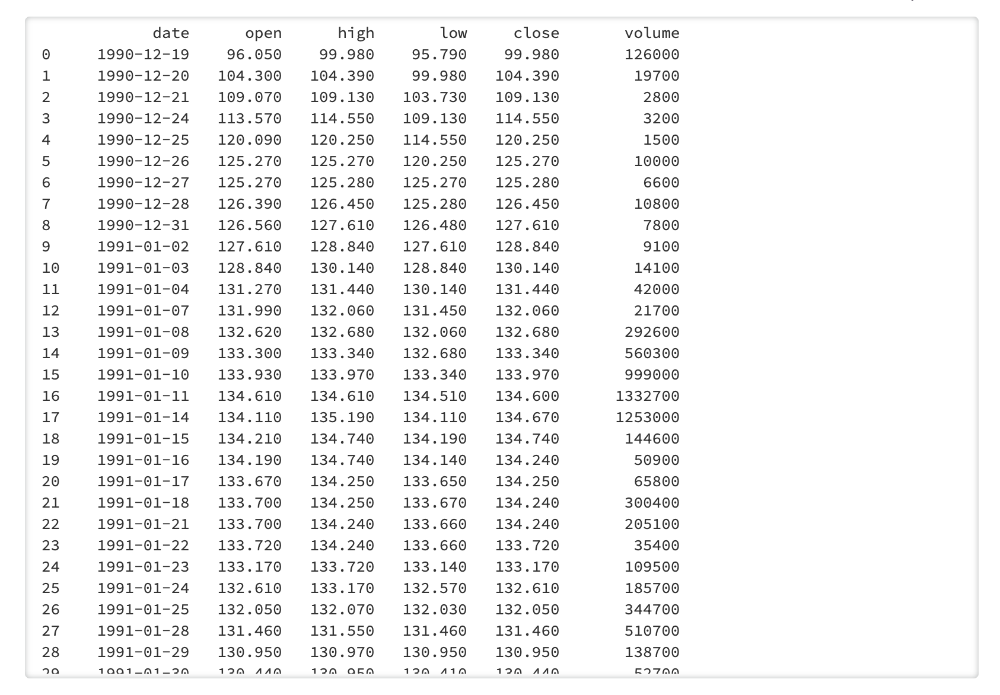

获取成功了，就可以收敛数据。精确指定支持的参数，获取上证指数指定日期区间的数据，Notebook 代码如下。

```python
import akshare as ak
currency_hist_df = ak.currency_hist(symbol="usd-cny", period="每日", start_date="2
print(currency_hist_df)
这里 symbol 、 period 等后面带着 "数值" 的就是所谓的参数，照抄 Akshare 文档就好。
```

数据获取成功了，可是官方范例并没有提供将获取的数据导出的方法，怎么办？问 newBing。得到的通用方案是前排导入 pandas 库，最后使用 df.to_csv(“路径 / 文件名”) 来保存。

```python
#Noteable早就看穿了一切，帮我们准备了pandas，直接导入即可
import pandas as pd
#保存到同级目录：'文件名'，保存到子目录：'路径/文件名'，单双引号都可以
df.to_csv("路径/文件名")
```

不想自己写也很简单，交给 GPT 就好。这里可以看到 df 前缀是要和前面定义的函数变量

```
stock_zh_index_daily_df 一致的，详见下方图稿。
```

- Noteable 运行结果

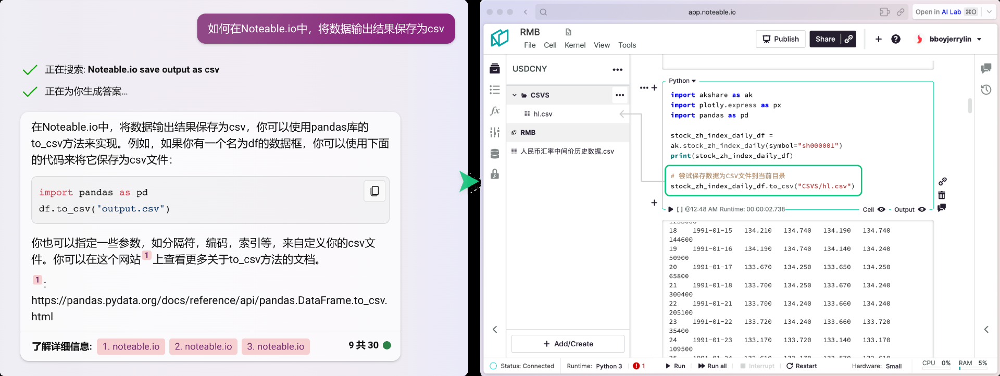

- 通用的 CSV 数据导出写法

### ✦ 分析更多的数据？SO EASY

你可以调用、提取官方提供的任何数据，来看实例。我们替换目标数据对应的函数。比如“房价指数”：

```
ak.macro_china_new_house_price() # 新房价指数
```

- Noteable 运行结果

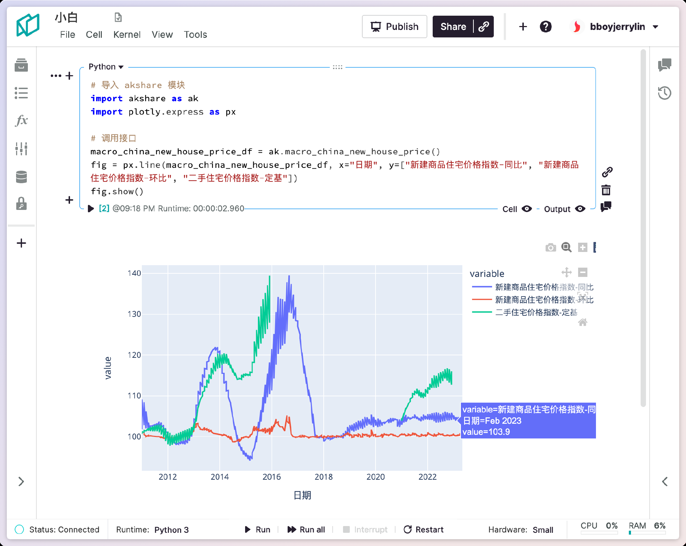

- 房价指数可视化

## 自动数据可视化

数据的上传、调用、导出都跑通了，接下来我们解决自动可视化的问题。我会带你实现两份数据的整合分析，按照一步一步思考的惯例，先搞定其中一份。

首先，让 GPT 调用上面保存的上证指数的数据来做自动可视化，将数据用合适的图表类型渲染出来，全程 prompt 就好，GPT-4 和 Noteable 会自动协作同步。

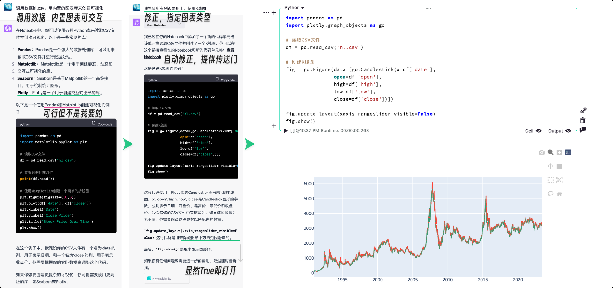

- 上证指数数据可视化

自动可视化方案首选的技术支持是内置的、支持交互和图片导出的 Plotly，官方图表库里可

```
以找到一切的用法指引。实际 prompt 可以是 ……用Plotly输出xx图 。
这里会发现 GPT 提供的代码引用的是 plotly.graph_object ，和官方图表库里的
plotly.express 并不一致。没关系，先解决“能用”问题，再提升精度，只要问 GPT 就能
```

解决。

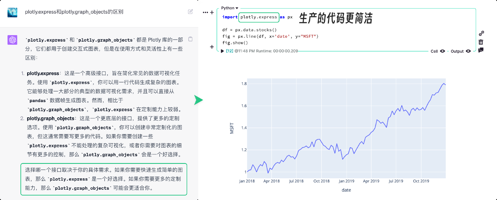

- 根据需求来选用图表库

OK，一份数据搞定，再来加入第二份数据。因为汇率数据的时间区间是 20230101-20230628，所以接下来就来取重合的时间区间，把两份数据合并，再输出可视化方案。

- 2 份图表合并可视化

GPT 在 Noteable 的加持下会化身 AutoGPT，自动奔向目标，直到需求解决。最后我们就能得到一份拼合的上证指数蜡烛图和汇率走势图。

可以看到，两者的走势是有一定的负相关性的，那“一定的”是多少？这就是数据分析要解决的量化问题。这里我们通过搜索或者提问，可以得到“相关性分析”和“线性回归”等建议，它们会有相应的计算和系数，但有 GPT 在，这些并不需要我们操心。只要找到“相关性分析”这种概念，用起来再说就行。

我们让 GPT 分析 2 份数据之间的规律。现在有权限的 GPT 可以“看穿”整个 Noteable 项目，我们直接说需求就好。

- 相关性分析的可视化方案：直接映射和动态关联

第一次跑机得到了精确的相关性系数（-0.2319269300615737），收盘价和人民币汇率两个变量的关系被映射到一个散点图上，从结果视觉来看确实也“解释了”弱相关性。但是我想继续深入探索一下，加上时间维度的考虑，会是怎样？

可以看到，考虑时间的影响之后，虽然动态相关性上蹿下跳，大部分情况却是在 -0.4 以下。0表示没有关系，-1 表示强烈的负相关，所以大部分情况下还是中等负相关的。

那如果将动态时间窗口再拖长呢？看看 30 天和 60 天的颗粒度。

动态相关性曲线从 5 月份开始一路往 -0.8 下潜，负相关性越发强烈。要知道，股市跌起来没有底，但是人民币贬值却是不可持续的。历史上的 USDCNY（美元兑换人民币），大周期要么是双顶背离——第二波上涨速度变慢，然后转向，要么是第二波冲顶失败，直接力竭掉头。评估汇率的走势，我们就可以预判上证会在什么情况下有转机，顺便投一点资金进去。如果你有大额外汇购买需求，等汇率回落再去操作，也会划算很多。反过来，近期把美元或者港币置换成人民币，就是不错的窗口。

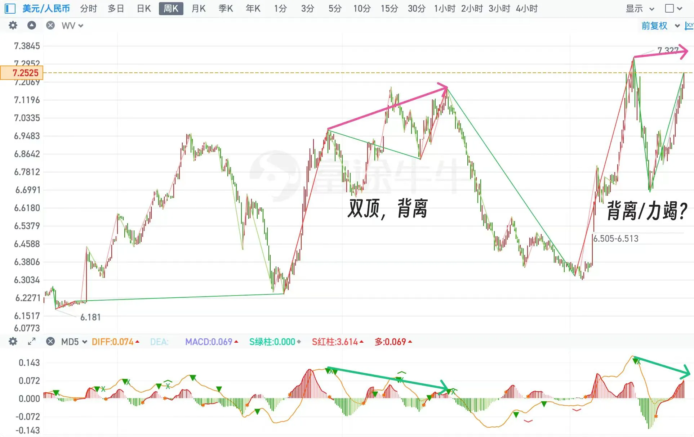

- 结合 USDCNY 的大周期规律和相关性分析来预判，做出决策

## 智能分析和建议

现在我们让 GPT 来给出智能分析参考，套路就是“GPT 请看图说话”。有插件联动的情况，不需要复制粘贴各种数据。

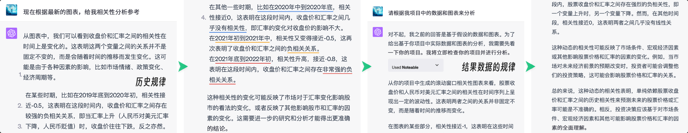

- 智能分析：看图说话

Noteable 其实还悄悄藏了好东西，那就是 Markdown 的支持。这样的话，只要把智能结论也自动排版写好，不就是一份完整数据可视化分析报告了？要的就是这个效果！

- 数据导入 + 数据获取 + 数据处理 + 数据可视化 + 智能结论

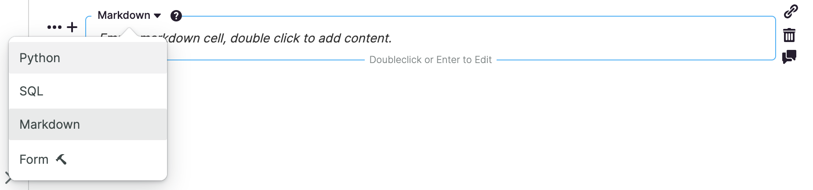

- Noteable 隐藏的 Markdown 支持

要求新建一个 Markdown Cell 并自动同步结论，报告完整了。

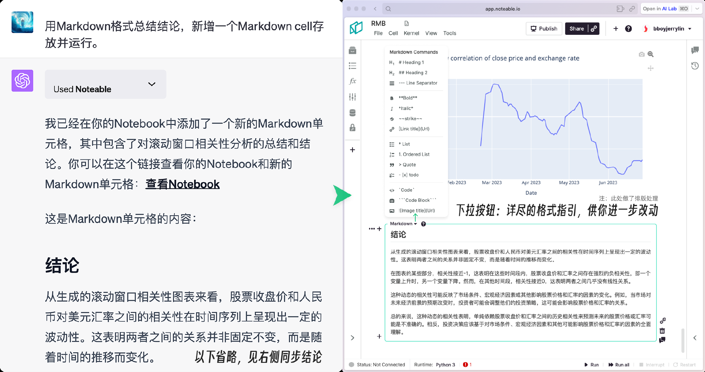

- 自动整合 Markdown 结论

接下来，点击项目上方的 Publish 按钮，将合适的信息块（Cell）添加到报告中，这里面有 4大类：代码（一般不会加进去）、数据、可交互图表和自动整合的智能分析结论。确认好报告的完整度就可以发布了。

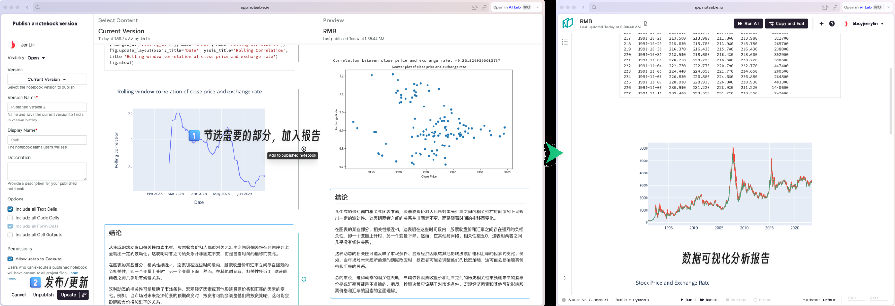

- 发布完整的可视化分析报告

这份报告是可交互、可随时更新的。到这个份上了，还要 PPT 做什么？而且回顾整套方案，要说写代码的地方，整个方案也只有 1 行，就是安装 Akshare 用的 !pip install。相较于本地折腾 Python 的方案，已经非常诱人了。

注意，以上方案仅作为完整的数据可视化分析流程的自动化思路分享，因为缺少更多维度数据的系统评估，并不够严谨，请不要根据以上单一的结论参考做出投资相关的决策，以免遭受不必要的损失。

## 可视化图表小彩蛋

只要涉及图片的输出，Markdown 永不缺席。我提供另一个在 ChatGPT 窗口中直接实现的兼容方案。

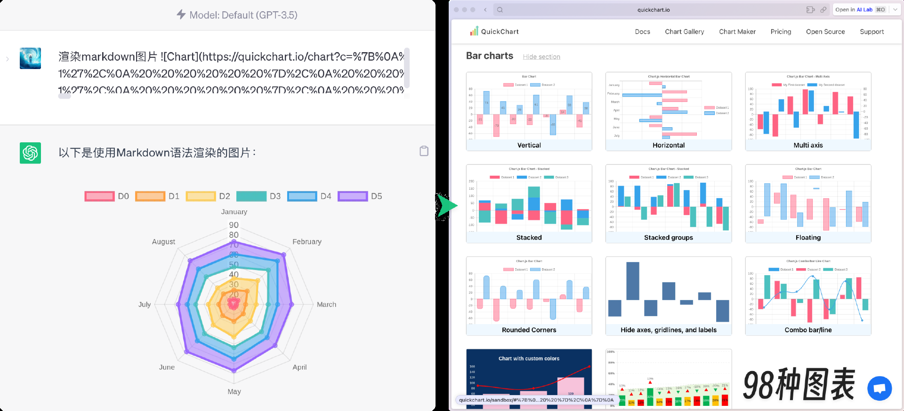

- 你没有看错，兼容 ChatGPT 模型

这个方案会用到 Quickchart 接口，我跟你说下具体的实现流程。

1. 手动粘贴数据给 ChatGPT。

2. 让 ChatGPT 将数据输出为一个 JSON 格式的图表配置。

3. 手动将这个 JSON 配置转换为 URL 编码的字符串（urlEncodedConfig）。

```
让 ChatGPT 用以下格式显示：。
```

优势是通过 Markdown 就能显示，美中不足是需要转码，因为这个链接写入了你提供的所有数据，假如数据量很大，你会面临漫长的等待和超出输入限制的问题。

有兴趣的朋友请自行到 Quickchart 官方了解，建议亲自实践一番，寻找合适的辅助解决方案。

最后，为了更专业和深入的分析，你还需要学习如何选取合适的分析算法，比如常用的频数统计、描述性统计分析和方差分析等等，这些靠之前分享的“智学三件套”就可以很快学习并在实践中内化。有了 GPT，做什么都如有神助，Just prompt it。

## 小黑板

这节课从跨越小白面前四座大山的想法出发，给你分享一个智能数据可视化分析方案。我带你走完了从到数据获取到运算、导出、可视化，再到最后的智能结论、发布报告这一整套流程，展示了人民币汇率和上证指数的相关性分析全过程。

我们明确了智能分析中 4 个角色的核心价值。你作为指挥官，调用自己的知识来派活，劳心为上；Akshare 用来获取数据；GPT 提供数据洞察；主战场在 Noteable 这个打开即用的智能分析空间。

你可能也会感受到，只要是涉及 GPT 的读取和流程的自动化，权限和各种接口都举足轻重。而对于联网的需求，更多是因为数据的时效性。

通过案例，我们了解了 2 个方便的数据分析方案。

1. 没有插件就创造条件，让 newBing 提供参考，在 Noteable 网页端解决问题。

2. 高贵的 Plus 会员，当然要用顶配的 GPT-4 联动 Noteable 插件，实现自动化高效分析，最后的报告都可以整合到 Notebook 的报告中。

最后强调几个可复用的方法，你可以根据几个关键词想一想具体步骤。

1. 0 开发基础也能用的、方便的数据获取。

2. 自动将获取的数据导出为 CSV。

3. 智能数据合并和纠错。

4. 智能数据解读和可视化。

5. 指挥 GPT，设计能打、颜值又高的可视化报告。

可视化模块主要把握 3 个重点。首先是逐个击破，合并分析的情况不用贪多，Noteable 的代码块（Cell）是可以分开运行的。其次是一定要对结果量化，这样才能用客观的数据来支撑分析参考。最后，拿到权限的 GPT 已经“看穿”了一切，聚焦提需求即可，数据和代码不需要我们操心。

最后分享一下这套方案最打动人心的地方。ChatGPT 出来之前我是怎么做数据分析呢？花一个月写 2 万多字的 BI 算法手册，花一季度设计整个 BI 产品的 UI 设计稿，再花一季度打磨细节，用最终的产品来导入数据，执行计算和分析，整体的体验和还原效果我也并不满意。而现在 1 个 GPT 就可以毫不费力地把事情做得更漂亮了，一个人就是一个团队。

要点：

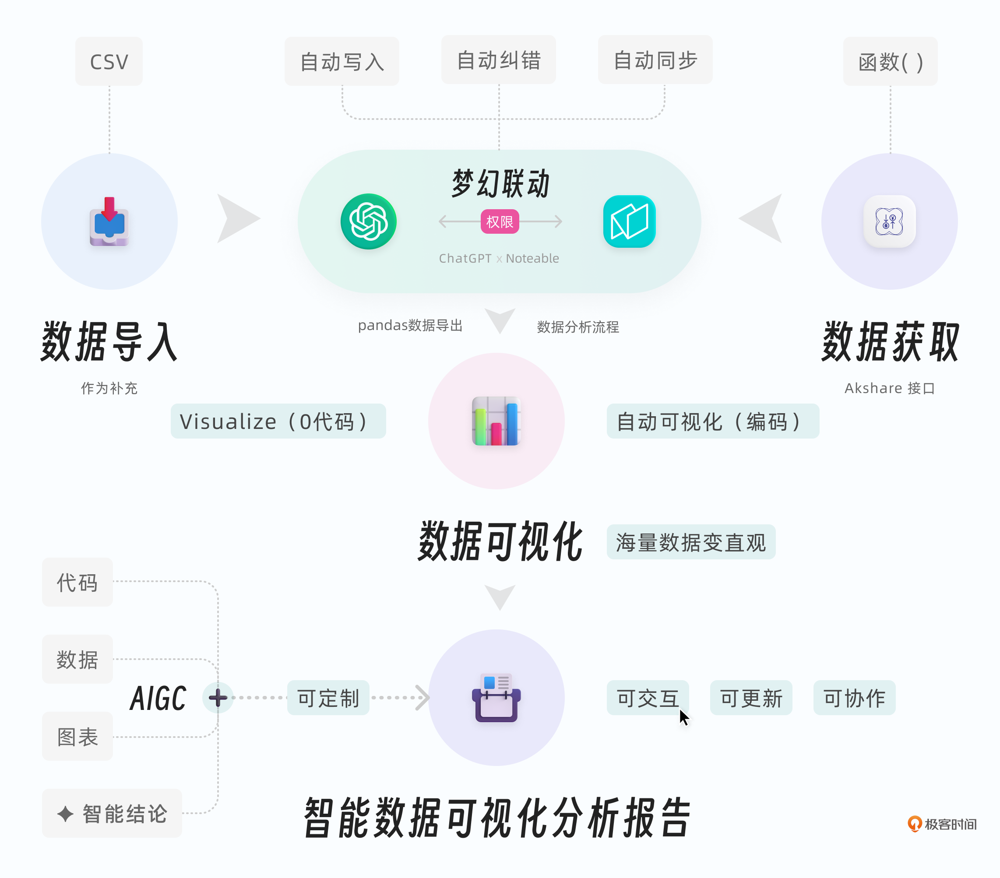

## 踏浪扬帆

到 Akshare 官方文档中寻找一类感兴趣的数据，契合自身的分析需求，尝试做一份完整的数据可视化分析报告。有插件的小伙伴，一定要感受自动化联动的魅力。小彩蛋也记得亲自体验啦。

期待在评论区看到你的思考或感受分享，也欢迎你将这节课分享给感兴趣的朋友们，戳此加入课程交流群，我们下节课再会。
