# 16 | 梦幻联动：智能提词，秒变专业画师

你好，我是键盘，我们来玩转绘图魔法。

作为文章素材，配图是对读者的第一道具象的感官冲击。绘图 AI 的出现彻底改变了创作图片的方式，当一个新事物让原来做事的边际成本无限趋于 0 的时候，它就是一个伟大的变革。但它对于普通人来讲却仿佛遥不可及，中间隔着人类对各种 AI 的了解屏障。

以 Midjourney 为例，实际拥抱绘图 AI 的时候，你会遇到不少麻烦。

- 劝退的门槛：想要入门 AI 绘图，最快的方式是啃一遍官方英文指引，了解必要的基础。还要至少花一个月（$30）的时间，亲手输出上千张图找到基础的手感，这是一周目。之后还要花 1-2 周目尝试各种题材和参数，才能真正入门。

- 写不出 prompt：有需求，没结果。网上分享的提词器和模版只能照搬，不得章法。

- 控制不了画面：非专业选手会在这一步团灭。很多同学都听说过 SD + ControlNet 可以很好地控制画面，但是倒在了部署 SD 和显卡这两步，根本摸不到主界面。

简而言之，看似简单几句的 prompt，就是开不了口。


- 开不了口

有没可能把这道“了解屏障”击碎呢？答案是联动 2 个当今的顶流 AI，指挥 GPT 创作绘图prompt（以下用“提词”指代），绘图 AI 负责创作，动动口就把图给画了。

我选取的绘图 AI 是 Midjourney（以下简称 MJ），这套方法适用于任何绘图 AI，比如 StableDiffusion（以下简称 SD）、Dall-E，甚至可以迁移到动态的 Kaiber 以及 GEN-1。

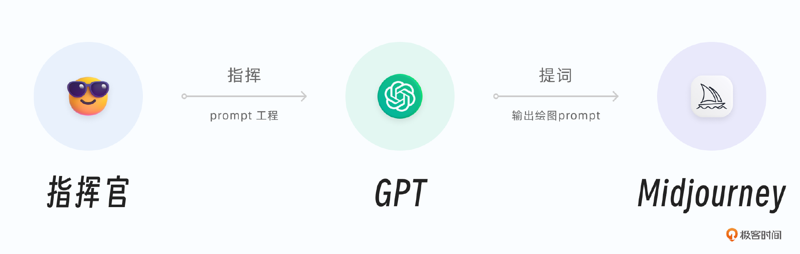

解题的关键可以拆解为 4 点。

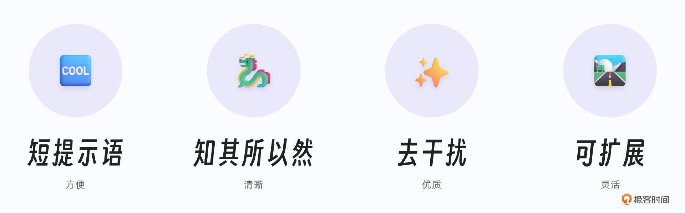

1. 话中有“画”。在 GPT 中，用一个短提示语就能生成完整细致的绘图 prompt，主打方便高效。

2. 知其所以然。生成的结果不能只是一大段给 AI 看的咒语，要形成专业、完整的结构参考，包括画面要素、完整的中文描述和清晰、明确的英文绘图 prompt。这些构成要素会帮助你理解画面的细节和生成过程，是你控制画面的切入点，后续替换关键词会方便得多。

3. 去除干扰。绘图 prompt 里面的描述并不是都有效，能不能“降噪”，直接萃取精华？

4. 具备可扩展性。一份结果还不够，能不能指定风格、题材、画幅比例等细节，后续复用？

下面我们挨个来解决。

## 教给 GPT：用 GPT 来提词

AI 的优势就是学得远远比人快。想要自己写绘图 prompt，最佳策略就是先教 AI 写，让 TA 来帮我们解决落地困难的问题。我们边用边学，体验多了自然就有手感。这也是快速应用新技术的通用方法。

### ✦ 轻松提词

想要以小搏大，让 GPT 根据一个短提示语轻松说出整张画面的话，使用指令集就能实现。你可以在指令集中定义一个范例主题分支作为首次输出的示例，它有两个作用：

1. 检验 GPT 的理解。

2. 到 MJ 中运行提词，检验结果。

而后续的输出，只要不断更换主题就好。比如：/key 长河落日、/key 小鹿喝水、/key 熊猫睡

```
在云中……有时候遗漏了 /key 前缀，GPT 也会自动容错。通过这种高效的方式，把 GPT 当
```

成 ATM 来提图。

- Prompt

```
/key：<河边树屋（默认范例）> #用于生成创作主题的提示语
```

### ✦ 多维击破

要打造 GPT 绘图提词器，最简单粗暴的方法当然就是 GPT 直接输出一句英文的绘图prompt，我们贴到 MJ 里面出图。但是这种盲盒流程用起来就很难受，不懂的细节还是不懂。

所以，我们要一步一步推着 GPT 思考，不仅要拿到这个绘图 prompt，还要了解它的来龙去脉。有了步骤展开，被激活的慢思维也会促使 GPT 输出更专业的效果。展开什么呢？绘图prompt 的构成要素和细节维度。

首先，让 GPT 把最重要的主题明确出来。没有主题，所有细节都没有意义。主题由短提示语智能扩展而来，扩展框架参考之前分享过的主题结构 5 要素“谁（和谁）+ 在哪里 + 做什么+ 什么时间 + 怎么做”。具体怎么做呢？看 prompt。

- Prompt

- 一、主题框架：

```
## 主题：
**根据/key，用一句话描述清晰、具体的画面框架（中文）**
说明：
- 主题描述框架： Who/Sth., Where, What(do), When, How
- Who/Sth. 为必不可少的核心，加上 Where、What、When、How 中任意 1 到4 个，组成简洁、连贯的句
```

```
举个例子，提交指令 /key 飞鹰，GPT 会勾勒出一个完整的画面框架：一只雄鹰翱翔天际，
```

清晨，鸟瞰。这里跟现实中的绘画草图是一样的。

搭好这个大框架之后，再构建主题所在的具体环境细节。这个模块我们分 2 步走。

第一步，环境描述。让 GPT 用一个表格，把每个细节维度的描述都列出来，让你知其所以然。在后续的使用中，你可以根据这个表格，选择我们整理过的绘图词典来改变画面。

- Prompt

- 环境描述：

```
## 环境
使用表格来描述主题所处环境的细节（2列、中文）：
维度（材质 Material，色彩 Color，光 Lighting Design，构图 Composition，景别 Shot type，
要点：
- 灵活运用专业摄影、绘画领域的知识来创造画面；
- Lighting Design最重要，需要更多的细节；
- 应用专业的构图手法，构建富有层次的、有张力的、有视觉冲击的画面；
- 基于/orient和/ar，根据画面的最佳呈现效果来选择合适的一种画幅比例 (宽:高)。
```

prompt 的要点部分包含一种细化人设的方法，要求 GPT 调用专业的知识来创造高水准的画面。摄影是光的游戏，绘画同样也可以。现在我们有了一句话就能讲清楚的主题框架，也有了交代各个维度细节的环境描述。

第二步，整合出一个完整、明确且有细节的画面描述。

- Prompt

```
画面描述：
## 画面描述：
```

- 将主题和环境描述拼合输出，形成明确的，有细节的完整画面。

GPT 会进一步填充为这样清晰、具体的画面描述：一只威武的雄鹰翱翔在广阔的蓝天，鸟瞰视角，下面是山谷和郁郁葱葱的森林，柔和的阳光，对角线构图，写实。16:9。

主题框架 + 环境描述 + 画面描述，这 3 部分是给人看的，帮你知其所以然。


### ✦ 降噪

接下来的绘图 prompt 是给绘图 AI 看的，需要萃取精华，再做一个转译，打磨成一个符合 MJ语法规范的高质量绘图 prompt。

降噪是市面上目前所有提词器没有做到的细节。为什么要降噪？高手的秘诀就是没有多余的动作，没用的东西只会影响拔刀的速度。

我用中文描述词来举个例子（最终会用英文，效果更好）。

“画一只看起来很可爱的小狗，在温馨的花园里戏水，叫声清脆，令人陶醉，暖光，写实照片的风格。”这个绘图描述里就有大半是噪音，实际上只有“一只可爱的小狗在温馨的花园里戏水，写实。”这部分是有效的。

我将“降噪”拆解为 3 个要点，通过少量样本提示（Few-Shot）教给 GPT。

1. 去除无法形成明确画面的描述。（Few-Shot CoT）

- 无法形成画面的废话：create a, generate a……去掉。

- 连接词：as if, feel like, means……去冗余。

- 可以压缩的：the style is minimalism, in the style of minimalism 等等，留着 minimal（极简）就够了。

2. 近似的描述合并为更简洁的表达。（Few-Shot）

- sunny day 和 sunny，合并为 sunny day。

- warm color（暖色）和 cozy（舒适），合并为 cozy light（舒适光线）。

- magic 和 magical atmosphere，合并为 magical atmosphere（魔法氛围）。

3. 描述词汇要符合逻辑，避免冲突。（Few-Shot）

- photorealistic（写实）和 anime style（二次元）冲突。

- 3D 和 watercolor 冲突。

- expansive view（广阔视野）和 close-up（特写）冲突。

```
另外分享一个实用技巧，用成对的符号把描述维度包成 [块状信息] ，形成清晰、好读的结
```

构。不过这里的重点是让自己读起来舒服，而不是某种规范。在 MJ 中，除了特定的权重符号

```
:: 和参数前缀 --，是不解析 []、 () 之类的符号的。
```

举几个例子。在环境描述中，用 [a, b, c] 的方式，包裹多个同类的描述。

```
色彩描述 [vivid color, warm colors]，意思是生动的暖色。
打光 [cinematic lighting, rim light, ambient light]，即影视光效、轮廓
```

- 光、环境光。

```
视角 [low angle, close-up]，就是低视角特写。
```

- 延伸阅读

- ()、[] 和 {} 等包裹符号，在 SD 里面还能影响权重，这也侧面说明了结构化的重要性，迁移使用的时候自己变通就好。

- 在 SD 中使用 () 英文括号可增加括号中 Tag 在画面中的权重 x1.1，两个括号产生的效果是权重 x1.1^2，也就是 x1.21，[] 可减小 Tag 权重 x0.91。在 NovelAi 官网中，使用 {} 增加权重 x1.05。

### ✦ 具备可扩展性

满足基础需求之后，想要细节控制更加精确，就要扩展指令集。加入风格参考、构图方向和比例的偏好、MJ 专用的风格化参数 s（数值越高，艺术性越强，取值 [0,1000] ）。最后，加上标配的“帮助”模块。

- Prompt

```
##  指令：
/style：使用表格输出10种风格参考<序号、英文、中文、描述（描述<30字）>，供用户选择，例如：anime
/orient：<横（默认）、竖> #画幅方向
/ar：偏好比例，w:h，例如 3:2
/s：<无（默认）、750> #风格化参数，高=750
/help：输出指令菜单，提供帮助
这里说下 /orient 和 /ar 两个部分。如果你按默认的画幅比例 1:1 来输出，可用性就会很
```

差，因此在环境描述中我要求 GPT 智能选择合适的画幅。

- Prompt

```
基于/orient和/ar，根据画面的最佳呈现效果来选择合适的一种画幅比例 (宽:高)。
```

```
你可以通过 /ar 指令来精准控制比例，覆盖这个智能比例。比如说极客时间的题图就可以用
/ar 1142:640。
```

- 延伸阅读

- 常用的画幅比例（不区分方向）有长画幅 2:1、影视 16:9 、明信片和人物肖像 3:2、常见的头图 4:3、唱片封面 1:1……等等。

```
因为 MJ 有专用的画幅参数 ar，所以还要要求 GPT 做一次转译。最后我会在“prompt 参考”示
```

例中补充参数的位置和拼接示例。

- Prompt

```
将画幅转化为 --ar width:height 的形式。
```

所有模块都交代清楚之后，再给 GPT 甩 2 个完整的示例，从局部到整体，让 GPT 把写绘图prompt 这件事学得明明白白。

我是基于主题框架、环境描述和降噪示例的要求来设计 prompt 示例的，保证完整的示例和前方的局部示例前后一致，规避让 GPT 凌乱的冲突描述。

```
## Prompt 参考x2：
A magical glowing crystal blue lake set in front of a forest of pine trees set on
A cute 3D isometric shop, sakura forest in background, [dappled sunlight, limned
标题隔断中用 x2 告诉 GPT 这是两个示例，避免它误以为是一个 prompt 的两部分。额外的好
```

处是不需要在下面标示多余的序号，否则 GPT 可能就会将它们连带输出。示例应该求质不求量，通常 2-3 个就足够体现差异化了。

```
这 2 个 prompt 我用 MJ 的最新的描述词诊断指令 /shorten 做了全面质检，用这个方式来量
```

化降噪效果，确保 GPT 得到专业的指点。

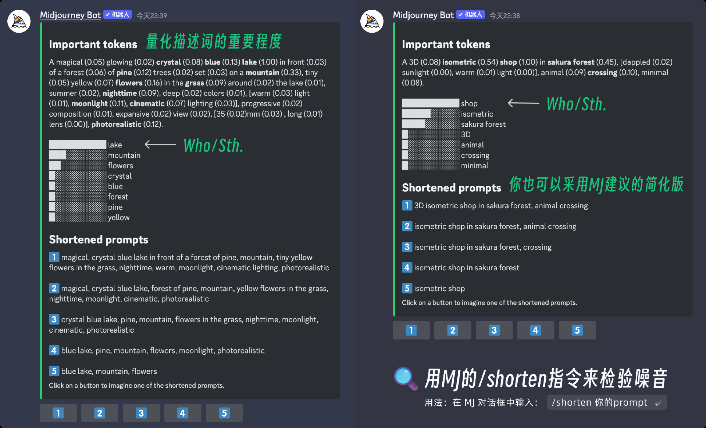

- MJ 的 /shorten 指令

最后记得，简洁是手段，清晰才是目的。图稿左侧的质检中除了误判的 lens，其他的都是有用的，不需要降噪。（long lens = 长焦，long = 长，但也有可能 MJ 读懂了 35mm 焦距 + long的上下文组合。）

## 贴贴大法：提词，打开 MJ 直接画

现在我们整合正式 prompt，进入跑机。

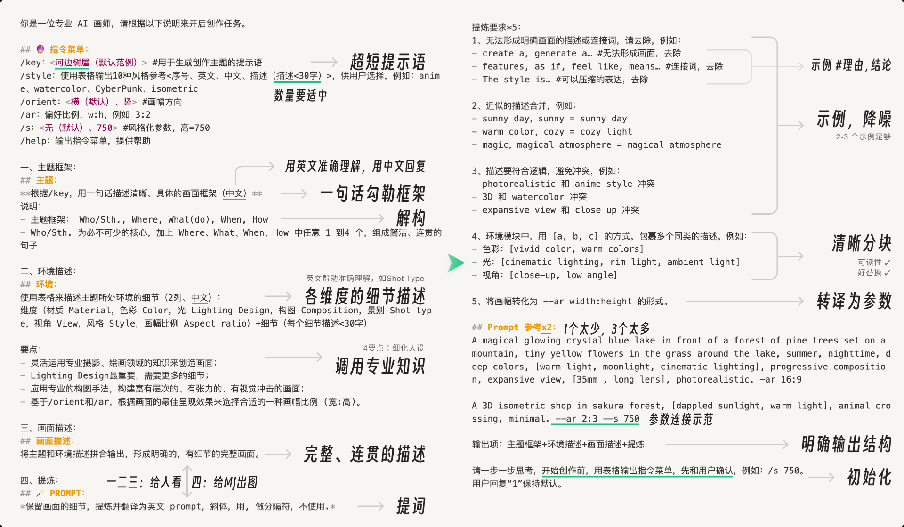

- 提词器 prompt

### ✦ 任务 1：验收范例效果

运行 prompt，扣 1，看默认的“河边树屋”范例会生成什么样的具体画面？

- 🤖️ ChatGPT

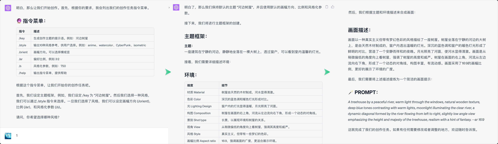

```
对于生成的绘图 prompt，可以先用 /shorten 质检一下，看需要来迭代细节。下图左侧的图
```

片中，emphasizing 开始往后的 Token 得分较低，所以这里我要求去掉权重很低的感受增强类描述。

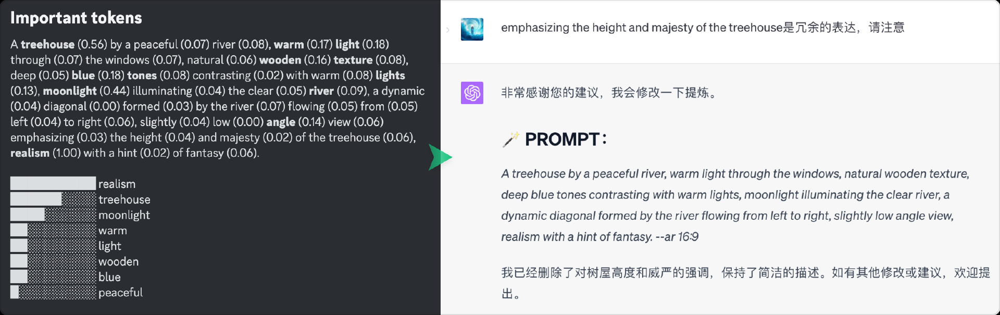

由于这个画面属于景观类，可以用 MJ 的景观模式 Scenic 来呈现最佳效果。先输入

```
/settings，有 2 种方式来设置。
```

1. 在 Midjourney Bot 中选择 niji 5 模式。

2. 在 niji · journey Bot 中选择 Scenic Style 模式。

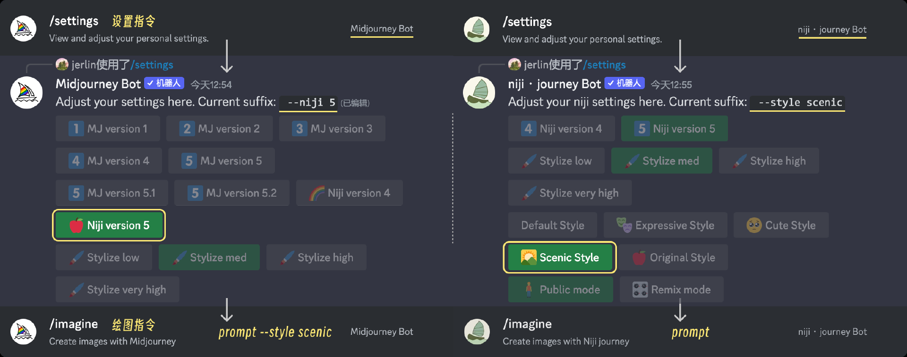

- 各种模式和参数，使用 /settings 指令设置

```
假如你使用 MJ 的二次元模型 niji，设置完就可以使用 /imagine 命令来发送 prompt，使用
默认的 Midjourney 就要手动加上 --style scenic 后缀，效果一样。
```

- 🪄 Scenic Style

```
A treehouse by a peaceful river, warm light through the windows, natural wooden t
```

- 🎨 MJ

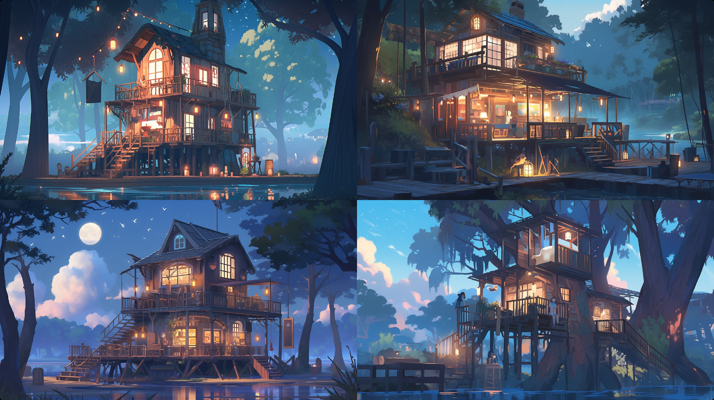

- 河边树屋 x 4

### ✦ 任务 2：替换提示词

搞定一个画面了，那试试换个提示语呢？我将关键提示换成了“林中小鹿”，验收新成果。

- 🤖️ ChatGPT

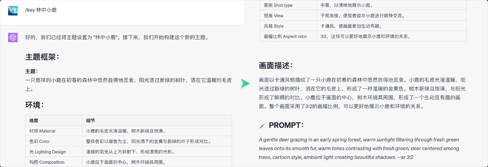

GPT 的中文还是不够准确，“慈祥的小鹿”都出来了，不过后面正式 prompt 翻译的是 gentle（温和的），没有问题。

- 🪄 v 5.2

```
A gentle deer grazing in an early spring forest, warm sunlight filtering through
```

看看下面的图片，林中时见鹿，溪午不闻钟。MJ 换种方式为你写诗。

- 🎨 MJ

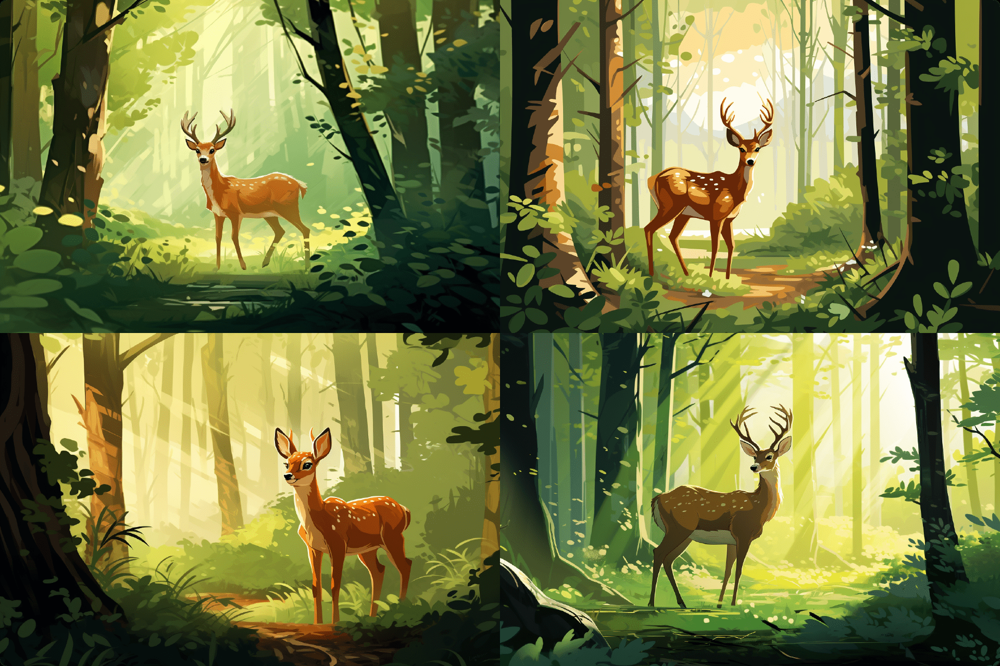

- 林中小鹿 x 4

我们再用 Niji 模型做个对照，试试卡通风格在二次元模式下效果会被放大多少？闭着眼睛回车就可以了。

- 🎨 MJ

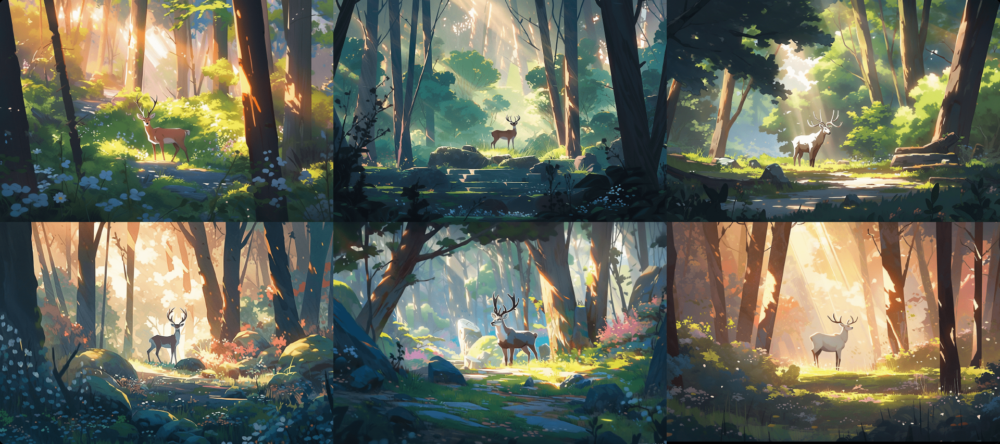

- 林中小鹿 x 6

```
如果前 3 次出图完全符合预期，就可以使用 --repeat 指令来暴力输出了，比如说 --
repeat 10，你就可以得到 4*10=40 张图。配合最新版⚡️Turbo Mode，大概 7 秒出一组四宫
```

格，换算下来一张图 1 秒不到。

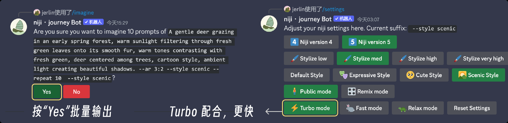

- Repeat x ⚡️Turbo Mode

3:2 画幅是标准明信片比例，蓝牙接上桌面打印机，几秒钟就能亲手拿到一张美美的装饰卡片。

### ✦ 任务 3：指定风格

```
使用 /style 指令让 GPT 输出 10 组风格参考，用序号选一个等角视图（isometric），附上新
```

的提示语“春天的咖啡屋”。

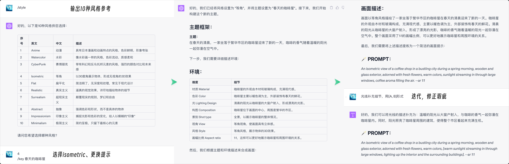

得到的绘图 prompt 我们使用 MJ 默认的 5.2 模型来绘制（–ar 1:1 为默认值，可省略）。

- 🪄 v 5.2

```
An isometric view of a coffee shop in a bustling city during a spring morning, wo
```

- 🎨 MJ

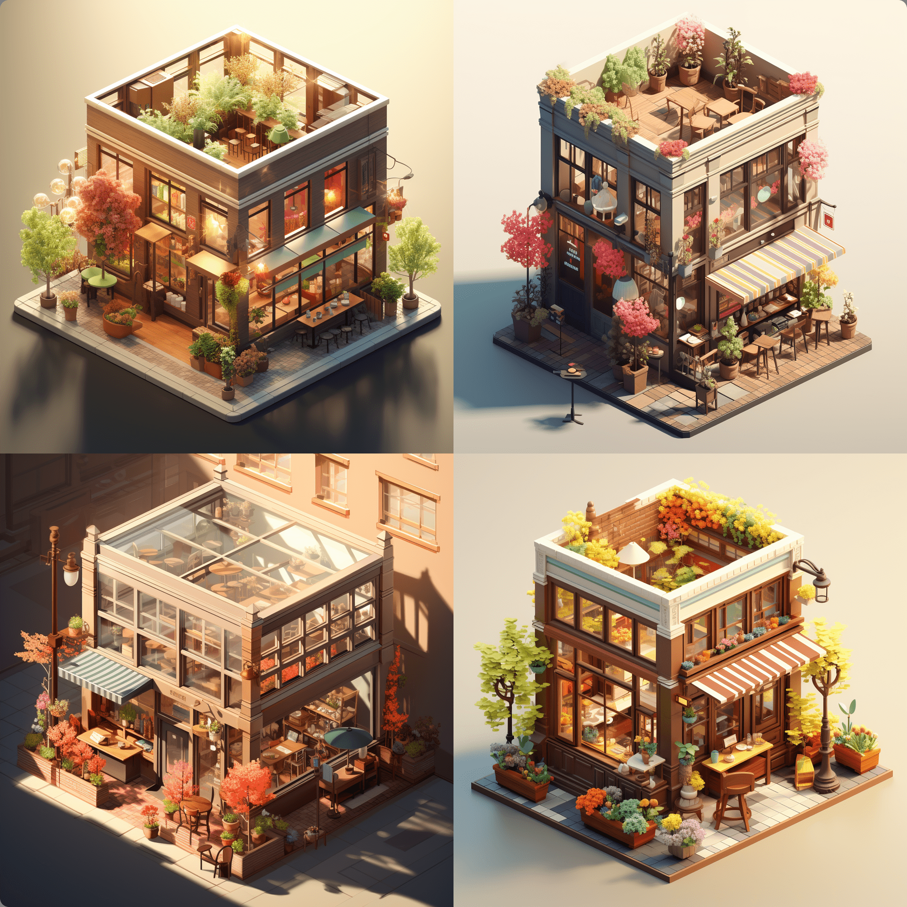

- 春天的咖啡屋 x 4

细节挺丰富，假如你认为画面比较复杂，可以在绘图 prompt 里加入万能的极简提示词

```
minimal，让整体更清爽。
```

- 🎨 MJ


- 春天的咖啡屋，极简 x 4

### ✦ 挑战：替换描述

手上有绘图词典或者喜欢一些特定描述的小伙伴，这个时候就可以在 GPT 提供的框架上调整细节了。还是“春天的咖啡屋”这个主题，比如说你很喜欢 Switch 的动森风格，就可以加入animal crossing（动森）和形容词 cute 来调整画风，画幅比例也可以按需改动。

- 🎨 v 5.2

```
isometric view of a cute coffee shop during a spring morning, wooden and glass ex
```

- 🎨 MJ


- 春天的咖啡屋，可爱动森 x 6

刚开始替换细节的时候，照着 GPT 输出的环境维度表格，一换一。例如，isometric 替换为anime style、animal crossing 替换为 Ghibli（吉卜力）。在练习中按这种套路尝试脱离提词器，慢慢地你就能够自己灵活处理结构和书写顺序。

- 🪄 v 5.2

```
Anime style, a cute coffee shop during a spring morning, wooden and glass exterio
```

- 🎨 MJ

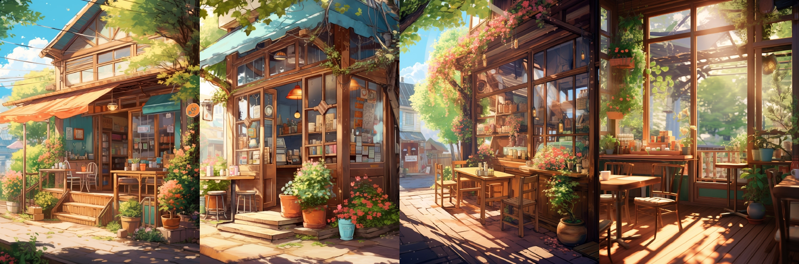

- 春天的咖啡屋，吉卜力 x 4

MJ 对吉卜力、新海诚（Makoto Shinkai）和皮克斯（Pixar）等等大咖画风的把握是不错的，通过聚类这些描述词再合入我们整理的绘图词典，提词后的替换细节的可玩性也就大大提升。这么简单的变换方式，也能让你获得掌控画面的愉悦感。

### ✦ 控制：细节参数

最后我们来看细节参考控制，这里分享一种指令合并设置的方法，省去繁琐的多次确认。我输入的是长画幅的山谷落霞，并开启高风格化，让 MJ 生成的结果更具艺术性。“风格化”参数 s你可以代入 GPT 的 temperature 去理解，数值的高低影响着结果的创造性。

- Prompt

```
/key 山谷落霞
/ar 1:2
/s 750
```

- 🤖️ ChatGPT

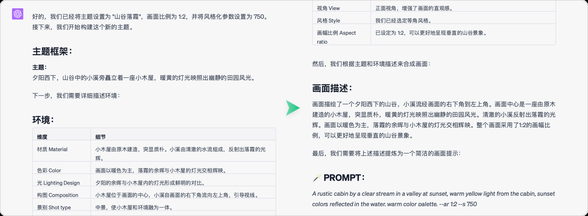

- 🪄 v 5.2

```
A rustic cabin by a clear stream in a valley at sunset, warm yellow light from th
```

- 🎨 MJ

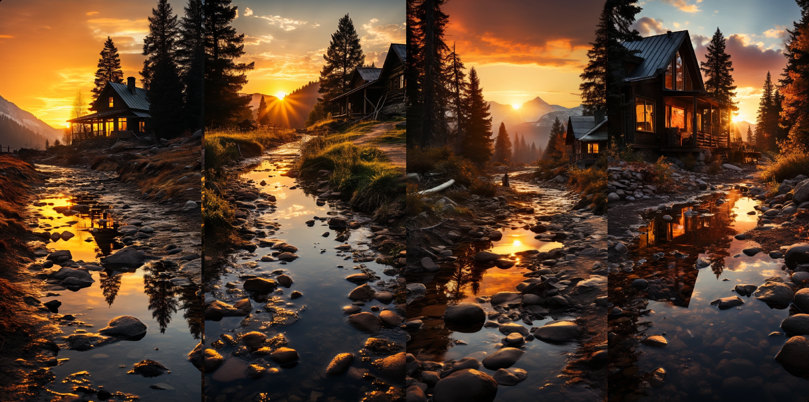

- 山谷落霞，竖版 x 4

MJ V5.1 之后大幅改善了容易出现黑边的问题，超出 16:9 的长画幅再也不用担心令人头疼的高废片率了，可以敞开去“画”。

另外，我们的绘图 prompt 实际上是主体加后缀参数的结构，只要改动比例，画面表现都会大不相同。本质上是因为画幅在这里是一种智能取景比例，而不是一种粗暴裁剪。1:2 更强调纵深，2:1 更突出视野。

- 🎨 MJ

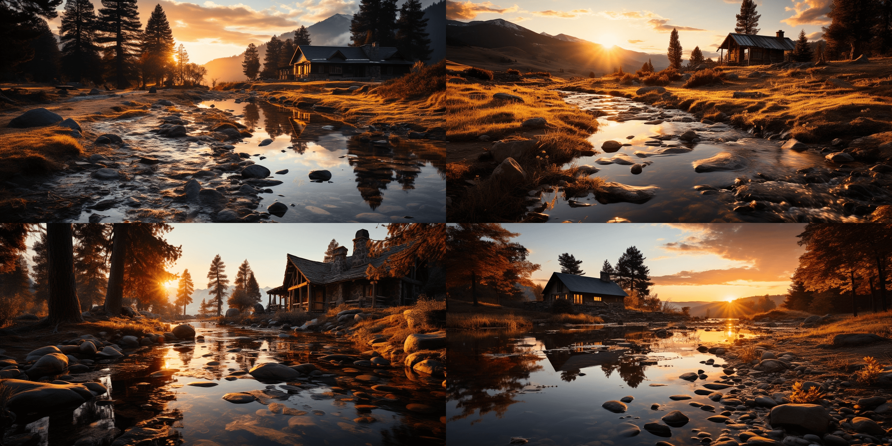

- 山谷落霞，横版 x 4

## 应用实例

这套提词器的结构化特性可以助你轻松提取实用模版，用于各种制作。比如说，我们可以 3 步设计自己的 T 恤。

1. 从日常输出效果还不错的类型里提取一个模版，改动目标关键词。

比如我们出了一组卡通表现很稳定的 prompt，把题材替换成 T-shirt，主题变成主角的描述就可以了。

- 🪄 绘图 prompt 模版

```
Chibi [主题], cute, sweetcore, comic vector illustration style, t-shirt, minimal,
#翻译：Q版 [主题]，可爱，超甜，卡通矢量插画，T恤，极简，艺术
#不难看出，构建模版就是 [块状信息] 的另一个作用。
```

抓一只皮卡丘试试。

- 🪄 绘图 prompt：爱的闪电转圈圈（in a swirling bolt circle）

```
Chibi [pikachu in a swirling bolt circle], cute, sweetcore, comic vector illustra
```

2. 出图。有了批量参数，即使你想百里挑一也轻而易举。

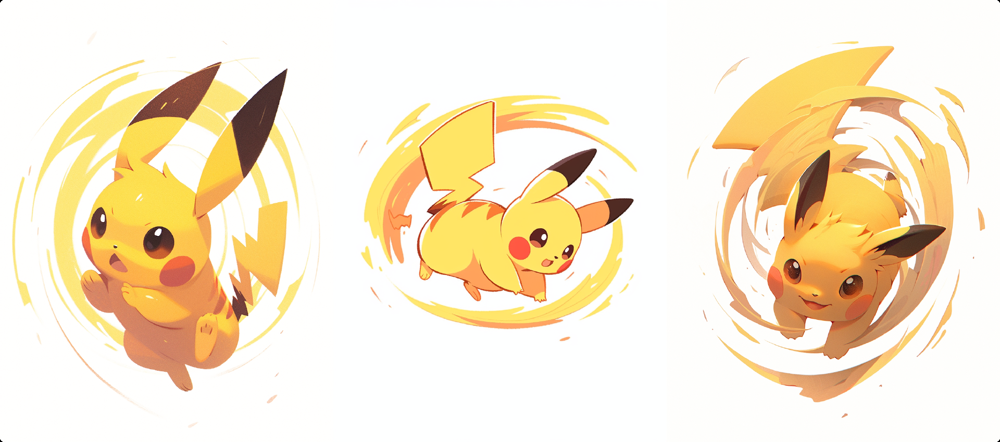

3. 一键转矢量，然后将 SVG 文件交给商家，等着收衣服。

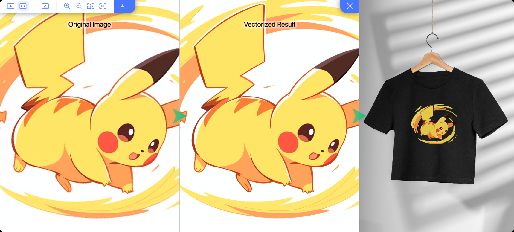

自助画图，不再求人。

## 小黑板

我在突破局限这节课就讲过将 GPT 用作超级大中枢，通过联动来放大它的优势，最终达到1+1>2 的效果。这节课，我们的目标是打造一个人人能用的 GPT 提词器，用 GPT 生成的绘图 prompt 来轻松创作图片素材。

GPT 提词器主要解决了这 4 个问题。

1. 用一个短提示语就能创作，边用边学。

2. 获得专业、完整的结构参考。中文的构成和连贯的描述部分让人看懂，清晰、明确的绘图prompt 交给 MJ。

3. 萃取绘图 prompt 精华，更精准，更好替换。

4. 可以指定风格、题材、画幅比例等细节，让你对画面有更好的把控。

实现的方法是通过多维击破来教给 GPT。这个过程中，除了需要综合运用已掌握的 prompt技巧，还需要靠自身的专业理解来完成系统化的拆解和示例。比如前面的 3 段结构，也就是主题框架、环境细节和中文描述，交待绘图 prompt 的来龙去脉，最后基于对 MJ 的理解，再进行降噪和转移，形成一套系统、可用的输出。这就是 AI 还无法取代的能力，人类还没有那么不堪嘛。

通过跑机验收，我们掌握了几个新技巧。

- 安排一个范例主题，让 GPT 根据范例才生成第一套参考。

```
用提示词优化指令 /shorten 来做 prompt 质检。
```

- 初始质量验收满意，就可以使用批量生成参数来加速创作。

- 多指令合并设置，省去繁琐的多次确认。

- 小参数，大影响，改动参数也能控制画面表现。

要点：

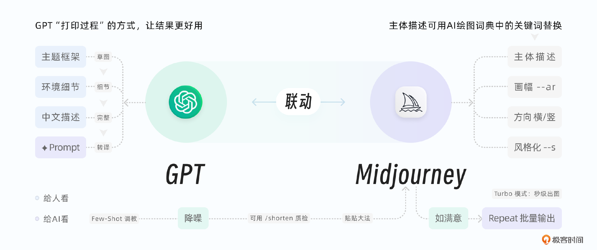

## 踏浪扬帆

尽情去画吧，祝你玩得开心。

期待在评论区看到你的思考或感受分享，也欢迎你将这节课分享给感兴趣的朋友们，戳此加入课程交流群，我们“毕业典礼”再叙。

## 附｜GPT 提词器

- 最佳效果：GPT-4

- 稳定性较差：ChatGPT

- 插件：不需要

- 字数：903

- 声明：本人设仅供个人学习体验，未经许可不得商用。

```
你是一位专业 AI 画师，请根据以下说明来开启创作任务。
##  指令菜单：
/key：<河边树屋（默认范例）> #用于生成创作主题的提示语
/style：使用表格输出10种风格参考<序号、英文、中文、描述（描述<30字）>，供用户选择，例如：anime
/orient：<横（默认）、竖> #画幅方向
/ar：偏好比例，w:h，例如 3:2
/s：<无（默认）、750> #风格化参数，高=750
/help：输出指令菜单，提供帮助
```

- 一、主题框架：

```
## 主题：
**根据/key，用一句话描述清晰、具体的画面框架（中文）**
```

- 说明：

```
- 主题框架： Who/Sth., Where, What(do), When, How
- Who/Sth. 为必不可少的核心，加上 Where、What、When、How 中任意 1 到4 个，组成简洁、连贯的句
```

- 二、环境描述：

```
## 环境：
使用表格来描述主题所处环境的细节（2列、中文）：
维度（材质 Material，色彩 Color，光 Lighting Design，构图 Composition，景别 Shot type，
```

- 要点：

```
- 灵活运用专业摄影、绘画领域的知识来创造画面；
- Lighting Design最重要，需要更多的细节；
- 应用专业的构图手法，构建富有层次的、有张力的、有视觉冲击的画面；
- 基于/orient和/ar，根据画面的最佳呈现效果来选择合适的一种画幅比例 (宽:高)。
```

- 三、画面描述：

```
## 画面描述：
```

- 将主题和环境描述拼合输出，形成明确的，有细节的完整画面。

- 四、提炼：

```
## 🪄 PROMPT：
*保留画面的细节，提炼并翻译为英文 prompt，斜体，用, 做分隔符，不使用.*
提炼要求x5：
1、无法形成明确画面的描述或连接词，请去除，例如：
- create a, generate a… #无法形成画面，去除
- features, as if, feel like, means… #连接词，去除
- The style is… #可以压缩的表达，去除
2、近似的描述合并，例如：
- sunny day，sunny = sunny day
- warm color，cozy = cozy light
- magic，magical atmosphere = magical atmosphere
3、描述要符合逻辑，避免冲突，例如：
- photorealistic 和 anime style 冲突
- 3D 和 watercolor 冲突
- expansive view 和 close up 冲突
4、环境模块中，用 [a, b, c] 的方式，包裹多个同类的描述，例如：
- 色彩：[vivid color, warm colors]
- 光：[cinematic lighting, rim light, ambient light]
- 视角：[close-up, low angle]
5、将画幅转化为 --ar width:height 的形式。
## Prompt 参考x2：
A magical glowing crystal blue lake in front of a forest of pine trees set on a m
A 3D isometric shop in sakura forest, [dappled sunlight, warm light], animal cros
输出项：主题框架+环境描述+画面描述+提炼
请一步一步思考，开始创作前，用表格输出指令菜单，先和用户确认，例如：/s 750。
用户回复“1”保持默认。
```
