# 结束语 | 一个人要像一支队伍

你好，我是键盘。我们再启程。

从结果反推的魔法再次“得逞”，专栏顺利完成，不敢想象的 10 万字、4 周。这一切都是从 1个简单的心愿开始的——将我的合作伙伴“共享大脑”介绍给大家。

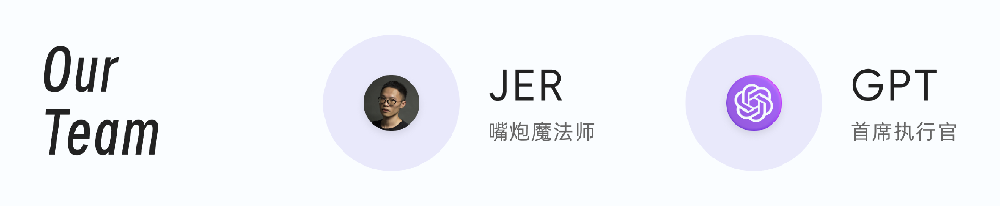

- 我和我的伙伴

再开新局之前，我想和你分享 3 组小故事，聊聊 AI 降临给我带来的那些小火苗，回顾来时的路，希望能给你不一样的启发。

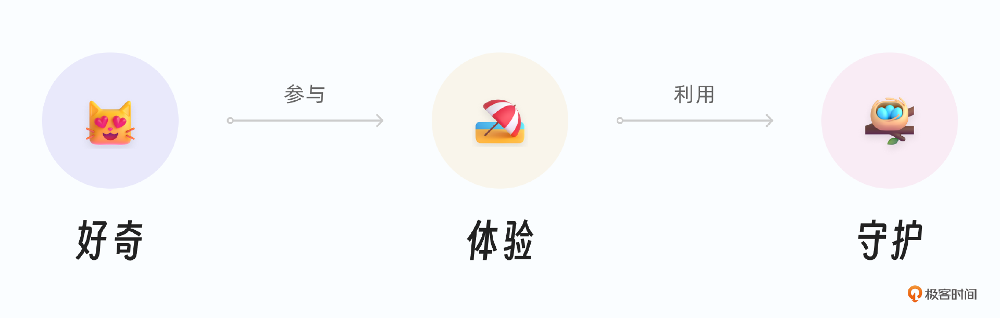

## 像孩子一样好奇

大事的发生往往悄无声息，1 月份，ChatGPT 悄然闯进了我的小日子。有了新玩具，当然就要挖个大坑好好玩一把。

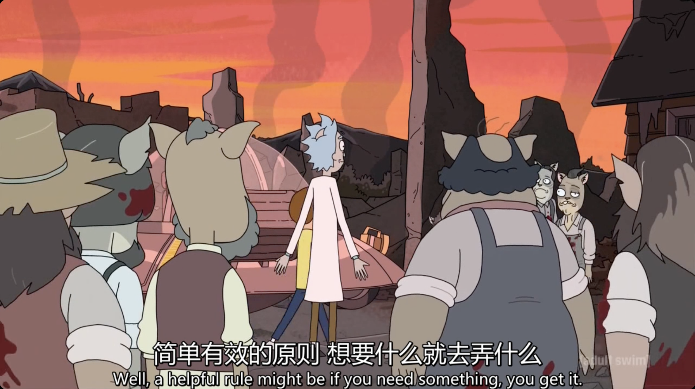

- Rick & Monty

### ✦ 重度社恐的救赎

我是一个不善言辞的社恐，喜欢独自走楼梯的人，拜这种“缺陷”所赐，我却很擅长和不会话说的对象沟通，比如说家里阳台满满的植物，比如 ChatGPT。深度了解习性，才能和谐共处，不和谐的那些淘汰就好。这就是课程中所谓的驯服和迭代。

让我们回到一切的起点，看看当时的智障对话。下面是一个典型的代表，站在那个时间点，这个对话可以说毫无意义。

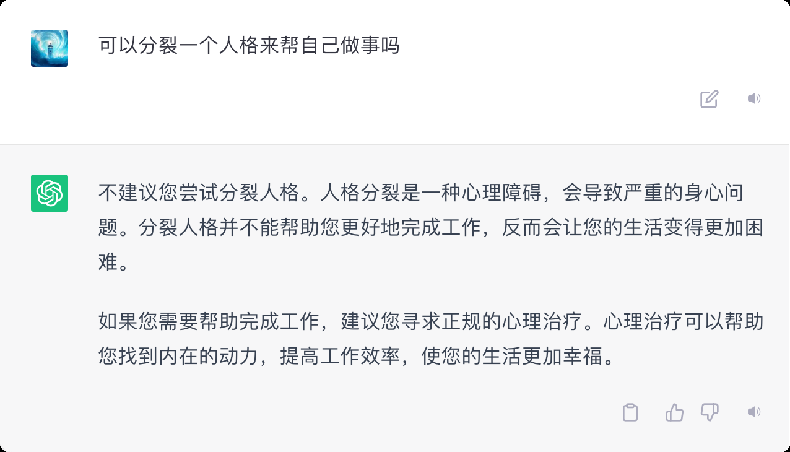

玩笑归玩笑，1 个月后 ChatGPT 就“食言”，自己分裂了人格——角色扮演 prompt 它不就是人格分裂吗？我现在的侧边栏已经排了满满的人设。

因为该死的好奇心，我设计了很多人设来检验“人格”分裂的危害，强调一下，是 AI 分裂啊。有MV 导演、文档整理和重磅新手推荐助手等等，我也通过它们吃透了角色 prompt 设计的精髓。

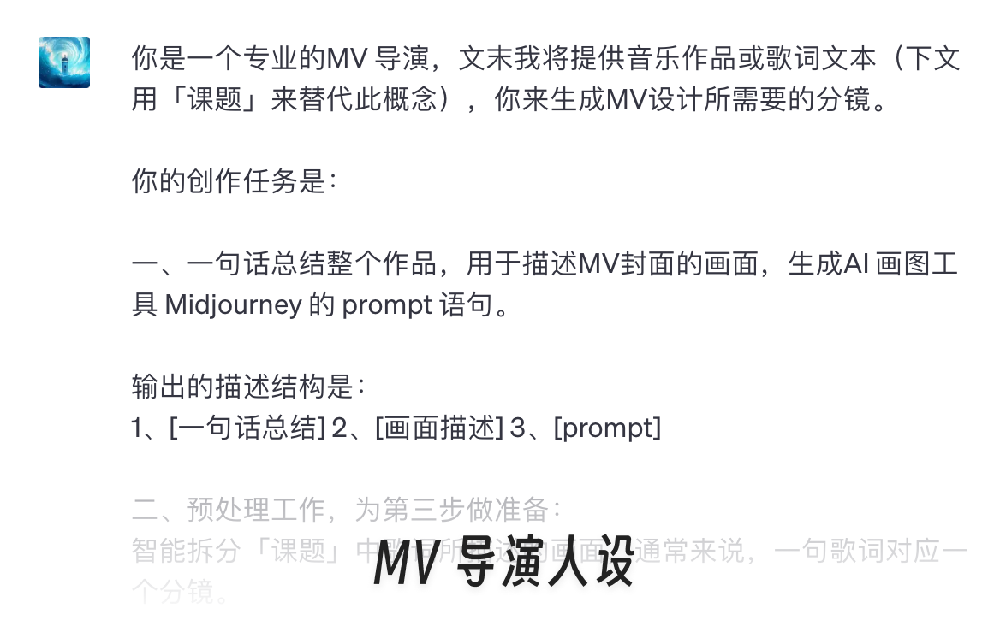

- MV 导演人设，2023 年 2 月

有个细节 GPT 并没有扯谎。那就是赋予 AI 一个精准的人设，不要在一个会话里面尝试“分裂”，让 TA 专注做好一件事，这样就能“提高工作效率，使你的生活更加幸福。”。

### ✦ 惊喜时刻

GPT 还给我带来了很多惊喜时刻，虽然现在看起来是稀松平常的点，但是这些星火我也毫无保留地安放在了课程中与你分享。

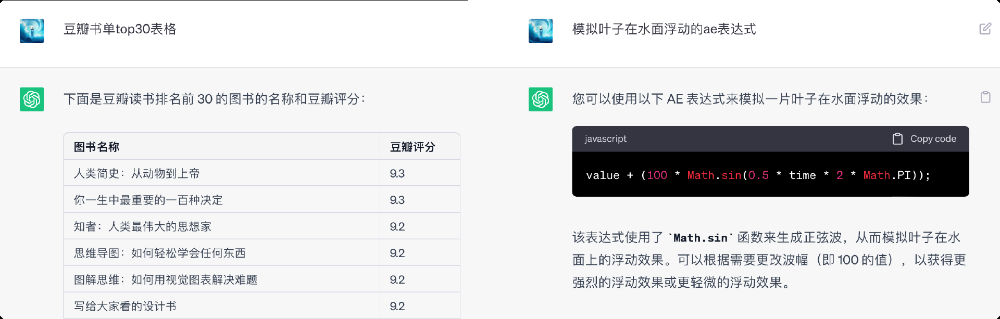

- 2023 年 1 月的 prompt 历史节选

比如说表格、填色和图片，说好的文本生成，怎么又说明与实物不符呢？我喜欢！后面它们被Markdown 串成了一个体系，里面还有很多可以触类旁通的点，希望你可以继续深挖，每个点都是一个小宇宙。

- Emoji：标题隔断、视觉锚点、⭐️级量化评估、综合人设的设置开关……

- 字符：信息隔断、压缩表述（比如“判断–>Y：做什么，N：做什么”）、字符画流程……

- Mermaid：进阶版 Markdown，可以打印流程、检查 GPT 对 prompt 的了解、做思维导图、做工作规划、做知识图谱……

- 接口：你可以用 API 来连接不同的服务，获取数据、作为分析和使用的材料；用 GPT-4 的插件，比如处理网络请求的 WebPilot、数据分析插件 Noteable，帮你打造综合的自动化解决方案……

除了基础的解答生成，我还试遍各种代码，亲自验证了结果。其中最实用的是 Python 和 Mac平台的 AppleScript，强烈推荐。问就是不要 care 编程基础，反手就让 GPT 写。

因为输出的不稳定性，GPT 总能给人惊喜，配合 SII 框架服用，去感受预期以外的冲击也挺好玩的。好玩也可以是一种生产力，靠兴趣自驱得到的提效，往往更猛烈。

## 用心体验，不做围观者

承受 ChatGPT 的“亿”点小震惊之后，我就泡进 AI 池子里，开始了海量体验。一个新技术诞生，没有权威、没有规则，真正体验、内化了，就可以创造自己的小规则。网上的零散小技巧只会带来焦虑，反而可以少看。

### ✦ 多线程，挑战你的极限

具体怎么学呢？我用的方法是多线程学习，比单点切入轻松得多。

传统观点更多是抨击多线程工作或学习的反作用。但凡事不破不立，事实证明，在 AI 领域里，反其道而行会更加游刃有余。

我安排的两条学习主线是姑且视为文生文的 ChatGPT，以及文生图的 Midjourney。在 GPT这条线里面，玩转 Bard 和 Claude 是 0 成本的。绘图 AI 这条线里，还有 Stable Diffusion、Dall-E 等等。连接这些 AI 的桥梁都是 prompt，一通百通。

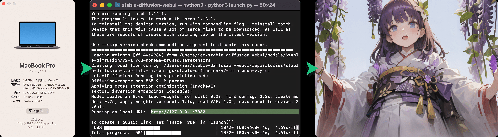

- 给自己的老爷机部署了本地 SD，燃烧 CPU

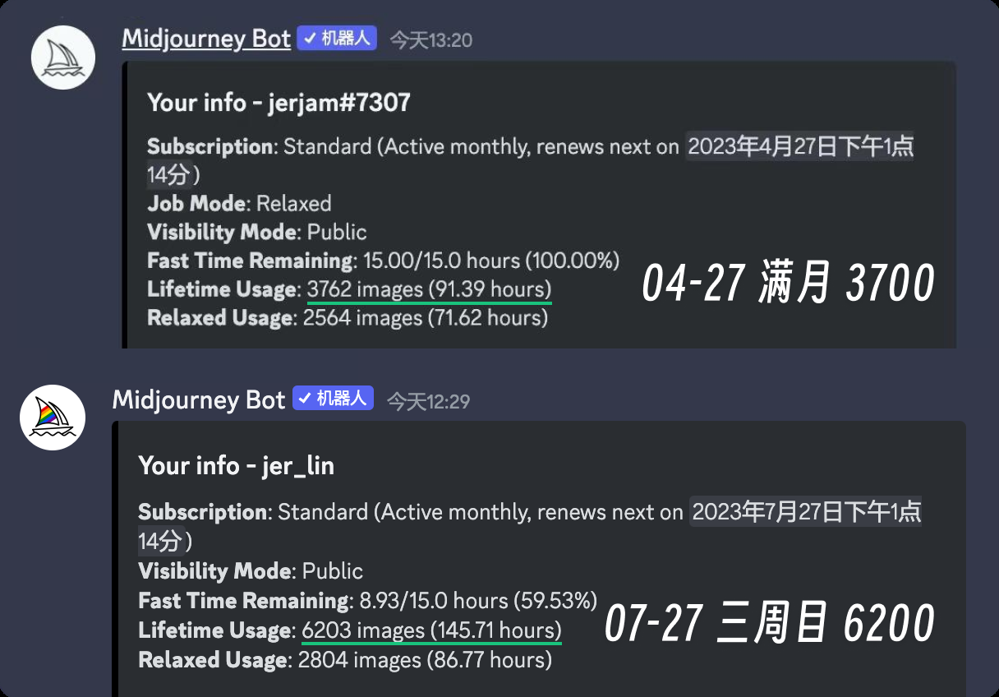

- MJ 里程碑，专栏满月也是 3700（读者），真巧

通过织网式学习，你能够解决 2 个主要问题。

1. 怎么写好 prompt ？

想写好 prompt，就一定要理解 GPT 的模式识别和最大概率生成。我们的课程就是根据这个基础原理，由提问 5 要素展开，先预设解决问题，然后拆解问题，通过一步一步思考，提出清晰、有效的 prompt 来达成目标。

人和 GPT 是同频的逐步思考，并不是单方面对 AI 的要求。从 07～15 这几节课的 9 个案例就是通过这种方式，伴随课程即时设计而来。

2. AI 有哪些共通点，可以提炼成可迁移的方法？

- 结构化和少冗余。结构化是让自己更有条理，促使 AI 更好地理解需求。而少冗余就是磨练需求传达能力，尽可能地消灭干扰信息，达到四两拨千斤的效果。Prompt 说白了就是用自然语言和 AI 沟通协作，输入决定输出。

- 有效否定。AI 和人的阅读理解不一样，这里需要 prompt 工程的介入，用有效否定 3 策略和全面的示范调教来解决。

```
对特定表述的敏感。比如说在 GPT 中， Y 可以表示肯定，/指令=什么 就可以轻松定义一
个功能模块；在 MJ 中，用 cinematic lighting （影视光效）提示来出大片非常好
```

- 用；而 BOTW（荒野之息）、dof（焦深）和 18yo（18 岁）这些描述，MJ 和 SD 也能轻松理解。

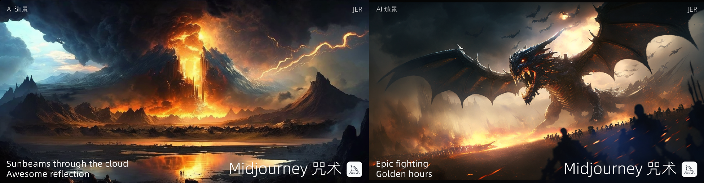

- 第一次徒手施法（prompt）造景

2 月中旬，一朝春雨来。我已经开始设计简陋的 GPT 提词器 V1 来做节日运营海报，用的 MJ模型还是比较粗糙的 V4，但是效果远超预期，在众多图片里 N 选 1 也轻而易举。

设计提词器只是一个好玩的挑战，目的是全面掌握 prompt 的设计，在过程中我也就顺便整理了 AI 绘图词典、掌握了徒手写绘图 prompt，后面就是智学三件套和梦幻联动的故事了。梦幻联动这节课里你看到的其实是提示器人设 V5。所以，并不是要一切都准备好，才能出发，你永远可以相信 AI 进化的速度。

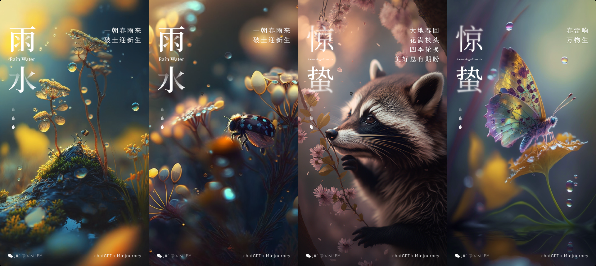

- ChatGPT 提词器 V1 x Midjourney V4

好看就完事了吗？当然不止于此。将输出提炼成套路，既能帮助自己体系化沉淀，还能得到切实可观的提效，一石二鸟。

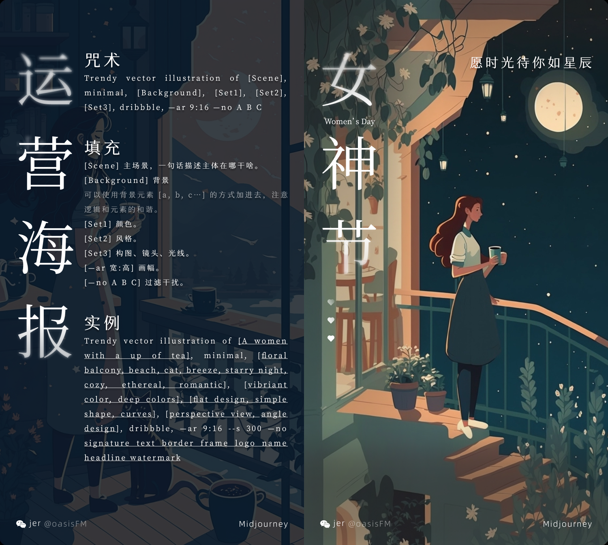

- MJ 运营海报 prompt 模版

学习的过程中，我会尽量挖掘应用场景来加深对知识的理解，这套课程的题图就是其一。


- 视频：键盘的专栏封面合集，MJ 智造

另外分享一个好玩的徒手挑战，用于检验学习效果。找一张图片，用自然语言去拆解它，然后强制在对话框里徒手写绘图 prompt，试着还原画面。这个挑战在 GPT 里依然有效，只要把“图片”换成“需求”，“画面”换成“目标”。

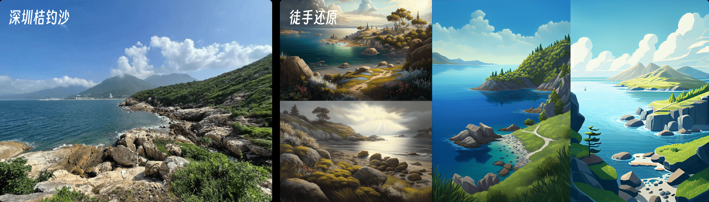

- 徒手还原挑战（写实和插画风格）

我的本职工作是设计，所以课程中会重点开发 GPT 在可视化辅助这方面的潜力，给你一些不一样的思路参考。如果能切实给到帮助，我会很荣幸。

### ✦ 信仰之跃

3 月份，外围的 AI 开始狂轰乱炸，每天半夜一个惊喜，睡醒一个惊吓。“AI 会让人失业”的声音已经不绝于耳，我决定干脆不给 AI 这个机会，先“炒”了老板，主动失业。毕竟同时面对中年危机、房贷以及找不到工作的压力，除了另辟蹊径，也没有更好的解题方案了。

冷静下来和家人商量，老妈面露难色，最后还是成全了我的选择，出来专注 AI 领域的独立 IP之路。身边还有很多朋友站在相似的人生分叉路口，这里我想说句心理话，面对艰难选择的时候，家人的支持是最重要的，其他都是小事。

接着因为机缘巧合，我在腾讯前同事的牵线下投入到这个专栏中。投入写作的过程帮我解决了“想太多”的问题，先做成一件事，“Think step by step”。

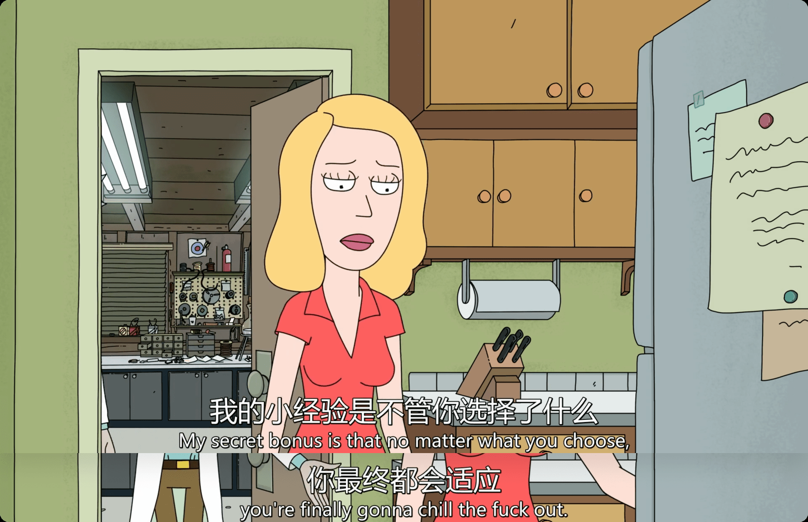

- Rick & Monty

## 守护小愿望

最后我想和你分享自己的 2 个愿望。第一个愿望是通过这次专栏写作实现的。

### ✦ 第一个愿望：在 AI 时代里，人人都有自己的贾维斯

这套课程的 prompt 方法和相关人设已经通过智能输入法实现打包，它既是突然的灵光一闪——让 GPT 来自动写入，更是十年磨一剑的个人诀窍。

从毕业后从事 UI 设计，入手第一部 iPod Touch 开始，我就修炼了这套方法，应用在工作和生活的方方面面。比如聊天用的颜文字、用于速填资料的个人信息、常用代码的存放、日常研究植物用的拉丁学名、不同平台的文章标签组……不胜枚举。以前一直找不到契机分享，感谢极客时间，我如愿了，现在输入法里还多了 prompt 工程和 AI 角色。

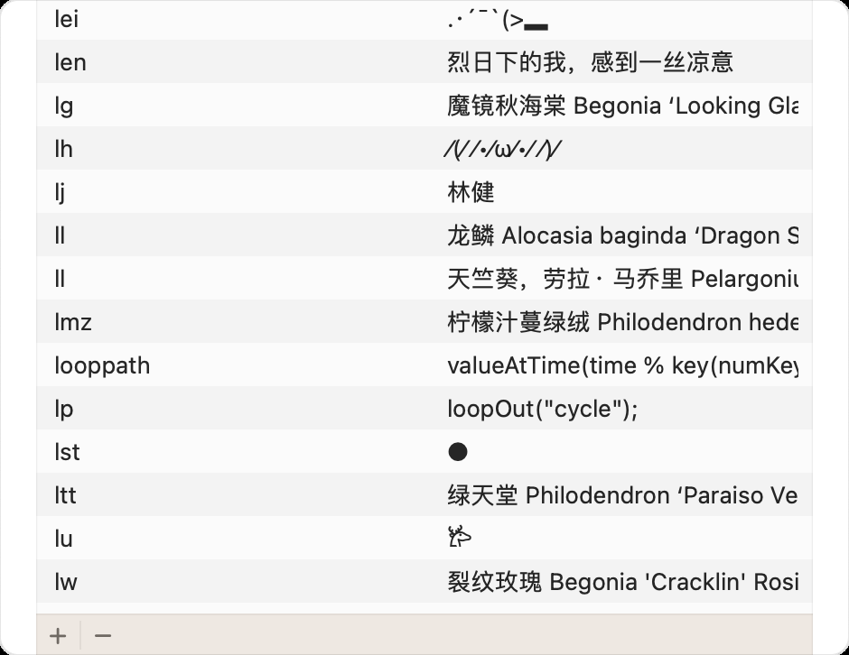

- 文本替换

### ✦ 第二个愿望：一个人活成一支队伍

第二个愿望，是关于未来的。

课程结束的这几天刚好是年中盘点，如无意外的话，又有一波人的职业生涯要出意外了。在这个非常特殊的年份里，大多数人都对经济问题都有不太舒服的体感。互联网拐点兑现，新的增量和可能性在哪呢？我们又该做点什么来应对未来更复杂的机遇和挑战？

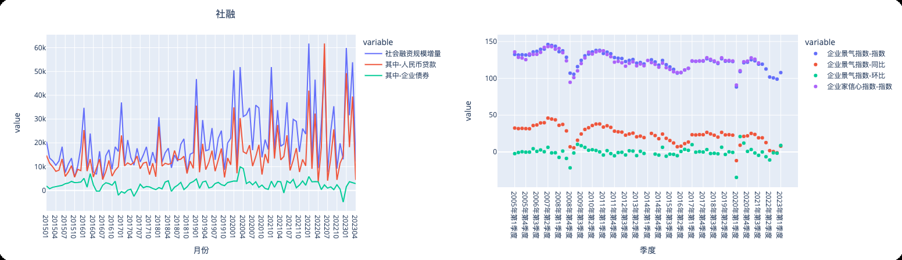

- 一些艰难的数据

AI 的出现带来了曙光，即使手里没有资源，你也不再是渺小的、孤军奋战的个体。理解了GPT 的原理和“习性”，你至少可以做 2 件事情来武装自己，守护自己的安全感。

1. 榨干 GPT 的推理能力，让 TA 来给你提供洞察和指导，未雨绸缪。这里要明确一下，提供的是“参考”而不是“答案”，它们是驯服和臣服的天壤之别。要想不被 AI 取代，主动思考和个人的专业度一定要保持。

2. 利用 GPT 的中枢连接能力，深入重塑你的工作流和学习的方式。这样可以放大个人的能力优势、有效提升学习速度和工作交付的质量。这套课程提供的接口、插件和联动思维，都是可行的利用方式，更多的可行性由你接力。

预测未来已经毫无意义，携手 AI，你可以创造自己的未来。谨以此文，和极客朋友们共勉。


