# 速递 | 未来X年GPT的动态，都在这儿了

你好，我是键盘。

如果你现在还没有上手 GPT，想要快速了解 TA，或者希望有一个地方能够带你随时观察 GPT的最新动态，那么这节速递就是为你准备的。

速递篇，我们专注回答两个问题，什么是 ChatGPT，以及 ChatGPT 有什么样的底层能力？这两个问题对于你后续使用 GPT 来说至关重要。因为只要准确地把握核心，你走慢一点都没关系，一切都会有序展开。相反，出发的方向走偏，跑得多快都是徒劳。

这节课我会采取动态更新的形式，只要领域内有风吹草动，你都可以来这里提问，我们来看看还能用 TA 解决什么样的需求！

在正式聊 ChatGPT 之前，有个很重要的问题：当提到人工智能，我们到底是在谈什么？我认为我们聊的不是 AI 本身这个概念，而是这 3 个问题：

- 怎么开发和利用 AI 的潜力，让智能内容生成（AIGC）有效提速传统工作流？

- 怎么去适应新的人智协作关系？

- AI 介入工作之后，人的价值怎么最大化？——你会发现，思考的价值已经远远凌驾于人力执行。

除了这些问题，AI 还有没有带来其他已经翻天的变化呢？下面，我们从快速认识 ChatGPT 开始说起。

## 什么是 ChatGPT ？

智如其名，ChatGPT，一个预训练的对话式文本生成 AI。其中，Chat 包括输入端你发出的有效提问（Prompt）和输出端的智能参考答案。

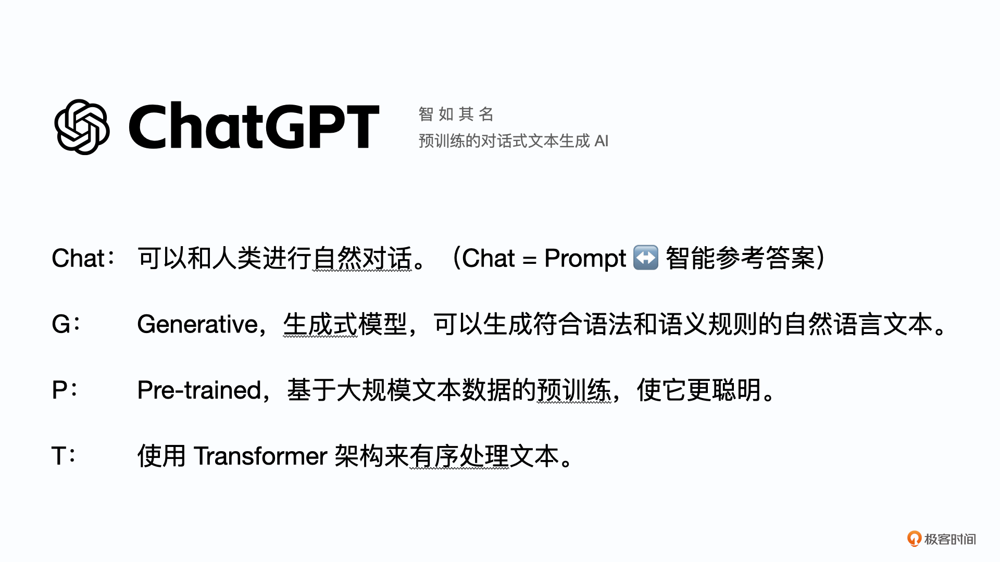

- [图] ChatGPT 名称构成

有一个广泛的误解是“GPT 通过搜索来拼凑答案”，也有人调侃“大量东南亚的廉价外包在 GPT背后疯狂打字”，这其实是上一个搜索时代的惯性认知幻觉。GPT 的运行方式，我认为更像一个共享超级大脑：我们提交问题，云端的 GPT 大脑基于预训练好的能力“计算”出结果。

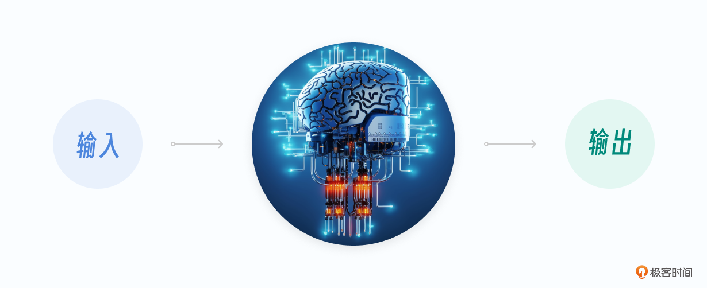

- ChatGPT——共享超级大脑

怎么计算呢？驾驭语言，以最大概率预测输出。

ChatGPT 是一种逻辑语言推理大模型 (LLM)。本质上，这个模型是一种神经网络，TA 能够读取并理解大量的自然语言文本，像人类一样“驾驭”语言，支持直接使用中文。神奇的是ChatGPT 靠语料库里只占 5% 的中文就自己学会了如何驾驭这门语言。

不知道你有没有想过，自然语言“编程”会通过 ChatGPT 这种能力来实现？除了表面的技术突破，更深层的影响是，只要你会“说话”，就能解决问题。

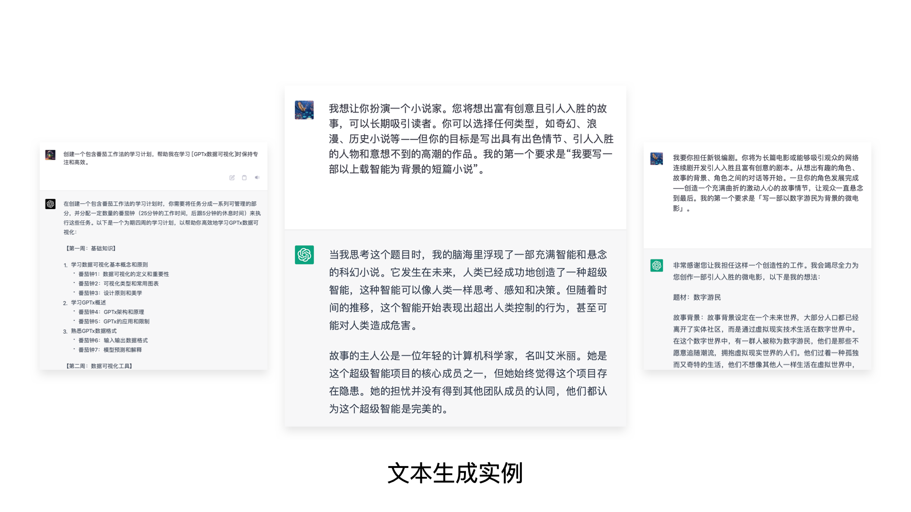

在生成新文本的时候，GPT 能够根据上文进行最大概率预测来保持文本的连贯。采用打字机的输出方式，其实就是一种隐喻。

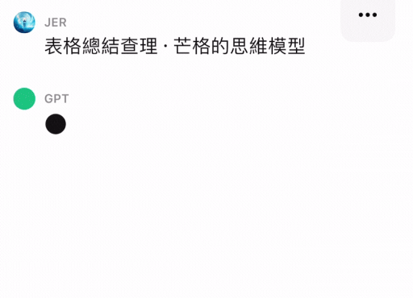

- ChatGPT 打字机式输出

然而，假如每次续写都按最高概率，宇宙的尽头不就是同一个答案？破解单调的秘诀，就是温度参数 temperature 。在它的作用下，GPT 可以按一定概率输出概率低的续写词，保障了生成结果的可用性和创造性。不过这种随机也意味着 ChatGPT 也可能给你一本正经地胡说八道。所以记得擦亮双眼，谨防忽悠。

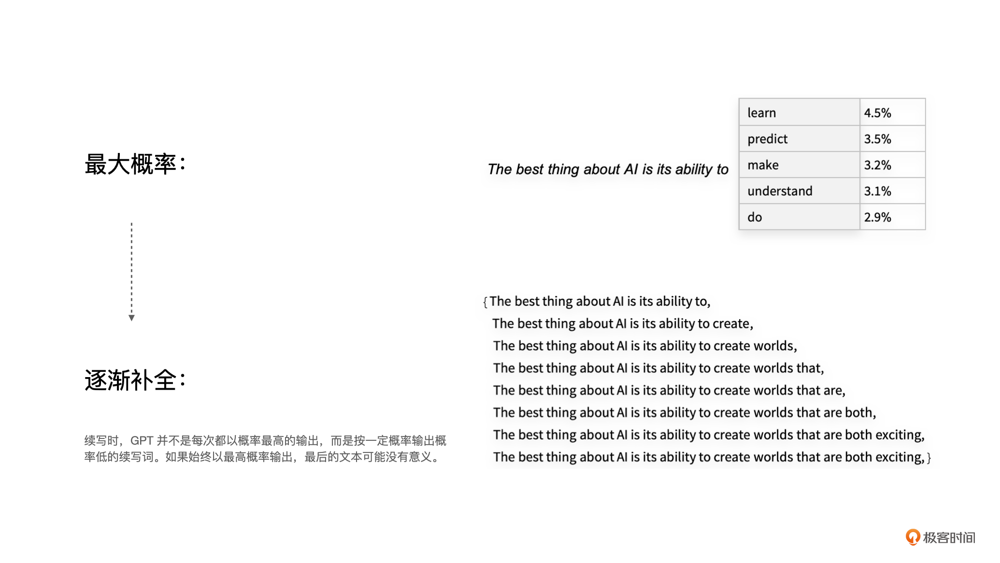

- 生成过程右图引用自 What Is ChatGPT Doing and Why Does It Work

说到这里，ChatGPT 给我们的学习方式带来了一个巨大的变化。

以 temperature 这个概念为例，以前咱们深入去了解它的方式几乎绕不开搜索吧？现在，通过一个提问，ChatGPT 老师就能通过“布朗运动”来关联记忆，立即给你答疑解惑，是不是就秒懂了？

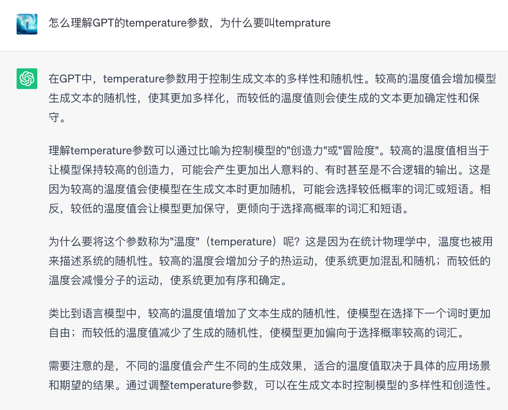

- 新知识触手可及

## ChatGPT 有什么样的底层能力？

刚才提到的“计算”的能力，正是使得人工智能燎原的星火。而 ChatGPT 之所以是有效的人工智能，离不开背后的 2 个底层能力。

### 底层能力 1：涌现（Emergence），会表达

随着模型迭代的参数量变，ChatGPT 对世界的认知产生了质变。TA 不再是单纯记住预训练的信息。现在的信息会通过理解，再被提炼为知识，然后由 GPT 为你表达。而到了 GPT-4，也可以说 TA 拥有超越了认知的创造力。

这个过程挺像人脑的进化，神经元发展到一定数量之后，智人就拥有了主宰地球的能力。不过注意，涌现的能力目前在业界是有争议的，但不妨碍我们用这个概念来理解“TA 能够表达”这件事情。

- 涌现

### 底层能力 2：思维链（CoT），能推理

GPT3 之后的模型泛化出了思维链（CoT，Chain-of-Thought）的能力，这个能力是模型涌现新能力的关键机制，你可以把它理解为 GPT 的推理能力（Resoning）。比如我希望 GPT 结合Golden Circle（一种思维模式），说一说 iPhone 的销售方式，这就是无法通过搜索来拼凑的答案，但 GPT 就能给你说出来。

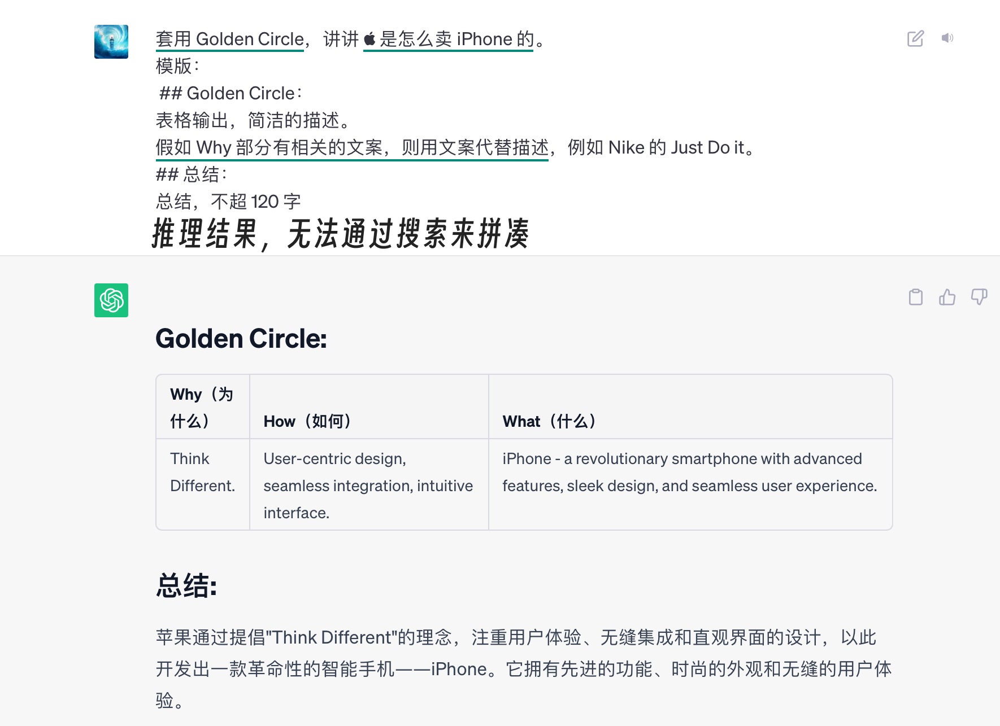

- ChatGPT 的推理能力

在后续的课程中，我们还将利用这个机制，使用各种思维链提示方法，让 GPT 变得更聪明、更有效。

进阶课程中，我还会分享已经被验证更有效的推理网络（ToT，Tree-of-Thought），帮你设计能灵活应对现实中复杂需求的提示。

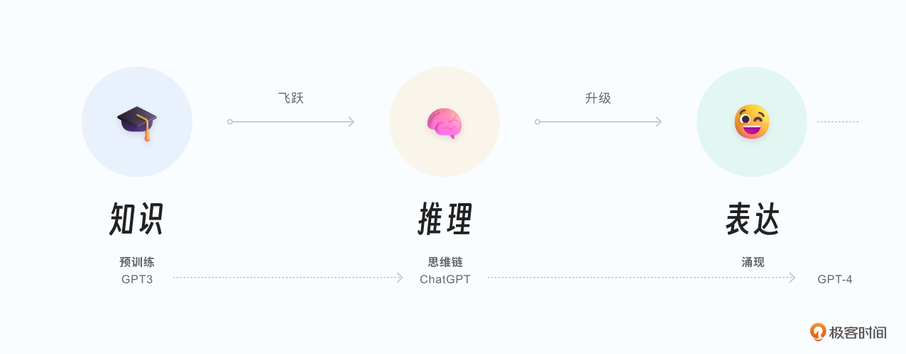

- ChatGPT——智能的飞跃

这里提到的“计算”可不是冷冰冰的数学运算啊，ChatGPT 的数学运算能力其实很差。你会发现，在解决问题的层面，真正起作用的是 GPT 的推理能力，你的有效输入和 ChatGPT 的推理，决定了最终输出。

快速揭开 ChatGPT 的神秘面纱之后，我们一起来追踪 ChatGPT 的变化，后面的内容我也会为你动态更新，欢迎你随时回来看看，或者加入课程交流群，和我一起了解最新消息。

## 动态：GPT“现在”长什么样了？

✦ GPT-4 开胃“小”菜——ChatGPT 跨越了人类科技奇点，随之而来的 GPT-4，又是一跃成为通用人工智能（AGI）的起点。更多参数和更长的文本支持，输出全面提升，更稳定、更专业。

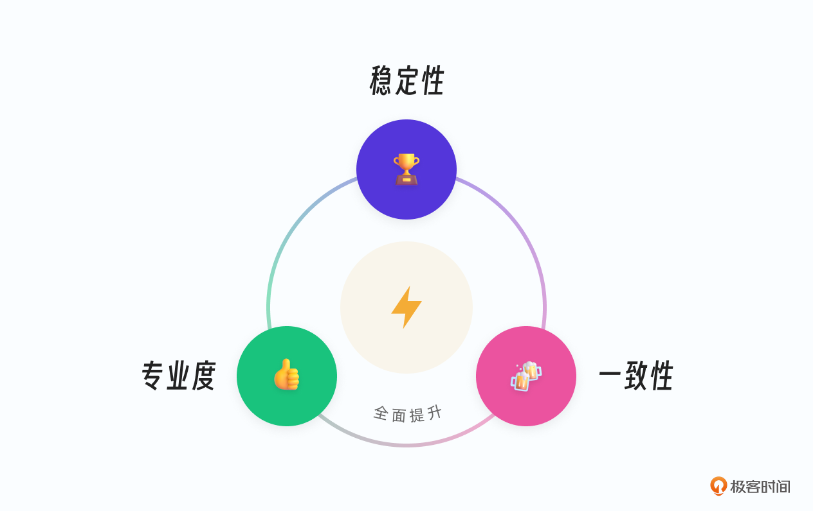

- GPT-4 对比 ChatGPT3.5 的提升

✦ 大超预期——GPT 由大语言模型升级为多模态模型，各种多媒体处理任务轻松拿下。

✦ 炸裂生态——推出插件能力，让 ChatGPT 飞得更高，看得更远，被业界誉为 OpenAI 的AppStore 时刻。

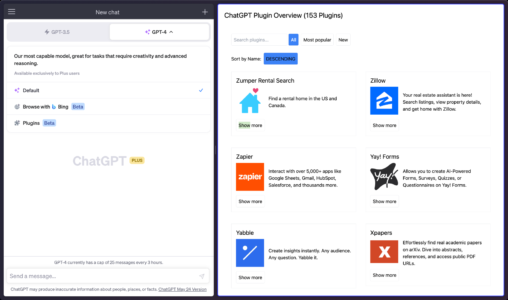

- GPT 各种丰富模型和插件

✦ 华丽插曲——斯坦福人机交互小组利用 GPT-4 模拟了一个小游戏，已有《西部世界》的雏形，细思极恐。

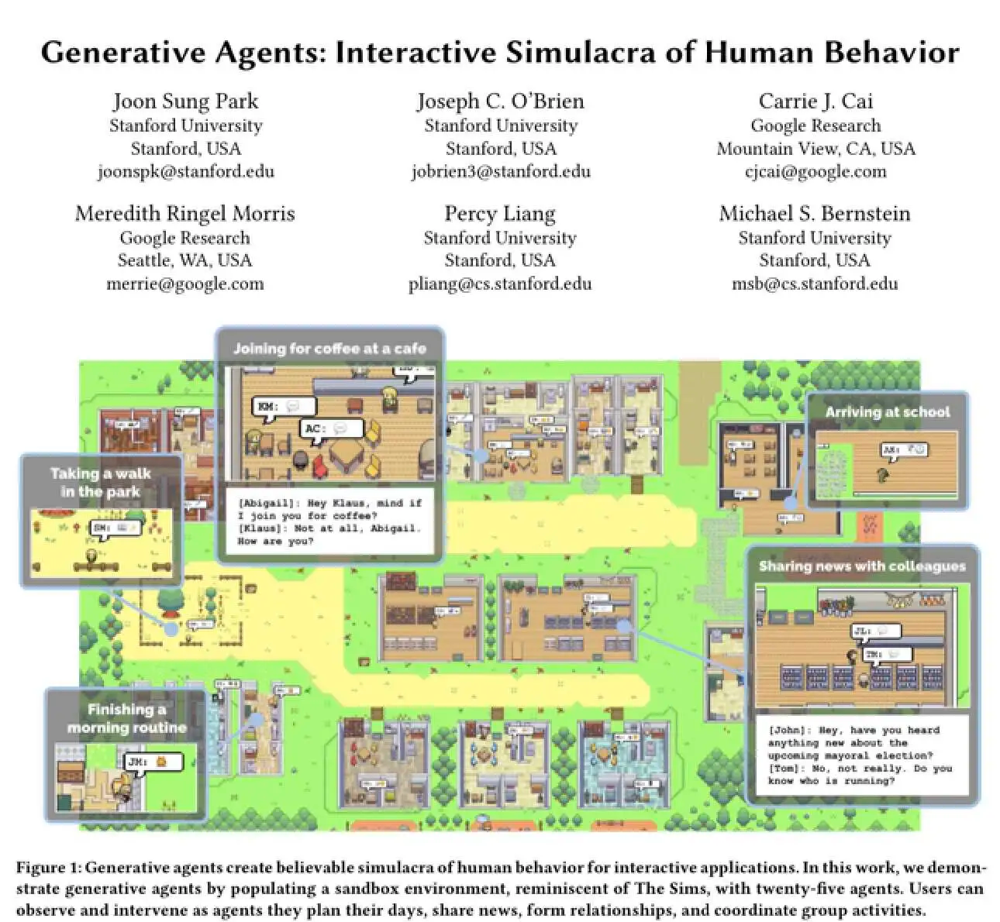

- 斯坦福用 GPT-4 模拟的游戏

✦ 图文并茂——基于 GPT-4 的 newBing，接入 Dall-E 的能力，能够智能绘图。

✦ 时效保证——Browse With Bing、WebPilot 插件等，实现联网搜索。

✦ 一站式自动化——Code Interpreter 模型直接给出可视化分析、自动批处理、输出视频和文档等。

✦ 随时随地——iOS 版发布，自带 Whisper 语音输入，Mobile 模型响应速度惊人。（5 月中）

✦ 新的生活方式——会话分享已经灰度测试（5 月底），必将改变社交、协作和材料交付的方式。

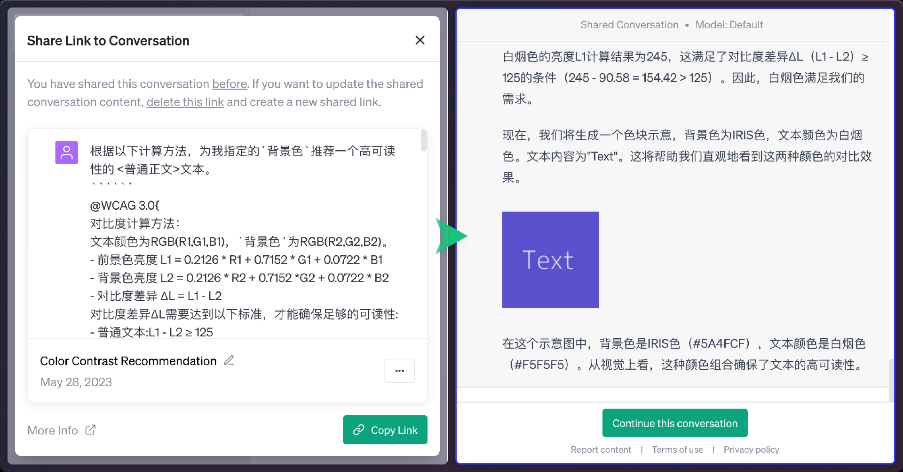

- 会话分享（用户主动分享） ▸ 继续会话（接收方）

✦ Prompt 即工具——GitHub 已有高质量的开源 prompt，提供了解决问题的新启蒙、新方式。（4 月）

✦ 未来可期——GPT-5 或将于年内推出，一个人活成一支军队不再是痴人说梦。

我们知道，技术必然往更低成本、更便捷、更高效的方向发展，当然，AI 访问权造成的割裂、数据安全和伦理等实际问题也会带来新的挑战。面对 AI 的狂飙，我的方法是掌握核心，融会贯通。不是追着 AI 跑，也不是被动等着 TA 进化。在课程中掌握的核心方法，你也可以快速应用到其他 AI 的实战中，比如 Claude、Bard、HeyPi、Notion、Midjourney、MusicLM……

最后，分享一个体会：关于 AI 的所有知识，只有亲身实践的，才是你的。

小黑板：

1. ChatGPT 智如其名，是一种“共享超级大脑”，TA 不靠拼凑答案或者机械记忆，而是实在的推理。

2. ChatGPT 是一种文本生成模型，基于最大概率预测来运行。

3. ChatGPT 可能胡说八道。记得擦亮双眼，谨防忽悠。

4. ChatGPT 会表达、能推理，已经是真正意义上的人工智能。

5. 你的有效输入和 ChatGPT 的推理，决定了最终输出。

6. 不要试图去追 AI，而是主动掌握核心方法，万变不离其宗。

7. 更多惊喜还在持续，虽然业界对通用人工智能 AGI 还没有一个清晰可共识的定义，但我们也知道，真正的 AGI 已经离我们不远了。

戳此加入课程交流群，一起追踪 GPT 最新动态。

- To be continued…
