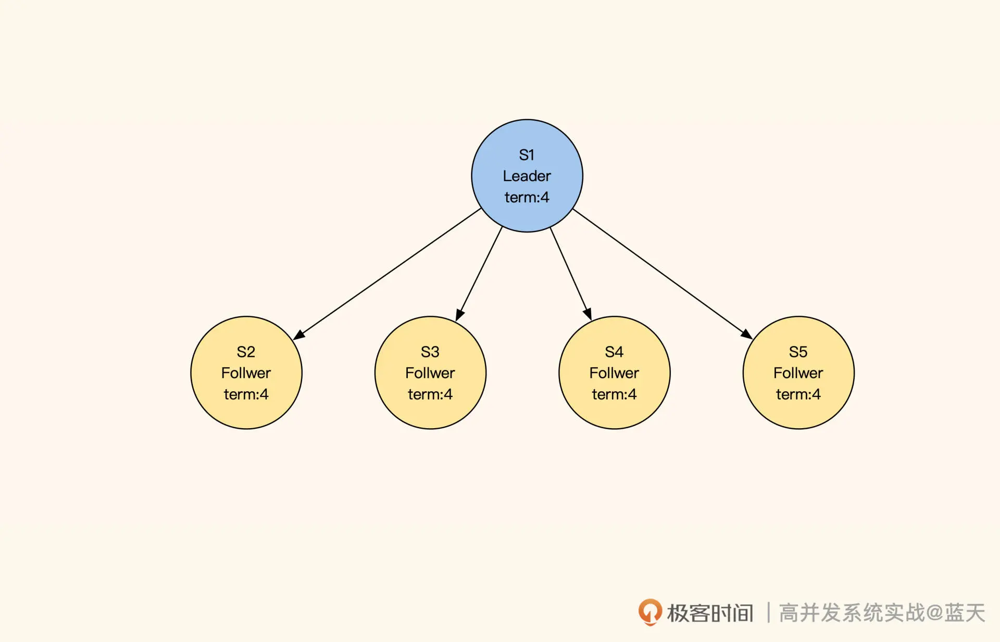
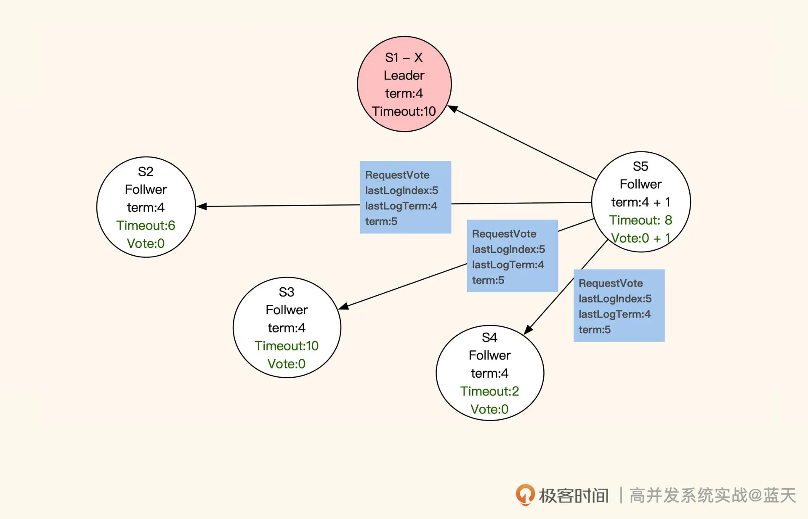
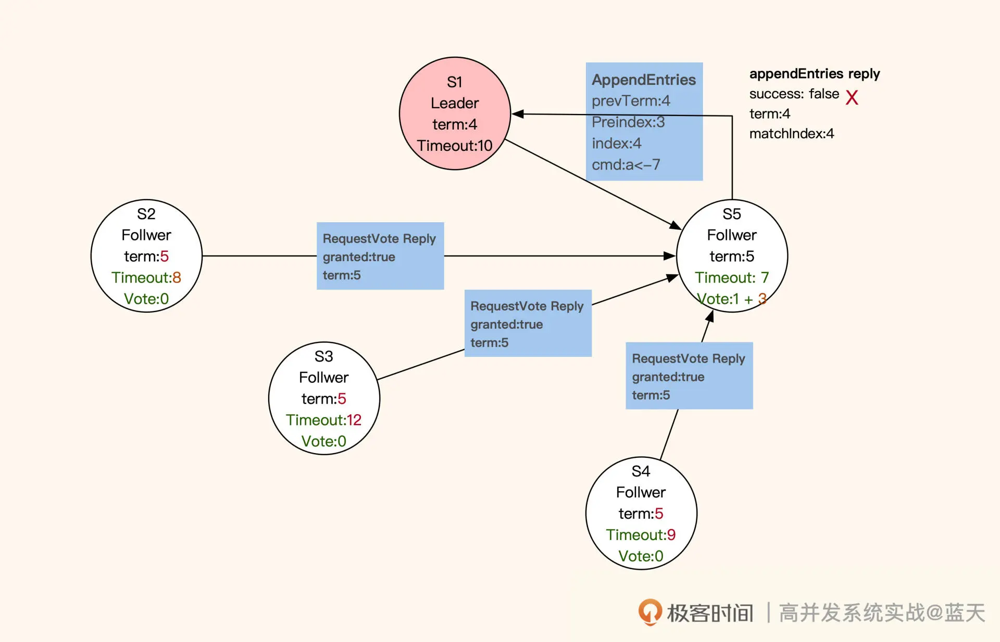
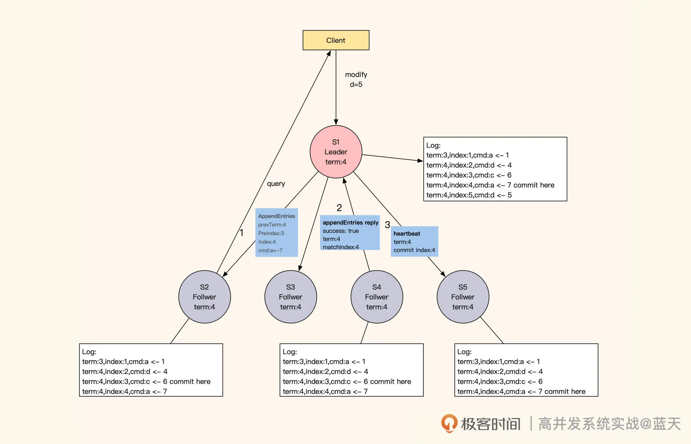
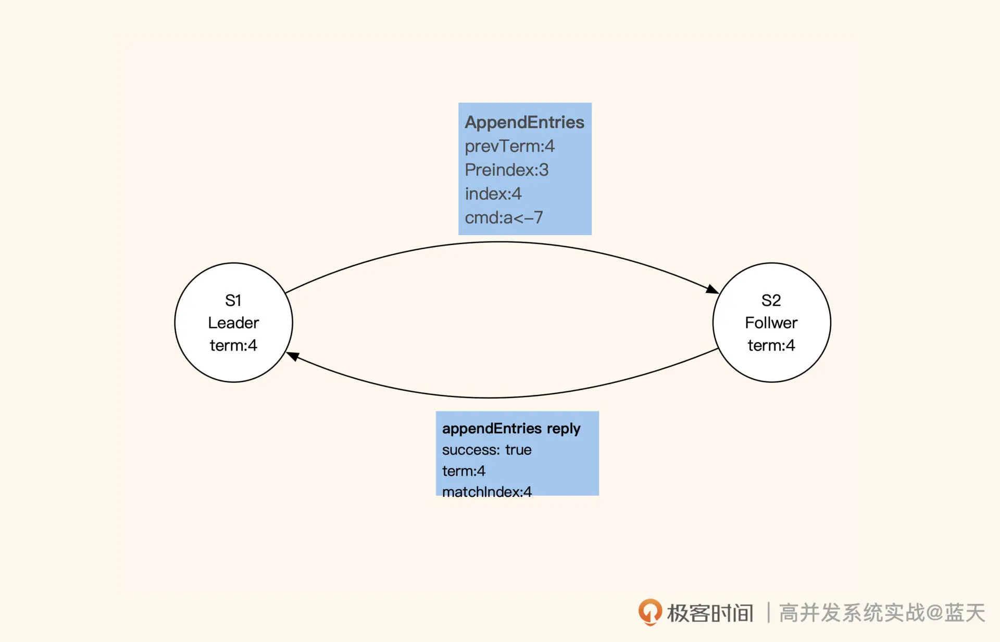
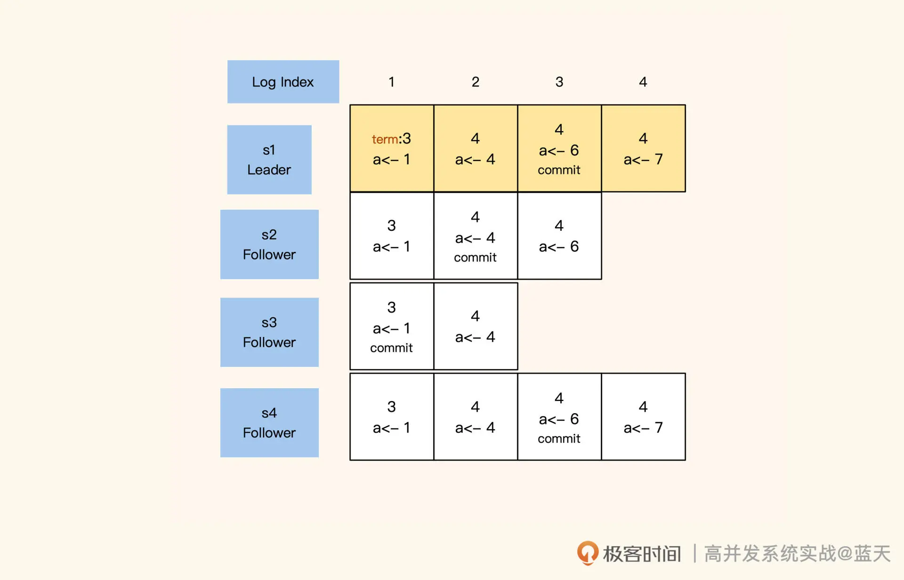
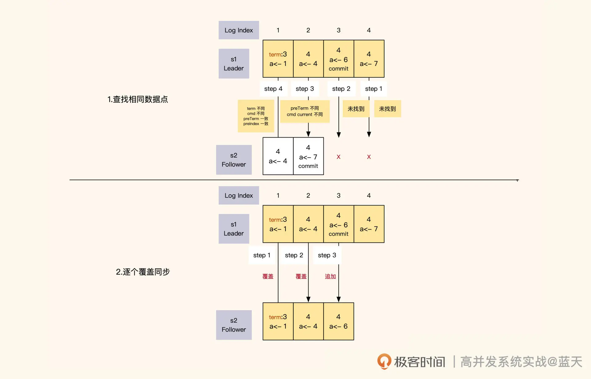
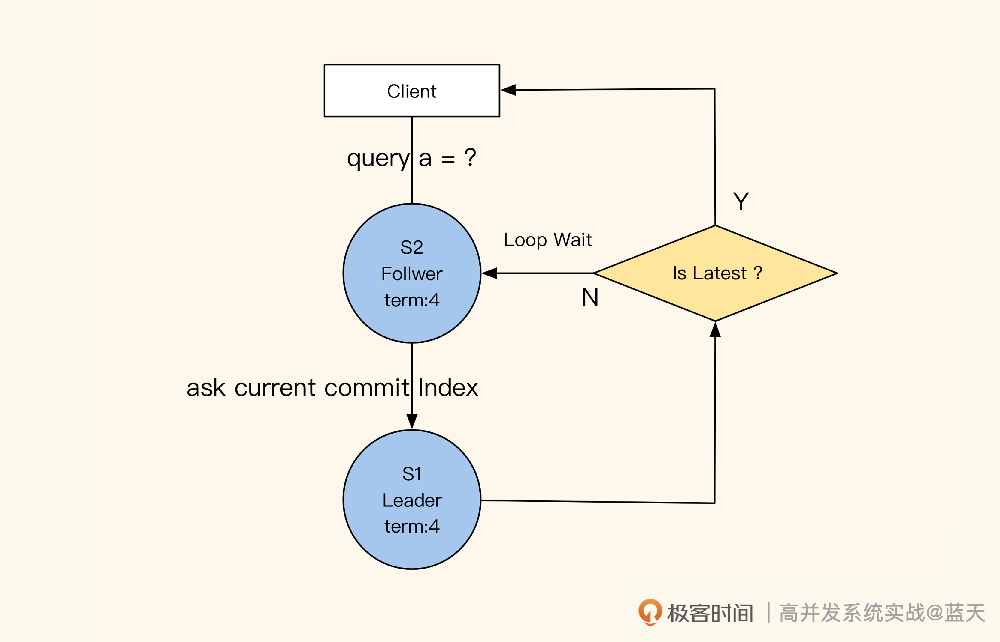
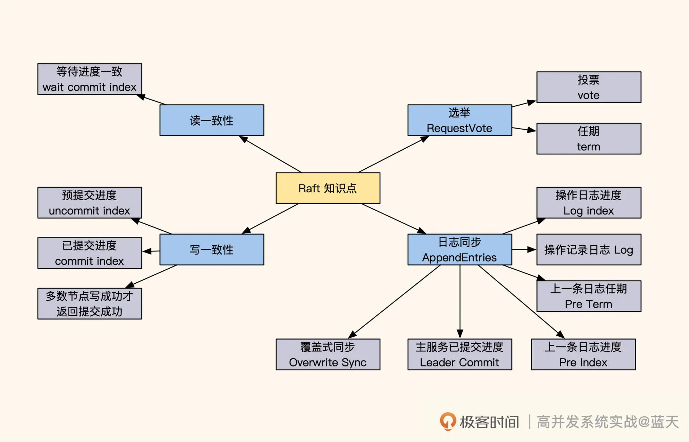

# 05 | 共识Raft：如何保证多机房数据的一致性？

你好，我是徐长龙。

上节课我们讲了如何通过 Otter 实现同城双活机房的数据库同步，但是这种方式并不能保证双机房数据双主的事务强一致性。

如果机房 A 对某一条数据做了更改，B 机房同时修改，Otter 会用合并逻辑对冲突的数据行或字段做合并。为了避免类似问题，我们在上节课对客户端做了要求：用户客户端在一段时间内只能访问一个机房。

但如果业务对“事务 + 强一致”的要求极高，比如库存不允许超卖，那我们通常只有两种选择：一种是将服务做成本地服务，但这个方式并不适合所有业务；另一种是采用多机房，但需要用分布式强一致算法保证多个副本的一致性。

在行业里，最知名的分布式强一致算法要属 Paxos，但它的原理过于抽象，在使用过程中经过多次修改会和原设计产生很大偏离，这让很多人不确定自己的修改是不是合理的。而且，很多人需要一到两年的实践经验才能彻底掌握这个算法。

随着我们对分布式多副本同步的需求增多，过于笼统的 Paxos 已经不能满足市场需要，于是，Raft 算法诞生了。

相比 Paxos，Raft 不仅更容易理解，还能保证数据操作的顺序，因此在分布式数据服务中被广泛使用，像 etcd、Kafka 这些知名的基础组件都是用 Raft 算法实现的。

那今天这节课我们就来探寻一下 Raft 的实现原理，可以说了解了 Raft，就相当于了解了分布式强一致性数据服务的半壁江山。几乎所有关于多个数据服务节点的选举、数据更新和同步都是采用类似的方式实现的，只是针对不同的场景和应用做了一些调整。

## 如何选举 Leader？

为了帮你快速熟悉 Raft 的实现原理，下面我会基于 Raft 官方的例子，对 Raft 进行讲解。

- Raft服务状态角色、调用关系、日志

如图所示，我们启动五个 Raft 分布式数据服务：S1、S2、S3、S4、S5，每个节点都有以下三种状态：

- Leader：负责数据修改，主动同步修改变更给 Follower；

- Follower：接收 Leader 推送的变更数据；

- Candidate：集群中如果没有 Leader，那么进入选举模式。

如果集群中的 Follower 节点在指定时间内没有收到 Leader 的心跳，那就代表 Leader 损坏，集群无法更新数据。这时候 Follower 会进入选举模式，在多个 Follower 中选出一个 Leader，保证一组服务中一直存在一个 Leader，同时确保数据修改拥有唯一的决策进程。

那 Leader 服务是如何选举出来的呢？进入选举模式后，这 5 个服务会随机等待一段时间。等待时间一到，当前服务先投自己一票，并对当前的任期“term”加 1 （上图中 term:4 就代表第四任 Leader），然后对其他服务发送 RequestVote RPC（即请求投票）进行拉票。

- S1失去联系，S5最先超时发起选举

收到投票申请的服务，并且申请服务（即“发送投票申请的服务”）的任期和同步进度都比它超前或相同，那么它就会投申请服务一票，并把当前的任期更新成最新的任期。同时，这个收到投票申请的服务不再发起投票，会等待其他服务邀请。

注意，每个服务在同一任期内只投票一次。如果所有服务都没有获取到多数票（三分之二以上服务节点的投票），就会等当前选举超时后，对任期加 1，再次进行选举。最终，获取多数票且最先结束选举倒计时的服务会被选为 Leader。

被选为 Leader 的服务会发布广播通知其他服务，并向其他服务同步新的任期和其进度情况。同时，新任 Leader 会在任职期间周期性发送心跳，保证各个子服务（Follwer）不会因为超时而切换到选举模式。在选举期间，若有服务收到上一任 Leader 的心跳，则会拒绝（如下图S1）。

- 投票结果返回

选举结束后，所有服务都进入数据同步状态。

## 如何保证多副本写一致？

在数据同步期间，Follower 会与 Leader 的日志完全保持一致。不难看出，Raft 算法采用的也是主从方式同步，只不过 Leader 不是固定的服务，而是被选举出来的。

这样当个别节点出现故障时，是不会影响整体服务的。不过，这种机制也有缺点：如果Leader 失联，那么整体服务会有一段时间忙于选举，而无法提供数据服务。

通常来说，客户端的数据修改请求都会发送到 Leader 节点（如下图 S1）进行统一决策，如果客户端请求发送到了 Follower，Follower 就会将请求重定向到 Leader。那么，Raft 是怎么实现同分区数据备份副本的强一致性呢？

- 多副本同步

具体来讲，Leader 成功修改数据后，会产生对应的日志，然后 Leader 会给所有 Follower 发送单条日志同步信息。只要大多数 Follower 返回同步成功，Leader 就会对预提交的日志进行commit，并向客户端返回修改成功。

接着，Leader 在下一次心跳时（消息中 leader commit 字段），会把当前最新 commit 的 Logindex（日志进度）告知给各 Follower 节点，然后各 Follower 按照这个 index 进度对外提供数据，未被 Leader 最终 commit 的数据则不会落地对外展示。

如果在数据同步期间，客户端还有其他的数据修改请求发到 Leader，那么这些请求会排队，因为这时候的 Leader 在阻塞等待其他节点回应。

- 通过日志同步，同时同步Follower目前Leader 的commit index

不过，这种阻塞等待的设计也让 Raft 算法对网络性能的依赖很大，因为每次修改都要并发请求多个节点，等待大部分节点成功同步的结果。

最惨的情况是，返回的 RTT 会按照最慢的网络服务响应耗时（“两地三中心”的一次同步时间为100ms 左右），再加上主节点只有一个，一组 Raft 的服务性能是有上限的。对此，我们可以减少数据量并对数据做切片，提高整体集群的数据修改性能。

请你注意，当大多数 Follower 与 Leader 同步的日志进度差异过大时，数据变更请求会处于等待状态，直到一半以上的 Follower 与 Leader 的进度一致，才会返回变更成功。当然，这种情况比较少见。

## 服务之间如何同步日志进度？

讲到这我们不难看出，在 Raft 的数据同步机制中，日志发挥着重要的作用。在同步数据时，Raft 采用的日志是一个有顺序的指令日志 WAL（Write Ahead Log），类似 MySQL 的binlog。该日志中记录着每次修改数据的指令和修改任期，并通过 Log Index 标注了当前是第几条日志，以此作为同步进度的依据。

- 日志格式

其中，Leader 的日志永远不会删除，所有的 Follower 都会保持和 Leader 完全一致，如果存在差异也会被强制覆盖。同时，每个日志都有“写入”和“commit”两个阶段，在选举时，每个服务会根据还未 commit 的 Log Index 进度，优先选择同步进度最大的节点，以此保证选举出的Leader 拥有最新最全的数据。

Leader 在任期内向各节点发送同步请求，其实就是按顺序向各节点推送一条条日志。如果Leader 同步的进度比 Follower 超前，Follower 就会拒绝本次同步。

Leader 收到拒绝后，会从后往前一条条找出日志中还未同步的部分或者有差异的部分，然后开始一个个往后覆盖实现同步。

- 第一阶段找到共同进度点，第二阶段覆盖+追加同步进度

Leader 和 Follower 的日志同步进度是通过日志 index 来确认的。Leader 对日志内容和顺序有绝对的决策权，当它发现自己的日志和 Follower 的日志有差异时，为了确保多个副本的数据是完全一致的，它会强制覆盖 Follower 的日志。

那么 Leader 是怎么识别出 Follower 的日志与自己的日志有没有差异呢？实际上，Leader 给Follower 同步日志的时候，会同时带上 Leader 上一条日志的任期和索引号，与 Follower 当前的同步进度进行对比。

对比分为两个方面：一方面是对比 Leader 和 Follower 当前日志中的 index、多条操作日志和任期；另一方面是对比 Leader 和 Follower 上一条日志的 index 和任期。

如果有任意一个不同，那么 Leader 就认为 Follower 的日志与自己的日志不一致，这时候Leader 会一条条倒序往回对比，直到找到日志内容和任期完全一致的 index，然后从这个index 开始正序向下覆盖。同时，在日志数据同步期间，Leader 只会 commit 其所在任期内的数据，过往任期的数据完全靠日志同步倒序追回。

你应该已经发现了，这样一条条推送同步有些缓慢，效率不高，这导致 Raft 对新启动的服务不是很友好。所以 Leader 会定期打快照，通过快照合并之前修改日志的记录，来降低修改日志的大小。而同步进度差距过大的 Follower 会从 Leader 最新的快照中恢复数据，按快照最后的 index 追赶进度。

## 如何保证读取数据的强一致性？

通过前面的讲解，我们知道了 Leader 和 Follower 之间是如何做到数据同步的，那从 Follower的角度来看，它又是怎么保证自己对外提供的数据是最新的呢？

这里有个小技巧，就是 Follower 在收到查询请求时，会顺便问一下 Leader 当前最新 commit的 log index 是什么。如果这个 log index 大于当前 Follower 同步的进度，就说明 Follower 的本地数据不是最新的，这时候 Follower 就会从 Leader 获取最新的数据返回给客户端。可见，保证数据强一致性的代价很大。

- Follower保持与Leader进度一致的方式，保证读到的数据和Leader强一致

你可能会好奇：如何在业务使用时保证读取数据的强一致性呢？其实我们之前说的 Raft 同步等待 Leader commit log index 的机制，已经确保了这一点。我们只需要向 Leader 正常提交数据修改的操作，Follower 读取时拿到的就一定是最新的数据。

## 总结

很多人都说 Raft 是一个分布式一致性算法，但实际上 Raft 算法是一个共识算法（多个节点达成共识），它通过任期机制、随机时间和投票选举机制，实现了服务动态扩容及服务的高可用。

通过 Raft 采用强制顺序的日志同步实现多副本的数据强一致同步，如果我们用 Raft 算法实现用户的数据存储层，那么数据的存储和增删改查，都会具有跨机房的数据强一致性。这样一来，业务层就无需关心一致性问题，对数据直接操作，即可轻松实现多机房的强一致同步。

由于这种方式的同步代价和延迟都比较大，建议你尽量在数据量和修改量都比较小的场景内使用，行业里也有很多针对不同场景设计的库可以选择，如：parallel-raft、multi-paxos、SOFAJRaft 等，更多请参考 Raft 的底部开源列表。

## 思考题

最后，请你思考一下，为什么 Raft 集群成员增减需要特殊去做？

欢迎你在留言区与我交流讨论，我们下节课见！
