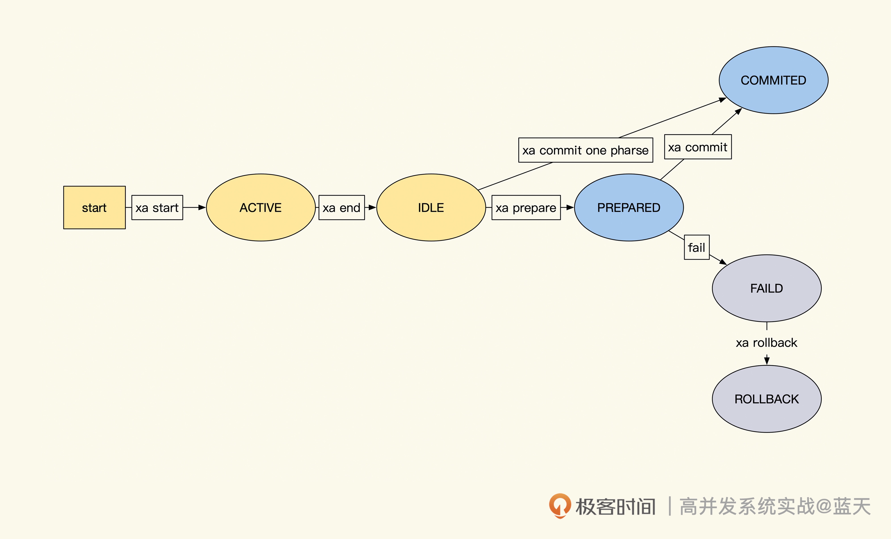
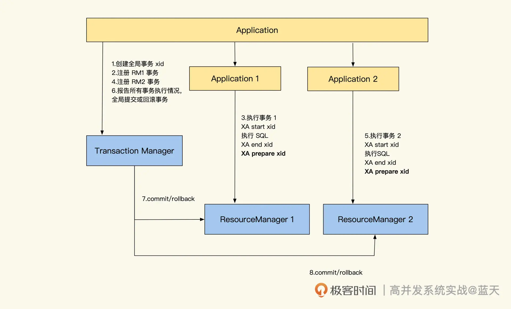
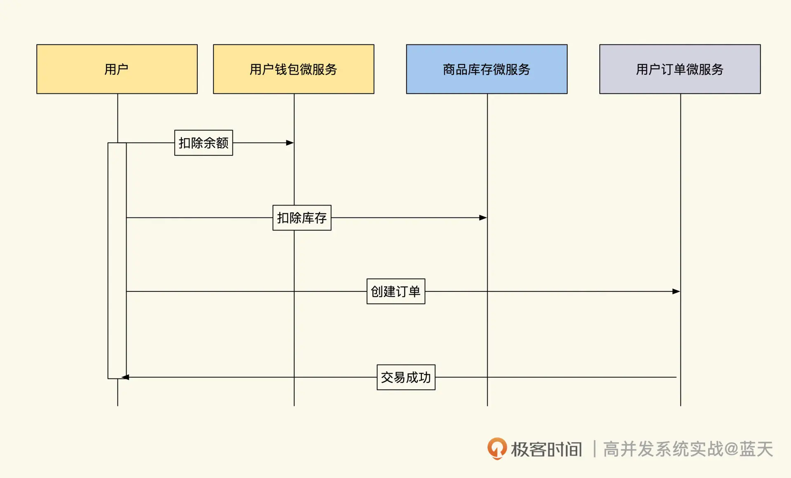
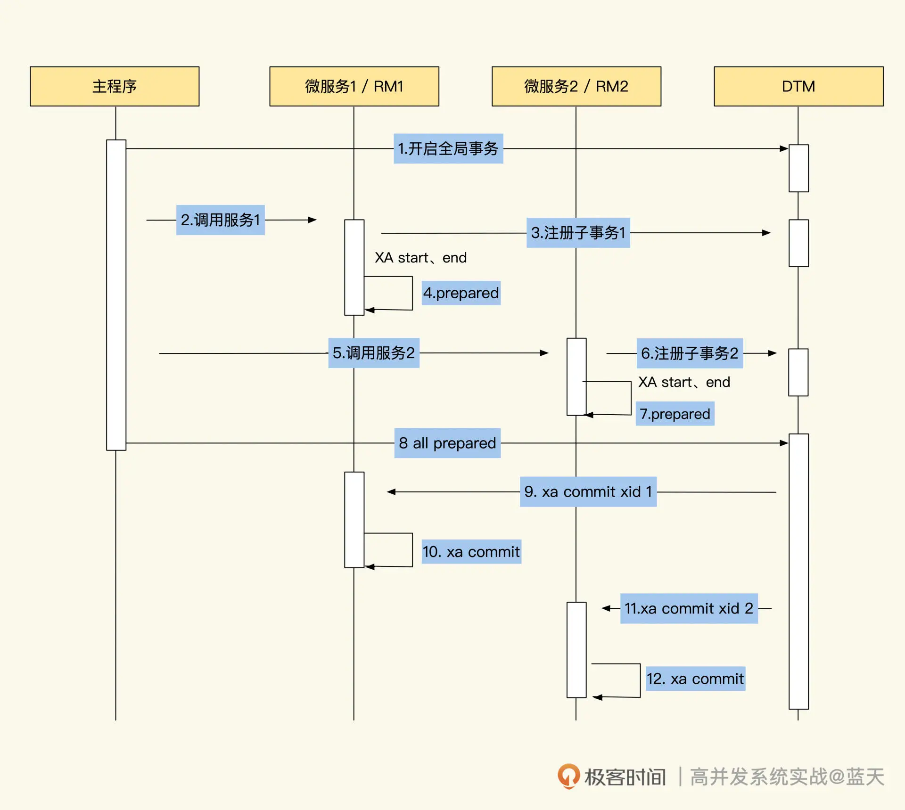
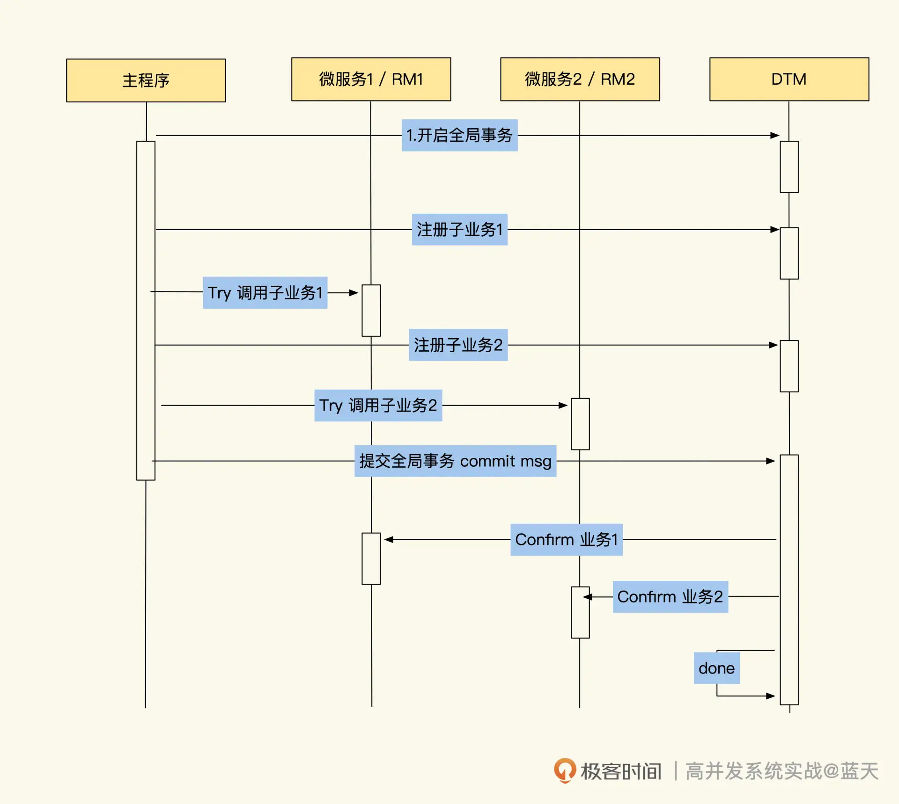

# 09 | 分布式事务：多服务的2PC、TCC都是怎么实现的？

你好，我是徐长龙，今天这节课我们聊聊分布式事务。

目前业界流行微服务，DDD 领域驱动设计也随之流行起来。DDD 是一种拆分微服务的方法，它从业务流程的视角从上往下拆分领域，通过聚合根关联多个领域，将多个流程聚合在一起，形成独立的服务。相比由数据表结构设计出的微服务，DDD 这种方式更加合理，但也加大了分布式事务的实现难度。

在传统的分布式事务实现方式中，我们普遍会将一个完整的事务放在一个独立的项目中统一维护，并在一个数据库中统一处理所有的操作。这样在出现问题时，直接一起回滚，即可保证数据的互斥和统一性。

不过，这种方式的服务复用性和隔离性较差，很多核心业务为了事务的一致性只能聚合在一起。

为了保证一致性，事务在执行期间会互斥锁定大量的数据，导致服务整体性能存在瓶颈。而非核心业务要想在隔离要求高的系统架构中，实现跨微服务的事务，难度更大，因为核心业务基本不会配合非核心业务做改造，再加上核心业务经常随业务需求改动（聚合的业务过多），结果就是非核心业务没法做事务，核心业务也无法做个性化改造。

也正因为如此，多个系统要想在互动的同时保持事务一致性，是一个令人头疼的问题，业内很多非核心业务无法和核心模块一起开启事务，经常出现操作出错，需要人工补偿修复的情况。

尤其在微服务架构或用 DDD 方式实现的系统中，服务被拆分得更细，并且都是独立部署，拥有独立的数据库，这就导致要想保持事务一致性实现就更难了，因此跨越多个服务实现分布式事务已成为刚需。

好在目前业内有很多实现分布式事务的方式，比如 2PC、3PC、TCC 等，但究竟用哪种比较合适呢？这是我们需要重点关注的。因此，这节课我会带你对分布式事务做一些讨论，让你对分布式事务有更深的认识，帮你做出更好的决策。

## XA 协议

在讲分布式事务之前，我们先认识一下 XA 协议。

XA 协议是一个很流行的分布式事务协议，可以很好地支撑我们实现分布式事务，比如常见的2PC、3PC 等。这个协议适合在多个数据库中，协调分布式事务，目前 Oracle、DB2、MySQL 5.7.7 以上版本都支持它（虽然有很多 bug）。而理解了 XA 协议，对我们深入了解分布式事务的本质很有帮助。

支持 XA 协议的数据库可以在客户端断开的情况下，将执行好的业务结果暂存起来，直到另外一个进程确认才会最终提交或回滚事务，这样就能轻松实现多个数据库的事务一致性。

在 XA 协议里有三个主要的角色：

- 应用（AP）：应用是具体的业务逻辑代码实现，业务逻辑通过请求事务协调器开启全局事务，在事务协调器注册多个子事务后，业务代码会依次给所有参与事务的子业务下发请求。

- 待所有子业务提交成功后，业务代码根据返回情况告诉事务协调器各个子事务的执行情况，由事务协调器决策子事务是提交还是回滚（有些实现是事务协调器发请求给子服务）。

- 事务协调器（TM）：用于创建主事务，同时协调各个子事务。事务协调器会根据各个子事务的执行情况，决策这些子事务最终是提交执行结果，还是回滚执行结果。此外，事务协调器很多时候还会自动帮我们提交事务；

- 资源管理器（RM）：是一种支持事务或 XA 协议的数据资源，比如 MySQL、Redis 等。

另外，XA 还对分布式事务规定了两个阶段：Prepare 阶段和 Commit 阶段。

在 Prepare 阶段，事务协调器会通过 xid（事务唯一标识，由业务或事务协调器生成）协调多个资源管理器执行子事务，所有子事务执行成功后会向事务协调器汇报。

这时的子事务执行成功是指事务内 SQL 执行成功，并没有执行事务的最终 commit（提交），所有子事务是提交还是回滚，需要等事务协调器做最终决策。

接着分布式事务进入 Commit 阶段：当事务协调器收到所有资源管理器成功执行子事务的消息后，会记录事务执行成功，并对子事务做真正提交。如果 Prepare 阶段有子事务失败，或者事务协调器在一段时间内没有收到所有子事务执行成功的消息，就会通知所有资源管理器对子事务执行回滚的操作。

需要说明的是，每个子事务都有多个状态，每个状态的流转情况如下图所示：



如上图，子事务有四个阶段的状态：

- ACTIVE：子事务 SQL 正在执行中；

- IDLE：子事务执行完毕等待切换 Prepared 状态，如果本次操作不参与回滚，就可以直接提交完成；

- PREPARED：子事务执行完毕，等待其他服务实例的子事务全部 Ready。

- COMMITED/FAILED：所有子事务执行成功 / 失败后，一起提交或回滚。

下面我们来看 XA 协调两个事务的具体流程，这里我拿最常见的 2PC 方式为例进行讲解。



- XA 协调两个服务的分布式事务过程

如上图所示，在协调两个服务 Application 1 和 Application 2 时，业务会先请求事务协调器创建全局事务，同时生成全局事务的唯一标识 xid，然后再在事务协调器里分别注册两个子事务，生成每个子事务对应的 xid。这里说明一下，xid 由 gtrid+bqual+formatID 组成，多个子事务的 gtrid 是相同的，但其他部分必须区分开，防止这些服务在一个数据库下。

那么有了子事务的 xid，被请求的服务会通过 xid 标识开启 XA 子事务，让 XA 子事务执行业务操作。当事务数据操作都执行完毕后，子事务会执行 Prepare 指令，将子事务标注为Prepared 状态，然后以同样的方式执行 xid2 事务。

所有子事务执行完毕后，Prepared 状态的 XA 事务会暂存在 MySQL 中，即使业务暂时断开，事务也会存在。这时，业务代码请求事务协调器通知所有申请的子事务全部执行成功。与此同时，TM 会通知 RM1 和 RM2 执行最终的 commit（或调用每个业务封装的提交接口）。

至此，整个事务流程执行完毕。而在 Prepare 阶段，如果有子事务执行失败，程序或事务协调器，就会通知所有已经在 Prepared 状态的事务执行回滚。

以上就是 XA 协议实现多个子系统的事务一致性的过程，可以说大部分的分布式事务都是使用类似的方式实现的。下面我们通过一个案例，看看 XA 协议在 MySQL 中的指令是如何使用的。

## MySQL XA 的 2PC 分布式事务

在进入案例之前，你可以先了解一下 MySQL 中，所有关 XA 协议的指令集，以方便接下来的学习：

```
# 开启一个事务Id为xid的XA子事务
# gtrid是事务主ID，bqual是子事务标识
# formatid是数据类型标注 类似format type
XA {START|BEGIN} xid[gtrid[,bqual[,format_id]]] [JOIN|RESUME]
# 结束xid的子事务，这个事务会标注为IDLE状态
# 如果IDEL状态直接执行XA COMMIT提交那么就是 1PC
XA END xid [SUSPEND [FOR MIGRATE]]
# 让子事务处于Prepared状态，等待其他子事务处理后，后续统一最终提交或回滚
# 另外 在这个操作之前如果断开链接，之前执行的事务都会回滚
XA PREPARE xid
# 上面不同子事务 用不同的xid(gtrid一致，如果在一个实例bqual必须不同)
# 指定xid子事务最终提交
XA COMMIT xid [ONE PHASE]
XA ROLLBACK xid 子事务最终回滚
# 查看处于Prepared状态的事务
# 我们用这个来确认事务进展情况，借此决定是否整体提交
# 即使提交链接断开了，我们用这个仍旧能看到所有的PrepareD状态的事务
#
XA RECOVER [CONVERT XID]
```

言归正传，我们以购物场景为例，在购物的整个事务流程中，需要协调的服务有三个：用户钱包、商品库存和用户购物订单，它们的数据都放在私有的数据库中。



- 用户购物

按照业务流程，用户在购买商品时，系统需要执行扣库存、生成购物订单和扣除用户账户余额的操作 。其中，“扣库存”和“扣除用户账户余额”是为了保证数据的准确和一致性，所以扣减过程中，要在事务操作期间锁定互斥的其他线程操作保证一致性，然后通过 2PC 方式，对三个服务实现事务协调。

具体实现代码如下：

```go
package main
import (
  "database/sql"
  "fmt"
  _ "github.com/go-sql-driver/mysql"
  "strconv"
  "time"
)
func main() {
  // 库存的连接
  stockDb, err := sql.Open("mysql", "root:paswd@tcp(127.0.0.1:3306)/shop_product
  if err != nil {
     panic(err.Error())
  }
  defer stockDb.Close()
  //订单的连接
  orderDb, err := sql.Open("mysql", "root:paswd@tcp(127.0.0.1:3307)/shop_order")
  if err != nil {
     panic(err.Error())
  }
  defer orderDb.Close()
  //钱包的连接
  moneyDb, err := sql.Open("mysql", "root:paswd@tcp(127.0.0.1:3308)/user_money_b
  if err != nil {
     panic(err.Error())
  }
  defer moneyDb.Close()
  // 生成xid(如果在同一个数据库，子事务不能使用相同xid)
  xid := strconv.FormatInt(time.Now().UnixMilli(), 10)
  //如果后续执行过程有报错，那么回滚所有子事务
  defer func() {
     if err := recover(); err != nil {
        stockDb.Exec("XA ROLLBACK ?", xid)
        orderDb.Exec("XA ROLLBACK ?", xid)
        moneyDb.Exec("XA ROLLBACK ?", xid)
     }
  }()
  // 第一阶段 Prepare
  // 库存 子事务启动
  if _, err = stockDb.Exec("XA START ?", xid); err != nil {
     panic(err.Error())
  }
  //扣除库存，这里省略了数据行锁操作
  if _, err = stockDb.Exec("update product_stock set stock=stock-1 where id =1")
     panic(err.Error())
  }
  //事务执行结束
  if _, err = stockDb.Exec("XA END ?", xid); err != nil {
     panic(err.Error())
  }
  //设置库存任务为Prepared状态
  if _, err = stockDb.Exec("XA PREPARE ?", xid); err != nil {
     panic(err.Error())
  }
  // 订单 子事务启动
  if _, err = orderDb.Exec("XA START ?", xid); err != nil {
     panic(err.Error())
  }
  //创建订单
  if _, err = orderDb.Exec("insert shop_order(id,pid,xx) value (1,2,3)"); err !=
     panic(err.Error())
  }
  //事务执行结束
  if _, err = orderDb.Exec("XA END ?", xid); err != nil {
     panic(err.Error())
  }
  //设置任务为Prepared状态
  if _, err = orderDb.Exec("XA PREPARE ?", xid); err != nil {
     panic(err.Error())
  }
  // 钱包 子事务启动
  if _, err = moneyDb.Exec("XA START ?", xid); err != nil {
     panic(err.Error())
  }
  //扣减用户账户现金，这里省略了数据行锁操作
  if _, err = moneyDb.Exec("update user_money_bag set money=money-1 where id =95
     panic(err.Error())
  }
  //事务执行结束
  if _, err = moneyDb.Exec("XA END ?", xid); err != nil {
     panic(err.Error())
  }
  //设置任务为Prepared状态
  if _, err = moneyDb.Exec("XA PREPARE ?", xid); err != nil {
     panic(err.Error())
  }
  // 在这时，如果链接断开、Prepared状态的XA事务仍旧在MySQL存在
  // 任意一个链接调用XA RECOVER都能够看到这三个没有最终提交的事务
  // --------
  // 第二阶段 运行到这里没有任何问题
  // 那么执行 commit
  // --------
  if _, err = stockDb.Exec("XA COMMIT ?", xid); err != nil {
     panic(err.Error())
  }
  if _, err = orderDb.Exec("XA COMMIT ?", xid); err != nil {
     panic(err.Error())
  }
  if _, err = moneyDb.Exec("XA COMMIT ?", xid); err != nil {
     panic(err.Error())
  }
  //到这里全部流程完毕
}
```

可以看到，MySQL 通过 XA 指令轻松实现了多个库或多个服务的事务一致性提交。

可能你会想，为什么在上面的代码中没有看到事务协调器的相关操作？这里我们不妨去掉子业务的具体实现，用 API 调用的方式看一下是怎么回事：

```go
package main
import (
  "database/sql"
  "fmt"
  _ "github.com/go-sql-driver/mysql"
  "strconv"
  "time"
)
func main() {
  // 库存的连接
  stockDb, err := sql.Open("mysql", "root:123456@tcp(127.0.0.1:3306)/shop_produc
  if err != nil {
     panic(err.Error())
  }
  defer stockDb.Close()
  //订单的连接
  orderDb, err := sql.Open("mysql", "root:123456@tcp(127.0.0.1:3307)/shop_order"
  if err != nil {
     panic(err.Error())
  }
  defer orderDb.Close()
  //钱包的连接
  moneyDb, err := sql.Open("mysql", "root:123456@tcp(127.0.0.1:3308)/user_money_
  if err != nil {
     panic(err.Error())
  }
  defer moneyDb.Close()
  // 生成xid
  xid := strconv.FormatInt(time.Now().UnixMilli(), 10)
  //如果后续执行过程有报错，那么回滚所有子事务
  defer func() {
     if err := recover(); err != nil {
        stockDb.Exec("XA ROLLBACK ?", xid)
        orderDb.Exec("XA ROLLBACK ?", xid)
        moneyDb.Exec("XA ROLLBACK ?", xid)
     }
  }()
  //调用API扣款，api内执行xa start、sql、xa end、xa prepare
  if _, err = API.Call("UserMoneyBagPay", uid, price, xid); err != nil {
     panic(err.Error())
  }
  //调用商品库存扣库存
  if _, err = API.Call("ShopStockDecr", productId, 1, xid); err != nil {
     panic(err.Error())
  }
  //调用API生成订单
  if _, err = API.Call("ShopOrderCreate",productId, uid, price, xid); err != nil
     panic(err.Error())
  }
  // --------
  // 第二阶段 运行到这里没有任何问题
  // 那么执行 commit
  // --------
  if _, err = stockDb.Exec("XA COMMIT ?", xid); err != nil {
     panic(err.Error())
  }
  if _, err = orderDb.Exec("XA COMMIT ?", xid); err != nil {
     panic(err.Error())
  }
  if _, err = moneyDb.Exec("XA COMMIT ?", xid); err != nil {
     panic(err.Error())
  }
  //到这里全部流程完毕
}
```

我想你已经知道了，当前程序本身就已经实现了事务协调器的功能。其实一些开源的分布式事务组件，比如 seata或 dtm 等，对事务协调器有一个更好的抽象封装，如果你感兴趣的话可以体验测试一下。

而上面两个演示代码的具体执行过程如下图所示：



- 整体流程图

通过流程图你会发现，2PC 事务不仅容易理解，实现起来也简单。

不过它最大的缺点是在 Prepare 阶段，很多操作的数据需要先做行锁定，才能保证数据的一致性。并且应用和每个子事务的过程需要阻塞，等整个事务全部完成才能释放资源，这就导致资源锁定时间比较长，并发也不高，常有大量事务排队。

除此之外，在一些特殊情况下，2PC 会丢数据，比如在 Commit 阶段，如果事务协调器的提交操作被打断了，XA 事务就会遗留在 MySQL 中。

而且你应该已经发现了，2PC 的整体设计是没有超时机制的，如果长时间不提交遗留在MySQL 中的 XA 子事务，就会导致数据库长期被锁表。

在很多开源的实现中，2PC 的事务协调器会自动回滚或强制提交长时间没有提交的事务，但是如果进程重启或宕机，这个操作就会丢失了，此时就需要人工介入修复了。

## 3PC 简述

另外提一句，分布式事务的实现除了 2PC 外，还有 3PC。与 2PC 相比，3PC 主要多了事务超时、多次重复尝试，以及提交 check 的功能。但因为确认步骤过多，很多业务的互斥排队时间会很长，所以 3PC 的事务失败率要比 2PC 高很多。

为了减少 3PC 因资源锁定等待超时导致的重复工作，3PC 做了预操作，整体流程分成三个阶段：

- CanCommit 阶段：为了减少因等待锁定数据导致的超时情况，提高事务成功率，事务协调器会发送消息确认资源管理器的资源锁定情况，以及所有子事务的数据库锁定数据的情况。

- PreCommit 阶段：执行 2PC 的 Prepare 阶段；

- DoCommit 阶段：执行 2PC 的 Commit 阶段。

总体来说，3PC 步骤过多，过程比较复杂，整体执行也更加缓慢，所以在分布式生产环境中很少用到它，这里我就不再过多展开了。

## TCC 协议

事实上，2PC 和 3PC 都存在执行缓慢、并发低的问题，这里我再介绍一个性能更好的分布式事务 TCC。

TCC 是 Try-Confirm-Cancel 的缩写，从流程上来看，它比 2PC 多了一个阶段，也就是将Prepare 阶段又拆分成了两个阶段：Try 阶段和 Confirm 阶段。TCC 可以不使用 XA，只使用普通事务就能实现分布式事务。

首先在 Try 阶段，业务代码会预留业务所需的全部资源，比如冻结用户账户 100 元、提前扣除一个商品库存、提前创建一个没有开始交易的订单等，这样可以减少各个子事务锁定的数据量。业务拿到这些资源后，后续两个阶段操作就可以无锁进行了。

在 Confirm 阶段，业务确认所需的资源都拿到后，子事务会并行执行这些业务。执行时可以不做任何锁互斥，也无需检查，直接执行 Try 阶段准备的所有资源就行。

请注意，协议要求所有操作都是幂等的，以支持失败重试，因为在一些特殊情况下，比如资源锁争抢超时、网络不稳定等，操作要尝试执行多次才会成功。

最后在 Cancel 阶段：如果子事务在 Try 阶段或 Confirm 阶段多次执行重试后仍旧失败，TM就会执行 Cancel 阶段的代码，并释放 Try 预留的资源，同时回滚 Confirm 期间的内容。注意，Cancel 阶段的代码也要做幂等，以支持多次执行。

上述流程图如下：



- TCC 的实现

最后，我们总结一下 TCC 事务的优点：

- 并发能力高，且无长期资源锁定；

- 代码入侵实现分布式事务回滚，开发量较大，需要代码提供每个阶段的具体操作；

- 数据一致性相对来说较好；

- 适用于订单类业务，以及对中间状态有约束的业务。

当然，它的缺点也很明显：

- 只适合短事务，不适合多阶段的事务；

- 不适合多层嵌套的服务；

- 相关事务逻辑要求幂等；

- 存在执行过程被打断时，容易丢失数据的情况。

## 总结

通常来讲，实现分布式事务要耗费我们大量的精力和时间，硬件上的投入也不少，但当业务真的需要分布式事务时，XA 协议可以给我们提供强大的数据层支撑。

分布式事务的实现方式有多种，常见的有 2PC、3PC、TCC 等。其中，2PC 可以实现多个子事务统一提交回滚，但因为要保证数据的一致性，所以它的并发性能不好。而且 2PC 没有超时的机制，经常会将很多 XA 子事务遗漏在数据库中。

3PC 虽然有超时的机制，但是因为交互过多，事务经常会出现超时的情况，导致事务的性能很差。如果 3PC 多次尝试失败超时后，它会尝试回滚，这时如果回滚也超时，就会出现丢数据的情况。

TCC 则可以提前预定事务中需要锁定的资源，来减少业务粒度。它使用普通事务即可完成分布式事务协调，因此相对地 TCC 的性能很好。但是，提交最终事务和回滚逻辑都需要支持幂等，为此需要人工要投入的精力也更多。

目前，市面上有很多优秀的中间件，比如 DTM、Seata，它们对分布式事务协调做了很多的优化，比如过程中如果出现打断情况，它们能够自动重试、AT 模式根据业务修改的 SQL 自动生成回滚操作的 SQL，这个相对来说会智能一些。

此外，这些中间件还能支持更复杂的多层级、多步骤的事务协调，提供的流程机制也更加完善。所以在实现分布式事务时，建议使用成熟的开源加以辅助，能够让我们少走弯路。

## 思考题

现在市面上有诸多分布式实现方式，你觉得哪一种性能更好？

欢迎在留言区与我交流讨论，我们下节课见！
