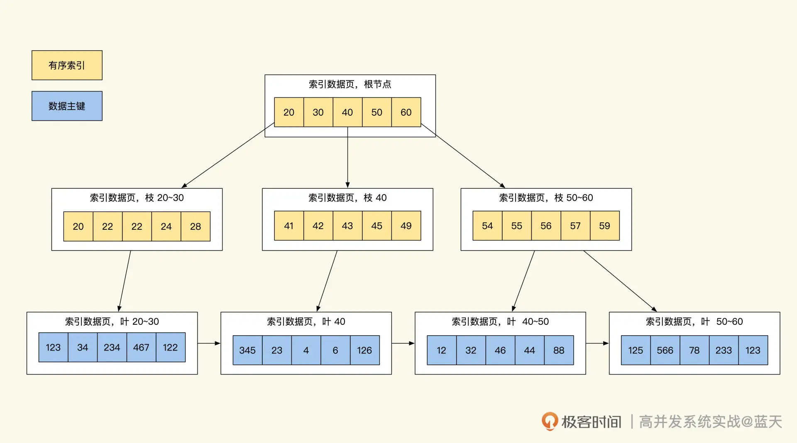
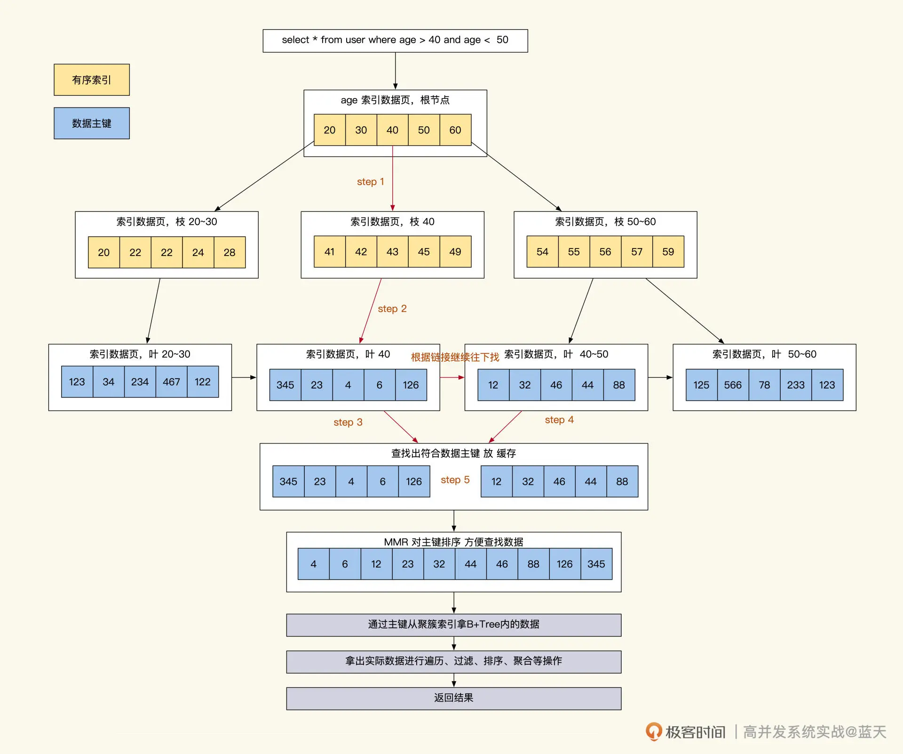
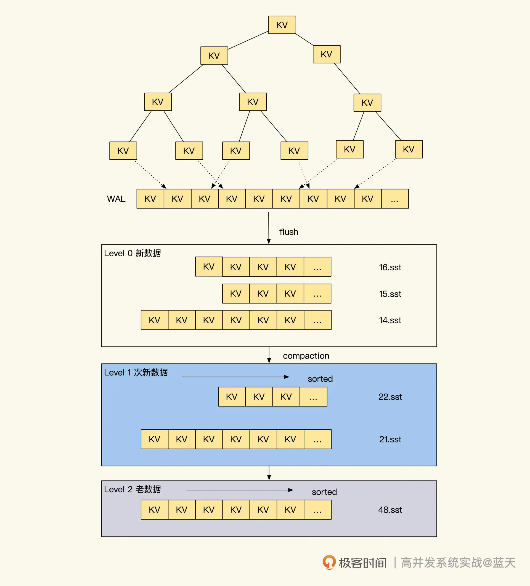
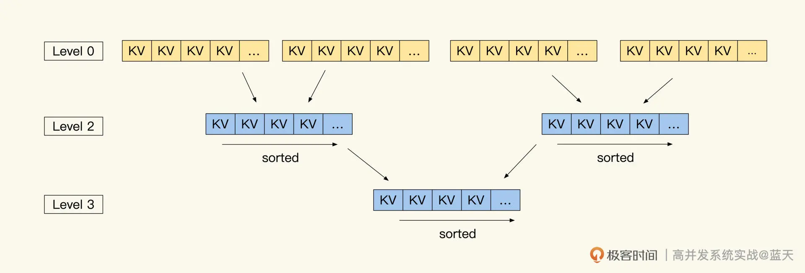
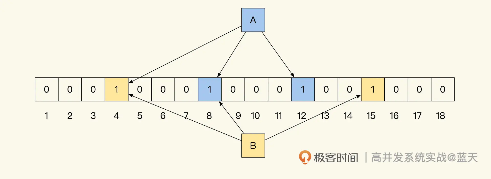
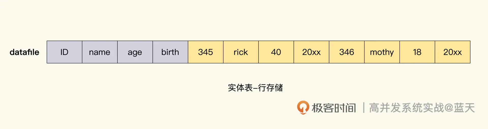
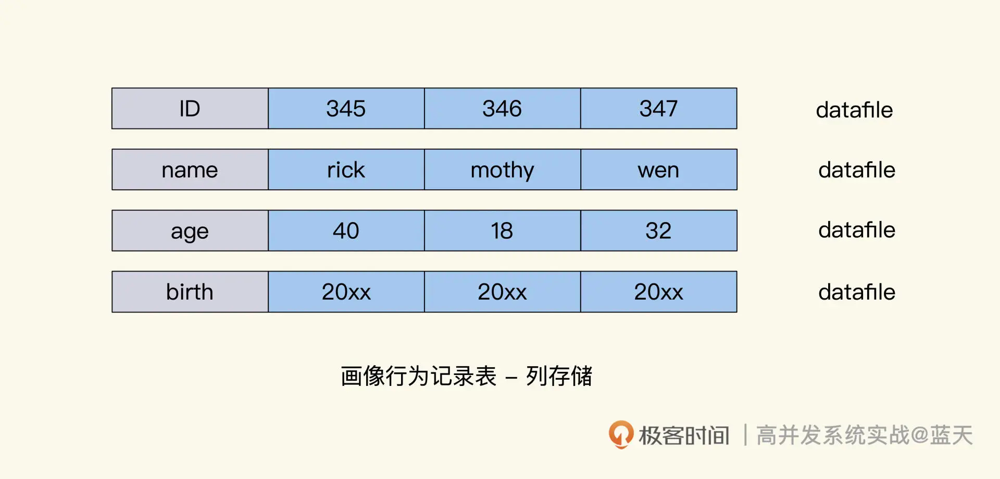
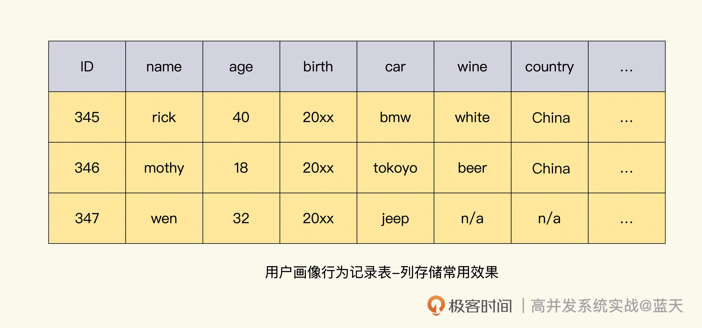

# 10 | 稀疏索引：为什么高并发写不推荐关系数据库？

你好，我是徐长龙。

从这一章起，我们来学习如何优化写多读少的系统。说到高并发写，就不得不提及新分布式数据库 HTAP，它实现了 OLAP 和 OLTP 的融合，可以同时提供数据分析挖掘和关系查询。

事实上，HTAP 的 OLAP 并不是大数据，或者说它并不是我们印象中每天拿几 T 的日志过来用于离线分析计算的那个大数据。这里更多的是指数据挖掘的最后一环，也就是数据挖掘结果对外查询使用的场景。

对于这个范围的服务，在行业中比较出名的实时数据统计分析的服务有 ElasticSearch、ClickHouse，虽然它们的 QPS 不高，但是能够充分利用系统资源，对大量数据做统计、过滤、查询。但是，相对地，为什么 MySQL 这种关系数据库不适合做类似的事情呢？这节课我们一起分析分析。

## B+Tree 索引与数据量

MySQL 我们已经很熟悉了，我们常常用它做业务数据存储查询以及信息管理的工作。相信你也听过“一张表不要超过 2000 万行数据”这句话，为什么会有这样的说法呢？

核心在于 MySQL 数据库的索引，实现上和我们的需求上有些冲突。具体点说，我们对外的服务基本都要求实时处理，在保证高并发查询的同时，还需要在一秒内找出数据并返回给用户，这意味着对数据大小以及数据量的要求都非常高高。

MySQL 为了达到这个效果，几乎所有查询都是通过索引去缩小扫描数据的范围，然后再回到表中对范围内数据进行遍历加工、过滤，最终拿到我们的业务需要的数据。

事实上，并不是 MySQL 不能存储更多的数据，而限制我们的多数是数据查询效率问题。

那么 MySQL 限制查询效率的地方有哪些？请看下图。

众所周知，MySQL 的 InnoDB 数据库的索引是 B+Tree，B+Tree 的特点在于只有在最底层才会存储真正的数据 ID，通过这个 ID 就可以提取到数据的具体内容，同时 B+Tree 索引最底层的数据是按索引字段顺序进行存储的。

通过这种设计方式，我们只需进行 1～3 次 IO（树深度决定了 IO 次数）就能找到所查范围内排序好的数据，而树形的索引最影响查询效率的是树的深度以及数据量（数据越独特，筛选的数据范围就越少）。

数据量我么很好理解，只要我们的索引字段足够独特，筛选出来的数据量就是可控的。

但是什么会影响到索引树的深度个数呢？这是因为 MySQL 的索引是使用 Page 作为单位进行存储的，而每页只能存储 16KB（innodb_page_size）数据。如果我们每行数据的索引是1KB，那么除去 Page 页的一些固定结构占用外，一页只能放 16 条数据，这导致树的一些分支装不下更多数据时，我么就需要对索引的深度再加一层。

我们从这个 Page 就可以推导出：索引第一层放 1280 条，树第二层大概能放 2 万条，树第三层大概能放 2400 万条，三层的深度 B+Tree 按主键查找数据每次查询需要 3 次 IO（一层索引在内存，IO 两次索引，最后一次是拿数据）。

不过这个 2000 万并不是绝对的，如果我们的每行数据是 0.5KB，那么大概在 4000 万以后才会出现第四层深度。而对于辅助索引，一页 Page 能存放 1170 个索引节点（主键 bigint8 字节+ 数据指针 6 字节），三层深度的辅助索引大概能记录 10 亿条索引记录。

可以看到，我们的数据存储数量超过三层时，每次数据操作需要更多的 IO 操作来进行查询，这样做的后果就是查询数据返回的速度变慢。所以，很多互联网系统为了保持服务的高效，会定期整理数据。

通过上面的讲解，相信你已经对整个查询有画面感了：当我们查询时，通过 1～3 次 IO 查找辅助索引，从而找到一批数据主键 ID。然后，通过 MySQL 的 MMR 算法将这些 ID 做排序，再回表去聚簇索引按取值范围提取在子叶上的业务数据，将这些数据边取边算或一起取出再进行聚合排序后，之后再返回结果。

可以看到，我们常用的数据库之所以快，核心在于索引用得好。由于加工数据光用索引是无法完成的，我们还需要找到具体的数据进行再次加工，才能得到我们业务所需的数据，这也是为什么我们的字段数据长度和数据量会直接影响我们对外服务的响应速度。

同时请你注意，我们一个表不能增加过多的索引，因为索引太多会影响到表插入的性能。并且我们的查询要遵循左前缀原则来逐步缩小查找的数据范围，而不能利用多个 CPU 并行去查询索引数据。这些大大限制了我们对大数据的处理能力。

另外，如果有数据持续高并发插入数据库会导致 MySQL 集群工作异常、主库响应缓慢、主从同步延迟加大等问题。从部署结构上来说，MySQL 只有主从模式，大批量的数据写操作只能由主库承受，当我们数据写入缓慢时客户端只能等待服务端响应，严重影响数据写入效率。

看到这里，相信你已经理解为什么关系型数据库并不适合太多的数据，其实 OLAP 的数据库也不一定适合大量的数据，正如我提到的 OLAP 提供的服务很多也需要实时响应，所以很多时候这类数据库对外提供服务的时候，计算用的数据也是做过深加工的。但即使如此，OLAP和 OLTP 底层实现仍旧有很多不同。

我们先来分析索引的不同。OLTP 常用的是 B+Tree，我们知道，B+tree 索引是一个整体的树，当我们的数据量大时会影响索引树的深度，如果深度过高就会严重影响其工作效率。对于大量数据，OLAP 服务会用什么类型的索引呢？

## 稀疏索引 LSM Tree 与存储

这里重点介绍一下 LSM 索引。我第一次见到 LSM Tree 还是从 RocksDB（以及 LevelDB）上看到的，RocksDB 之所以能够得到快速推广并受到欢迎，主要是因为它利用了磁盘顺序写性能超绝的特性，并以较小的性能查询代价提供了写多读少的 KV 数据存储查询服务，这和关系数据库的存储有很大的不同。

为了更好理解，我们详细讲讲 Rocksdb 稀疏索引是如何实现的，如下图所示：

我们前面讲过，B+Tree 是一个大树，它是一个聚合的完整整体，任何数据的增删改都是在这个整体内进行操作，这就导致了大量的随机读写 IO。

RocksDB LSM 则不同，它是由一棵棵小树组成，当我们新数据写入时会在内存中暂存，这样能够获得非常大的写并发处理能力。而当内存中数据积累到一定程度后，会将内存中数据和索引做顺序写，落地形成一个数据块。

这个数据块内保存着一棵小树和具体的数据，新生成的数据块会保存在 Level 0 层（最大有几层可配置），Level 0 层会有多个类似的数据块文件。结构如下图所示：

每一层的数据块和数据量超过一定程度时，RocksDB 合并不同 Level 的数据，将多个数据块内的数据和索引合并在一起，并推送到 Level 的下一层。通过这个方式，每一层的数据块个数和数据量就能保持一定的数量，合并后的数据会更紧密、更容易被找到。

这样的设计，可以让一个 Key 存在于多个 Level 或者数据块中，但是最新的常用的数据肯定是在 Level 最顶部或内存（0～4 层，0 为顶部）中最新的数据块内。

- bloomfilter 能辅助确认数据的**绝对没有**

而当我们查询一个 key 的时候，RocksDB 会先查内存。如果没找到，会从 Level 0 层到下层，每层按生成最新到最老的顺序去查询每层的数据块。同时为了减少 IO 次数，每个数据块都会有一个 BloomFIlter 辅助索引，来辅助确认这个数据块中是否可能有对应的 Key；如果当前数据块没有，那么可以快速去找下一个数据块，直到找到为止。当然，最惨的情况是遍历所有数据块。

可以看到，这个方式虽然放弃了整体索引的一致性，却换来了更高效的写性能。在读取时通过遍历所有子树来查找，减少了写入时对树的合并代价。

LSM 这种方式的数据存储在 OLAP 数据库中很常用，因为 OLAP 多数属于写多读少，而当我们使用 OLAP 对外提供数据服务的时候，多数会通过缓存来帮助数据库承受更大的读取压力。

## 列存储数据库

说到这里，不得不提 OLAP 数据库和 OLTP 数据之间的另一个区别。我们常用的关系型数据库，属于行式存储数据库 Row-based，表数据结构是什么样，它就会按表结构的字段顺序进行存储；而大数据挖掘使用的数据库普遍使用列式存储（Column-based），原因在于我们用关系数据库保存的多数是实体属性和实体关系，很多查询每一列都是不可或缺的。

但是，实时数据分析则相反，很多情况下常用一行表示一个用户或主要实体（聚合根），而列保存这个用户或主要实体是否买过某物、使用过什么 App、去过哪里、开什么车、点过什么食品、哪里人等等。

这样组织出来的数据，做数据挖掘、分析对比很方便，不过也会导致一个表有成百上千个字段，如果用行存储的数据引擎，我们对数据的筛选是一行行进行读取的，会浪费大量的 IO 读取。

而列存储引擎可以指定用什么字段读取所需字段的数据，并且这个方式能够充分利用到磁盘顺序读写的性能，大大提高这种列筛选式的查询，并且列方式更好进行数据压缩，在实时计算领域做数据统计分析的时候，表现会更好。

到了这里相信你已经发现，使用场景不同，数据底层的实现也需要不同的方式才能换来更好的性能和性价比。随着行业变得更加成熟，这些需求和特点会不断挖掘、总结、合并到我们的底层服务当中，逐渐降低我们的工作难度和工作量。

## HTAP

通过前面的讲解，我么可以看到 OLAP 和 OLTP 数据库各有特点，并且有不同的发展方向，事实上它们对外提供的数据查询服务都是期望实时快速的，而不同在于如何存储和查找索引。

最近几年流行将两者结合成一套数据库集群服务，同时提供 OLAP 以及 OLTP 服务，并且相互不影响，实现行数据库与列数据库的互补。

2022 年国产数据库行业内 OceanBase、PolarDB 等云厂商提供的分布式数据库都在紧锣密鼓地开始支持 HTAP。这让我们可以保存同一份数据，根据不同查询的范围触发不同的引擎，共同对外提供数据服务。

可以看到，未来的某一天，我们的数据库既能快速地实时分析，又能快速提供业务数据服务。逐渐地，数据服务底层会出现多套存储、索引结构来帮助我们更方便地实现数据库。

而目前常见的 HTAP 实现方式，普遍采用一个服务集群内同一套数据支持多种数据存储方式（行存储、列存储），通过对数据提供不同的索引来实现 OLAP 及 OLTP 需求，而用户在查询时，可以指定或由数据库查询引擎根据 SQL 和数据情况，自动选择使用哪个引擎来优化查询。

## 总结

这节课，我们讨论了 OLAP 和 OLTP 数据库的索引、存储、数据量以及应用的不同场景。

OLAP 相对于关系数据库的数据存储量会更多，并且对于大量数据批量写入支持很好。很多情况下，高并发批量写数据很常见，其表的字段会更多，数据的存储多数是用列式方式存储，而数据的索引用的则是列索引，通过这些即可实现实时大数据计算结果的查询和分析。

相对于离线计算来说，这种方式更加快速方便，唯一的缺点在于这类服务都需要多台服务器做分布式，成本高昂。

可以看出，我们使用的场景不同决定了我们的数据底层如何去做更高效，HTAP 的出现，让我们在不同的场景中有了更多的选择，毕竟大数据挖掘是一个很庞大的数据管理体系，如果能有一个轻量级的 OLAP，会让我们的业务拥有更多的可能。

## 思考题

最后，请你思考一下：列存储数据库为什么能够提高 OLAP 查找性能？

欢迎你在留言区与我交流讨论，我们下节课见！
