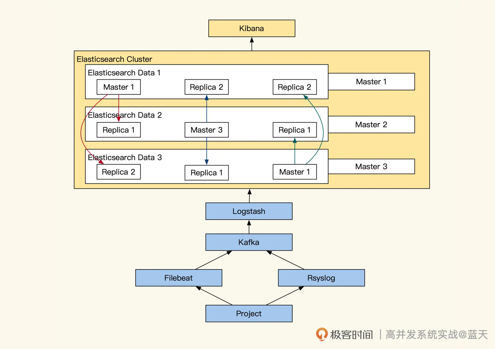
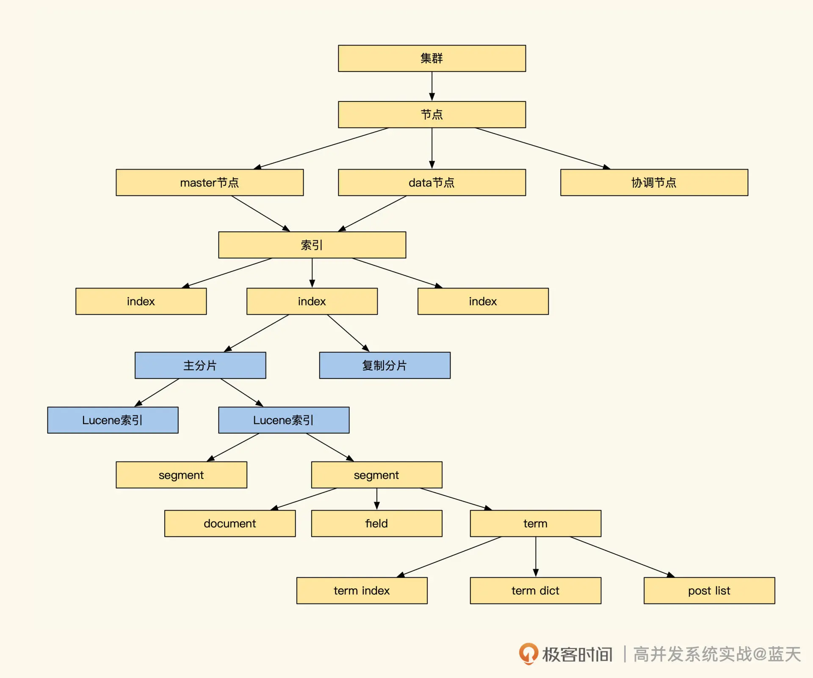
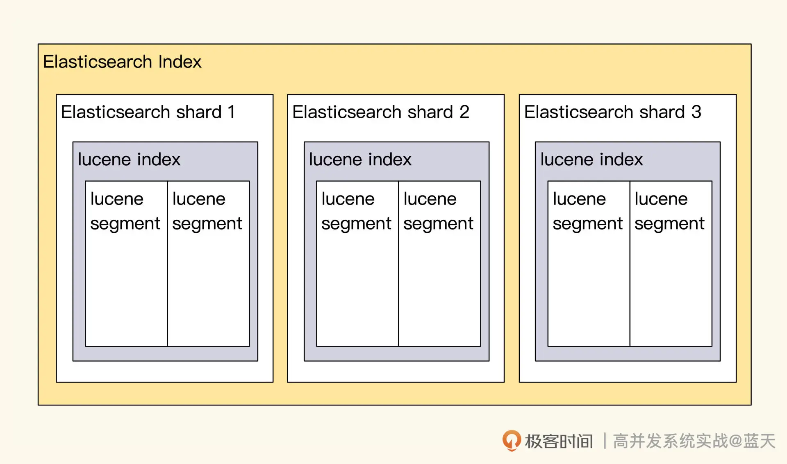
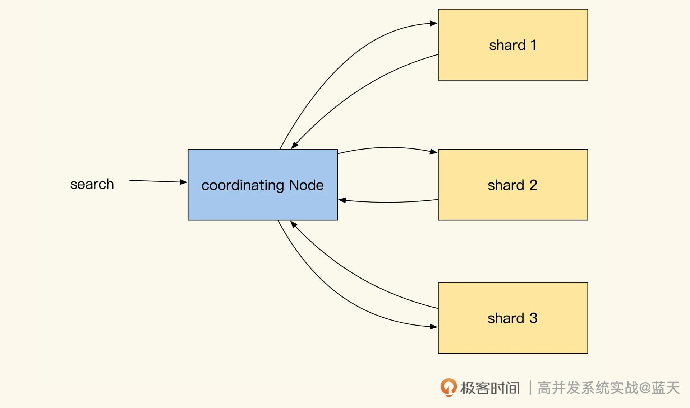
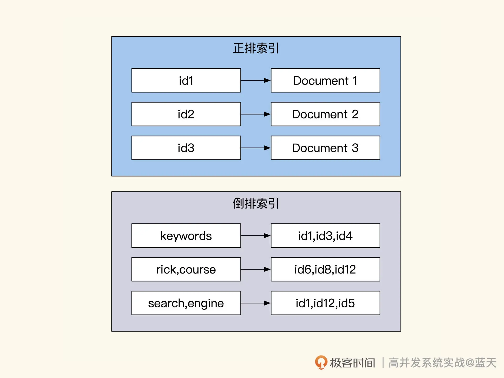
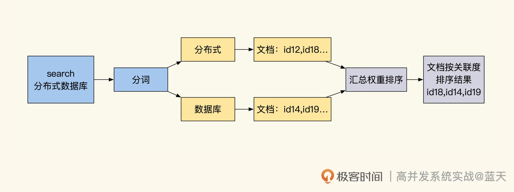
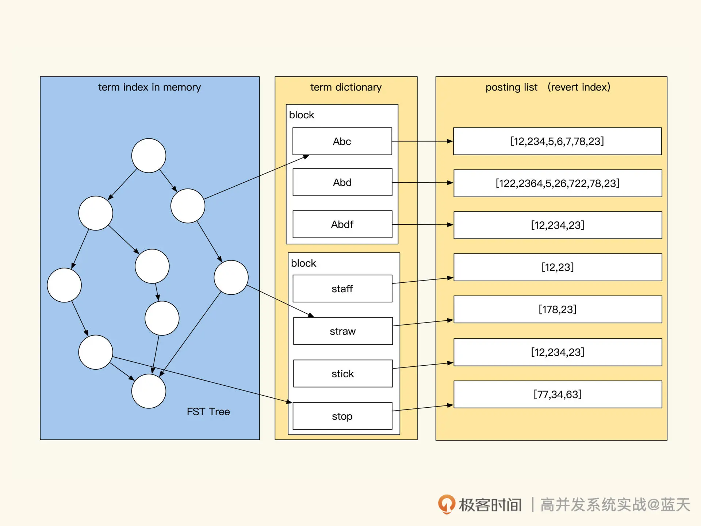

# 12 | 引擎分片：Elasticsearch如何实现大数据检索？

你好，我是徐长龙。

上节课我们看到了 ELK 对日志系统的强大支撑，如果没有它的帮助，我们自己实现分布式链路跟踪其实是十分困难的。

为什么 ELK 功能这么强大？这需要我们了解 ELK 中储存、索引等关键技术点的架构实现才能想清楚。相信你学完今天的内容，你对大数据分布式的核心实现以及大数据分布式统计服务，都会有更深入的理解。

## Elasticsearch 架构

那么 ELK 是如何运作的？它为什么能够承接如此大的日志量？

我们先分析分析 ELK 的架构长什么样，事实上，它和 OLAP 及 OLTP 的实现区别很大，我们一起来看看。Elasticsearch 架构如下图：

- 整体的数据流向图

我们对照架构图，梳理一下整体的数据流向，可以看到，我们项目产生的日志，会通过Filebeat 或 Rsyslog 收集将日志推送到 Kafka 内。然后由 LogStash 消费 Kafka 内的日志、对日志进行整理，并推送到 Elasticsearch 集群内。

接着，日志会被分词，然后计算出在文档的权重后放入索引中供查询检索，Elasticsearch 会将这些信息推送到不同的分片。每个分片都会有多个副本，数据写入时，只有大部分副本写入成功了，主分片才会对索引进行落地（需要你回忆下分布式写一致知识）。

Elasticsearch 集群中服务分多个角色，我带你简单了解一下：

- Master 节点：负责集群内调度决策，集群状态、节点信息、索引映射、分片信息、路由信息，Master 真正主节点是通过选举诞生的，一般一个集群内至少要有三个 Master 可竞选成员，防止主节点损坏（回忆下之前 Raft 知识，不过 Elasticsearch 刚出那会儿还没有 Raft标准）。

- Data 存储节点：用于存储数据及计算，分片的主从副本，热点节点，冷数据节点。

- Client 协调节点：协调多个副本数据查询服务，聚合各个副本的返回结果，返回给客户端。

- Kibana 计算节点：作用是实时统计分析、聚合分析统计数据、图形聚合展示。

实际安装生产环境时，Elasticsearch 最少需要三台服务器，三台中有一台会成为 Master 节点负责调配集群内索引及资源的分配，而另外两个节点会用于 Data 数据存储、数据检索计算，当 Master 出现故障时，子节点会选出一个替代故障的 Master 节点（回忆下分布式共识算法中的选举）。

如果我们的硬件资源充裕，我们可以另外增加一台服务器将 Kibana 计算独立部署，这样会获得更好的数据统计分析性能。如果我们的日志写入过慢，可以再加一台服务器用于 Logstash分词，协助加快 ELK 整体入库的速度。

要知道最近这几年大部分云厂商提供的日志服务都是基于 ELK 实现的，Elasticsearch 已经上市，可见其市场价值。

## Elasticsearch 的写存储机制

下图是 Elasticsearch 的索引存储具体的结构，看起来很庞大，但是别担心，我们只需要关注分片及索引部分即可：

我们再持续深挖一下，Elasticsearch 是如何实现分布式全文检索服务的写存储的。其底层全文检索使用的是 Lucene 引擎，事实上这个引擎是单机嵌入式的，并不支持分布式，分布式功能是基础分片来实现的。

为了提高写效率，常见分布式系统都会先将数据先写在缓存，当数据积累到一定程度后，再将缓存中的数据顺序刷入磁盘。Lucene 也使用了类似的机制，将写入的数据保存在 IndexBuffer 中，周期性地将这些数据落盘到 segment 文件。

再来说说存储方面，Lucene 为了让数据能够更快被查到，基本一秒会生成一个 segment 文件，这会导致文件很多、索引很分散。而检索时需要对多个 segment 进行遍历，如果segment 数量过多会影响查询效率，为此，Lucene 会定期在后台对多个 segment 进行合并。

更多索引细节，我稍后再给你介绍，可以看到 Elasticsearch 是一个 IO 频繁的服务，将新数据放在 SSD 上能够提高其工作效率。

但是 SSD 很昂贵，为此 Elasticsearch 实现了冷热数据分离。我们可以将热数据保存在高性能SSD，冷数据放在大容量磁盘中。

同时官方推荐我们按天建立索引，当我们的存储数据量达到一定程度时，Elasticsearch 会把一些不经常读取的索引挪到冷数据区，以此提高数据存储的性价比。而且我建议你创建索引时按天创建索引，这样查询时。我们可以通过时间范围来降低扫描数据量。

- ES索引组成

另外，Elasticsearch 服务为了保证读写性能可扩容，Elasticsearch 对数据做了分片，分片的路由规则默认是通过日志 DocId 做 hash 来保证数据分布均衡，常见分布式系统都是通过分片来实现读写性能的线性提升。

你可以这样理解：单个节点达到性能上限，就需要增加 Data 服务器节点及副本数来降低写压力。但是，副本加到一定程度，由于写强一致性问题反而会让写性能下降。具体加多少更好呢？这需要你用生产日志实测，才能确定具体数值。

## Elasticsearch 的两次查询

前面提到多节点及多分片能够提高系统的写性能，但是这会让数据分散在多个 Data 节点当中，Elasticsearch 并不知道我们要找的文档，到底保存在哪个分片的哪个 segment 文件中。

所以, 为了均衡各个数据节点的性能压力，Elasticsearch 每次查询都是请求所有索引所在的Data 节点，查询请求时协调节点会在相同数据分片多个副本中，随机选出一个节点发送查询请求，从而实现负载均衡。

而收到请求的副本会根据关键词权重对结果先进行一次排序，当协调节点拿到所有副本返回的文档 ID 列表后，会再次对结果汇总排序，最后才会用 DocId 去各个副本 Fetch 具体的文档数据将结果返回。

可以说，Elasticsearch 通过这个方式实现了所有分片的大数据集的全文检索，但这种方式也同时加大了 Elasticsearch 对数据查询请求的耗时。下图是协调节点和副本的通讯过程：

除了耗时，这个方式还有很多缺点，比如查询 QPS 低；网络吞吐性能不高；协助节点需要每次查询结果做分页；分页后，如果我们想查询靠后的页面，要等每个节点先搜索和排序好该页之前的所有数据，才能响应，而且翻页跨度越大，查询就越慢……

为此，ES 限制默认返回的结果最多 1w 条，这个限制也提醒了我们不能将 Elasticsearch 的服务当作数据库去用。

还有一点实践的注意事项，这种实现方式也导致了小概率个别日志由于权重太低查不到的问题。为此，ES 提供了 search_type=dfs_query_then_fetch 参数来应对特殊情况，但是这种方式损耗系统资源严重，非必要不建议开启。

除此之外，Elasticsearch 的查询有 query and fetch、dfs query and fetch、dfs query thenfetch 三种，不过它们和这节课主线关联不大，有兴趣的话你可以课后自己了解一下。

## Elasticsearch 的倒排索引

我们再谈谈 Elasticsearch 的全文检索的倒排索引。

Elasticsearch 支持多种查询方式不仅仅是全文检索，如数值类使用的是 BKD Tree，Elasticsearch 的全文检索查询是通过 Lucene 实现的，索引的实现原理和 OLAP 的 LSM 及OLTP 的 B+Tree 完全不同，它使用的是倒排索引（Inverted Index）。

- 正排索引及倒排索引

- 查询时多个分词的合并交集

一般来说，倒排索引常在搜索引擎内做全文检索使用，其不同于关系数据库中的 B+Tree 和 B-Tree 。B+Tree 和 B-Tree 索引是从树根往下按左前缀方式来递减缩小查询范围，而倒排索引的过程可以大致分四个步骤：分词、取出相关 DocId、计算权重并重新排序、展示高相关度的记录。

首先，对用户输入的内容做分词，找出关键词；然后，通过多个关键词对应的倒排索引，取出所有相关的 DocId；接下来，将多个关键词设计索引 ID 做交集后，再根据关键词在每个文档的出现次数及频率，以此计算出每条结果的权重，进而给列表排序，并实现基于查询匹配度的评分；然后就可以根据匹配评分来降序排序，列出相关度高的记录。

下面，我们简单看一下 Lucene 具体实现。

- ES的倒排索引原理

如上图，Elasticsearch 集群的索引保存在 Lucene 的 segment 文件中，segment 文件格式相关信息你可以参考 segment 格式，其中包括行存、列存、倒排索引。

为了节省空间和提高查询效率，Lucene 对关键字倒排索引做了大量优化，segment 主要保存了三种索引：

- Term Index（单词词典索引）：用于关键词（Term）快速搜索，Term index 是基础 Trie 树改进的 FST（Finite State Transducer 有限状态传感器，占用内存少）实现的二级索引。平时这个树会放在内存中，用于减少磁盘 IO 加快 Term 查找速度，检索时会通过 FST 快速找到 Term Dictionary 对应的词典文件 block。

- Term Dictionary（单词词典）：单词词典索引中保存的是单词（Term）与 Posting List 的关系，而这个单词词典数据会按 block 在磁盘中排序压缩保存，相比 B-Tree 更节省空间，其中保存了单词的前缀后缀，可以用于近似词及相似词查询，通过这个词典可以找到相关的倒排索引列表位置。

- Posting List（倒排列表）：倒排列表记录了关键词 Term 出现的文档 ID，以及其所在文档中位置、偏移、词频信息，这是我们查找的最终文档列表，我们拿到这些就可以拿去排序合并了。

一条日志在入库时，它的具体内容并不会被真实保存在倒排索引中。

在日志入库之前，会先进行分词，过滤掉无用符号等分隔词，找出文档中每个关键词（Term）在文档中的位置及频率权重；然后，将这些关键词保存在 Term Index 以及 Term Dictionary内；最后，将每个关键词对应的文档 ID 和权重、位置等信息排序合并到 Posting List 中进行保存。通过上述三个结构就实现了一个优化磁盘 IO 的倒排索引。

而查询时，Elasticsearch 会将用户输入的关键字通过分词解析出来，在内存中的 Term Index单词索引查找到对应 Term Dictionary 字典的索引所在磁盘的 block。接着，由 TermDictionary 找到对关键词对应的所有相关文档 DocId 及权重，并根据保存的信息和权重算法对查询结果进行排序返回结果。

## 总结

不得不感叹，Elasticsearch 通过组合一片片小 Lucene 的服务，就实现了大型分布式数据的全文检索。这无论放到当时还是现在，都很不可思议。可以说了，Elasticsearch 几乎垄断了所有日志实时分析、监控、存储、查找、统计的市场，其中用到的技术有很多地方可圈可点。

现在市面上新生代开源虽然很多，但是论完善性和多样性，能够彻底形成平台性支撑的开源仍然很少见。而 Elasticsearch 本身是一个十分庞大的分布式检索分析系统，它对数据的写入和查询做了大量的优化。

我希望你关注的是，Elasticsearch 用到了大量分布式设计思路和有趣的算法，比如：分布式共识算法（那时还没有 Raft）、倒排索引、词权重、匹配权重、分词、异步同步、数据一致性检测等。这些行业中的优秀设计，值得我们做拓展了解，推荐你课后自行探索。

## 思考题

如果让你实现一个 Elasticsearch，你觉得需要先解决的核心功能是什么？

欢迎你在评论区与我交流讨论，我们下节课见！
