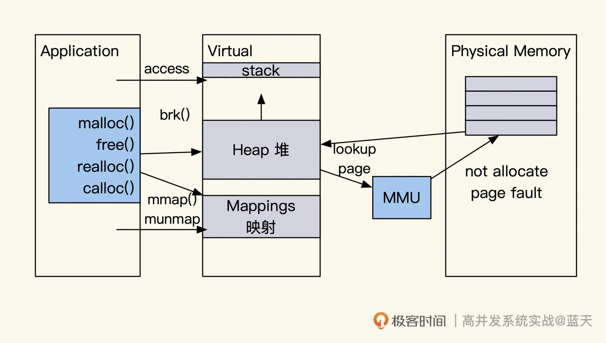
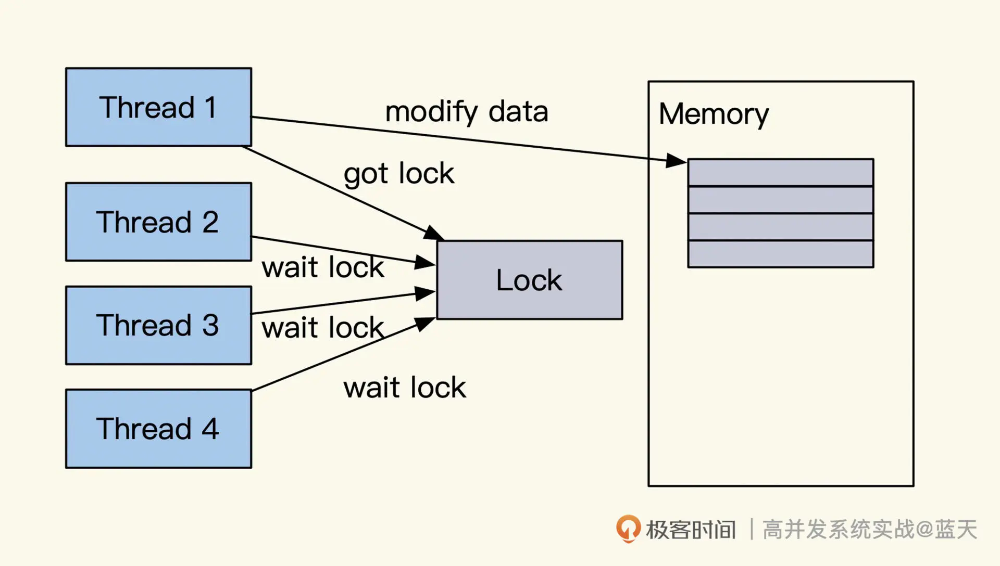
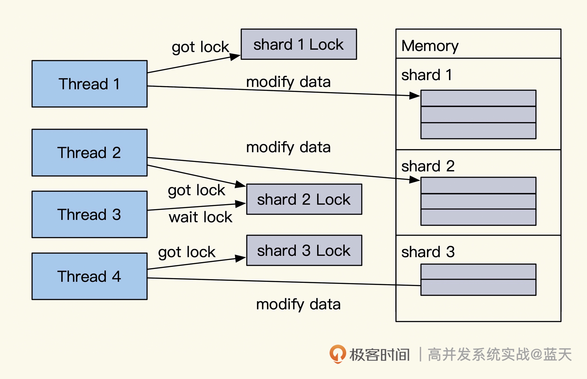
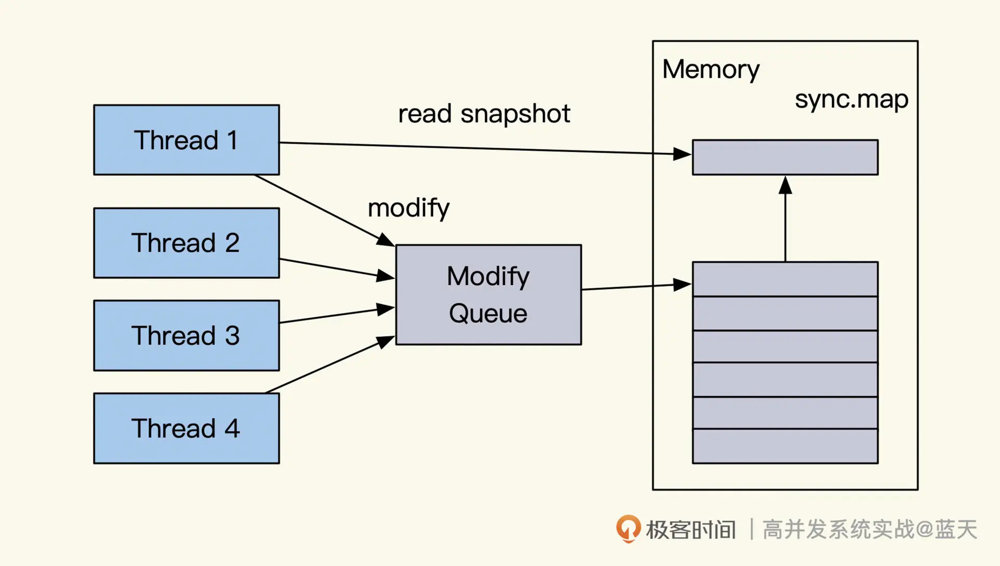
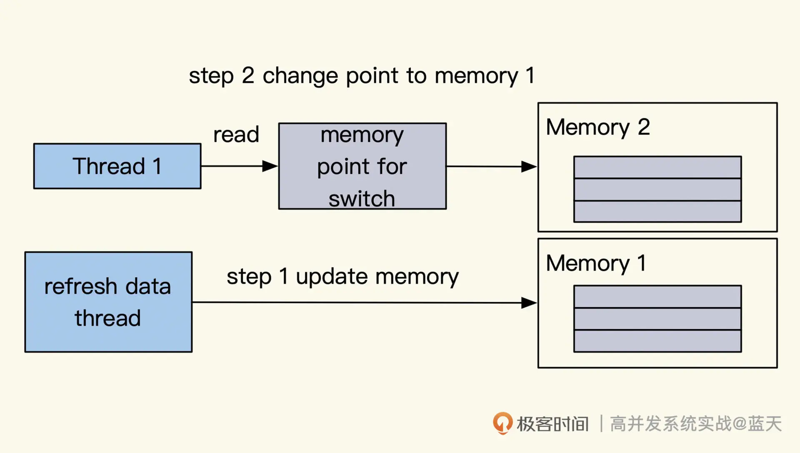
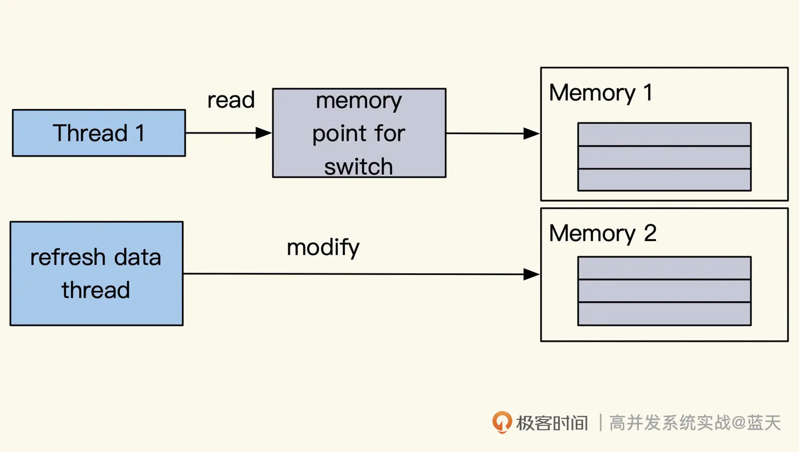
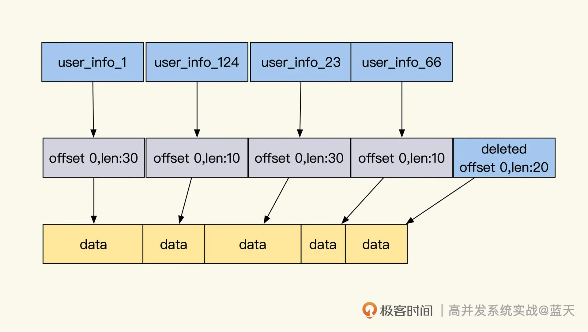
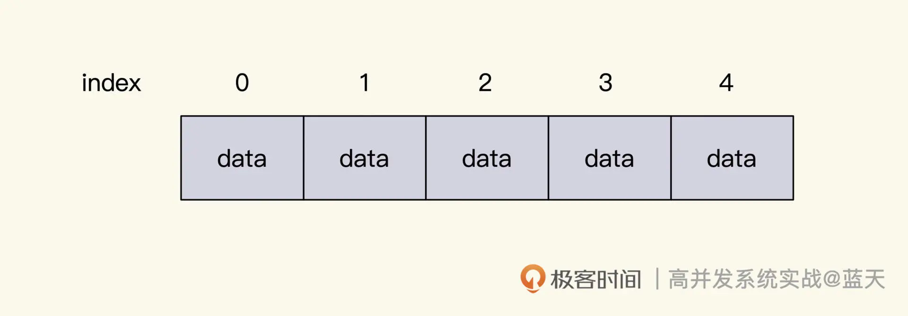
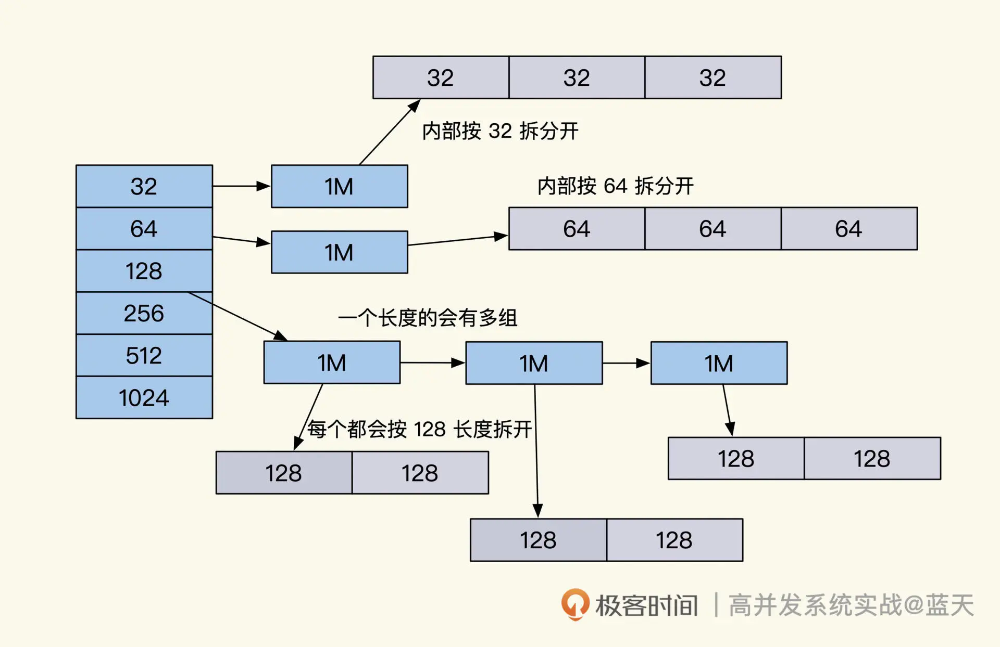
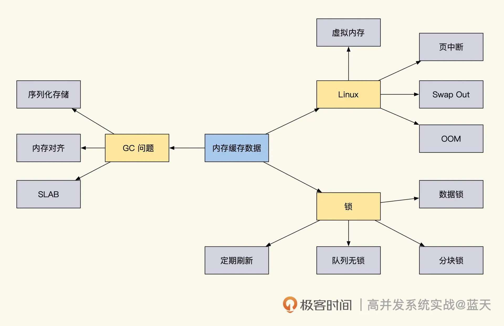

# 16 | 本地缓存：用本地缓存做服务会遇到哪些坑？

你好，我是徐长龙。

这一章我们来学习如何应对读多写多的系统。微博 Feed、在线游戏、IM、在线课堂、直播都属于读多写多的系统，这类系统里的很多技术都属于行业天花板级别，毕竟线上稍有点问题，都极其影响用户体验。

说到读多写多不得不提缓存，因为目前只有缓存才能够提供大流量的数据服务，而常见的缓存架构，基本都会使用集中式缓存方式来对外提供服务。

但是，集中缓存在读多写多的场景中有上限，当流量达到一定程度，集中式缓存和无状态服务的大量网络损耗会越来越严重，这导致高并发读写场景下，缓存成本高昂且不稳定。

为了降低成本、节省资源，我们会在业务服务层再增加一层缓存，放弃强一致性，保持最终一致性，以此来降低核心缓存层的读写压力。

## 虚拟内存和缺页中断

想做好业务层缓存，我们需要先了解一下操作系统底层是如何管理内存的。

对照后面这段 C++ 代码，你可以暂停思考一下，这个程序如果在环境不变的条件下启动多次，变量内存地址输出是什么样的？

```javascript
int testvar = 0;
int main(int argc, char const *argv[])
{
 testvar += 1;
 sleep(10);
 printf("address: %x, value: %d\n", &testvar, testvar );
 return 0;
}
```

答案可能出乎你的意料，试验一下，你就会发现变量内存地址输出一直是固定的，这证明了程序见到的内存是独立的。如果我们的服务访问的是物理内存，就不会发生这种情况。

为什么结果是这样呢？这就要说到 Linux 的内存管理方式，它用虚拟内存的方式管理内存，因此每个运行的进程都有自己的虚拟内存空间。

回过头来看，我们对外提供缓存数据服务时，如果想提供更高效的并发读写服务，就需要把数据放在本地内存中，一般会实现为一个进程内的多个线程来共享缓存数据。不过在这个过程中，我们还会遇到缺页问题，我们一起来看看。



- 虚拟内存及 page fault

如上图所示，我们的服务在 Linux 申请的内存不会立刻从物理内存划分出来。系统数据修改时，才会发现物理内存没有分配，此时 CPU 会产生缺页中断，操作系统才会以 page 为单位把物理内存分配给程序。系统这么设计，主要是为了降低系统的内存碎片，并且减少内存的浪费。

不过系统分配的页很小，一般是 4KB，如果我们一次需要把 1G 的数据插入到内存中，写入数据到这块内存时就会频繁触发缺页中断，导致程序响应缓慢、服务状态不稳定的问题。

所以，当我们确认需要高并发读写内存时，都会先申请一大块内存并填 0，然后再使用，这样可以减少数据插入时产生的大量缺页中断。我额外补充一个注意事项，这种申请大内存并填 0的操作很慢，尽量在服务启动时去做。

前面说的操作虽然立竿见影，但资源紧张的时候还会有问题。现实中很多服务刚启动就会申请几 G 的内存，但是实际运行过程中活跃使用的内存不到 10%，Linux 会根据统计将我们长时间不访问的数据从内存里挪走，留出空间给其他活跃的内存使用，这个操作叫 Swap Out。

为了降低 Swap Out 的概率，就需要给内存缓存服务提供充足的内存空间和系统资源，让它在一个相对专用的系统空间对外提供服务。

但我们都知道内存空间是有限的，所以需要精心规划内存中的数据量，确认这些数据会被频繁访问。我们还需要控制缓存在系统中的占用量，因为系统资源紧张时 OOM 会优先杀掉资源占用多的服务，同时为了防止内存浪费，我们需要通过 LRU 淘汰掉一些不频繁访问的数据，这样才能保证资源不被浪费。

即便这样做还可能存在漏洞，因为业务情况是无法预测的。所以建议对内存做定期扫描续热，以此预防流量突增时触发大量缺页中断导致服务卡顿、最终宕机的情况。

## 程序容器锁粒度

除了保证内存不放冷数据外，我们放在内存中的公共数据也需要加锁，如果不做互斥锁，就会出现多线程修改不一致的问题。

如果读写频繁，我们常常会对相应的 struct 增加单条数据锁或 map 锁。但你要注意，锁粒度太大会影响到我们的服务性能。

因为实际情况往往会和我们预计有一些差异，建议你在具体使用时，在本地多压测测试一下。就像我之前用 C++ 11 写过一些内存服务，就遇到过读写锁性能反而比不上自旋互斥锁，还有压缩传输效率不如不压缩效率高的情况。

那么我们再看一下业务缓存常见的加锁方式。



- 多线程修改一个数据，配一个锁

为了减少锁冲突，我常用的方式是将一个放大量数据的经常修改的 map 拆分成 256 份甚至更多的分片，每个分片会有一个互斥锁，以此方式减少锁冲突，提高并发读写能力。



- 多线程 多个分块锁

除此之外还有一种方式，就是将我们的修改、读取等变动只通过一个线程去执行，这样能够减少锁冲突加强执行效率，我们常用的 Redis 就是使用类似的方式去实现的，如下图所示：



- 单线程更新，配合 sync.map

如果我们接受半小时或一小时全量更新一次，可以制作 map，通过替换方式实现数据更新。

具体的做法是用两个指针分别指向两个 map，一个 map 用于对外服务，当拿到更新数据离线包时，另一个指针指向的 map 会加载离线全量数据。加载完毕后，两个 map 指针指向互换，以此实现数据的批量更新。这样实现的缓存我们可以不加互斥锁，性能会有很大的提升。



- 第一步，更新内存 1，并切换阅读指针



- 切换后效果，对外提供 memory 1 的数据，开始更新内存 2

当然行业也存在一些无锁的黑科技，这些方法都可以减少我们的锁争抢，比如 atomic、Go 的sync.Map、sync.Pool、Java 的 volidate。感兴趣的话，你可以找自己在用的语言查一下相关知识。除此之外，无锁实现可以看看 MySQL InnoDB 的 MVCC。

## GC 和数据使用类型

当做缓存时，我们的数据 struct 直接放到 map 一类的容器中就很完美了吗？事实上我并不建议这么做。这个回答可能有些颠覆你的认知，但看完后面的分析你就明白了。

当我们将十万条数据甚至更多的数据放到缓存中时，编程语言的 GC 会定期扫描这些对象，去判断这些对象是否能够回收。这个机制导致 map 中的对象越多，服务 GC 的速度就会越慢。

因此，很多语言为了能够将业务缓存数据放到内存中，做了很多特殊的优化，这也是为什么高级语言做缓存服务时，很少将数据对象放到一个大 map 中。

这里我以 Go 语言为例带你看看。为了减少扫描对象个数，Go 对 map 做了一个特殊标记，如果 map 中没有指针，则 GC 不会遍历它保存的对象。

为了方便理解举个例子：我们不再用 map 保存具体的对象数据，只是使用简单的结构作为查询索引，如使用 map[int]int，其中 key 是 string 通过 hash 算法转成的 int，value 保存的内容是数据所在的 offset 和长度。

对数据做了序列化后，我们会把它保存在一个很长的 byte 数组中，通过这个方式缓存数据，但是这个实现很难删除修改数据，所以删除的一般只是 map 索引记录。



- 索引、位置映射和保存在数组的数据关系

这也导致了我们做缓存时，要根据缓存的数据特点分情况处理。

如果我们的数据量少，且特点是读多写多（意味着会频繁更改），那么将它的 struct 放到 map中对外服务更合理；如果我们的数据量大，且特点是读多写少，那么把数据放到一个连续内存中，通过 offset 和 length 访问会更合适。

分析了 GC 的问题之后，相信你已经明白了很多高级语言宁可将数据放到公共的基础服务中，也不在本地做缓存的原因。

如果你仍旧想这么做，这里我推荐一个有趣的项目 XMM 供你参考，它是一个能躲避Golang GC 的内存管理组件。事实上，其他语言也存在类似的组件，你可以自己探索一下。

## 内存对齐

前面提到，数据放到一块虚拟地址连续的大内存中，通过 offse 和 length 来访问不能修改的问题，这个方式其实还有一些提高的空间。

在讲优化方案前，我们需要先了解一下内存对齐，在计算机中很多语言都很关注这一点，究其原因，内存对齐后有很多好处，比如我们的数组内所有数据长度一致的话，就可以快速对其定位。

举个例子，如果我想快速找到数组中第 6 个对象，可以用如下方式来实现：

sizeof(obj) * index => offset

使用这个方式，要求我们的 struct 必须是定长的，并且长度要按 2 的次方倍数做对齐。另外，也可以把变长的字段，用指针指向另外一个内存空间



通过这个方式，我们可以通过索引直接找到对象在内存中的位置，并且它的长度是固定的，无需记录 length，只需要根据 index 即可找到数据。

这么设计也可以让我们在读取内存数据时，能快速拿到数据所在的整块内存页，然后就能从内存快速查找要读取索引的数据，无需读取多个内存页，毕竟内存也属于外存，访问次数少一些更有效率。这种按页访问内存的方式，不但可以快速访问，还更容易被 CPU L1、L2 缓存命中。

## SLAB 内存管理

除了以上的方式外，你可能好奇过，基础内存服务是怎么管理内存的。我们来看后面这个设计。



如上图，主流语言为了减少系统内存碎片，提高内存分配的效率，基本都实现了类似Memcache 的伙伴算法内存管理，甚至高级语言的一些内存管理库也是通过这个方式实现的。

我举个例子，Redis 里可以选择用 jmalloc 减少内存碎片，我们来看看 jmalloc 的实现原理。

jmalloc 会一次性申请一大块儿内存，然后将其拆分成多个组，为了适应我们的内存使用需要，会把每组切分为相同的 chunk size，而每组的大小会逐渐递增，如第一组都是 32byte，第二组都是 64byte。

需要存放数据的时候，jmalloc 会查找空闲块列表，分配给调用方，如果想放入的数据没找到相同大小的空闲数据块，就会分配容量更大的块。虽然这么做有些浪费内存，但可以大幅度减少内存的碎片，提高内存利用率。

很多高级语言也使用了这种实现方式，当本地内存不够用的时候，我们的程序会再次申请一大块儿内存用来继续服务。这意味着，除非我们把服务重启，不然即便我们在业务代码里即使释放了临时申请的内存，编程语言也不会真正释放内存。所以，如果我们使用时遇到临时的大内存申请，务必想好是否值得这样做。

## 总结

学完这节课，你应该明白，为什么行业中，我们都在尽力避免业务服务缓存应对高并发读写的情况了。

因为我们实现这类服务时，不但要保证当前服务能够应对高并发的网络请求，还要减少内部修改和读取导致的锁争抢，并且要关注高级语言 GC 原理、内存碎片、缺页等多种因素，同时我们还要操心数据的更新、一致性以及内存占用刷新等问题。



即便特殊情况下我们用上了业务层缓存的方式，在业务稳定后，几乎所有人都在尝试把这类服务做降级，改成单纯的读多写少或写多读少的服务。

更常见的情况是，如果不得不做，我们还可以考虑在业务服务器上启动一个小的 Redis 分片去应对线上压力。当然这种方式，我们同样需要考虑清楚如何做数据同步。

除了今天讲的踩坑点，内存对外服务的过程中，我们还会碰到一些其他问题，我们下节课再展开。

## 思考题

使用了大数组来保存数据，用 offset+length 实现的数据缓存，有什么办法修改数据？

欢迎你在评论区与我交流讨论，我们下节课见！
