# 多层依赖：如何避免落入数据服务接口的陷阱？

你好，我是徐长龙。

在之前的课程里，我们探讨了读多写少、强一致、写多读少、读多写多这四种常见类型的系统如何优化。不过，很多复杂业务系统中，读写逻辑常常混合在一起、相互牵制，这给优化工作带来了很多挑战。

碰上这样的情况，我们不妨考虑一种更高级的拆分模式——CQRS。你可能对 CQRS 早有耳闻，但觉得太过复杂就望而却步了。不过别担心，这节课里我会结合例子，带你看看传统单体服务架构与 CQRS 的思考方式有什么不同。

学完今天的内容，你将会深入理解 CQRS 的拆分思想，找到规避数据服务接口陷阱的方法，还能理解一些反常识的设计，比如微服务里为什么要把 5 个项目拆成 200 个。

## 传统单体架构缺点

我们先看看熟悉的传统单体架构设计思路，重点关注一下它有什么缺点，这有助于你理解为什么会出现 CQRS 这种模式。

这里我们继续沿用前面课程里用户中心的案例，请看下图。图里面展示了单体服务状态下的用户中心，这时候高频和低频的读写服务放在了一起。

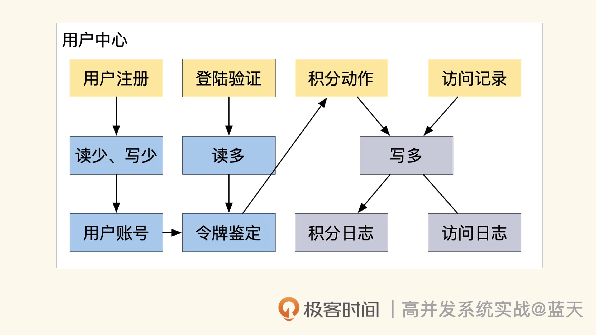

- 单体服务 高频、低频的读写服务放在一起

在我们的印象中，用户中心读并发流量大。但实际上用户中心里，不是所有功能都是读多写少类型的，你可以参考后面表格列出的例子。

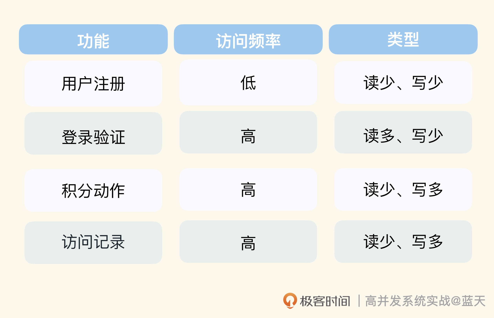

可以看到，除了读多写少的服务功能外，还有很多其它类型的功能（事实上这取决于调用方的场景）。

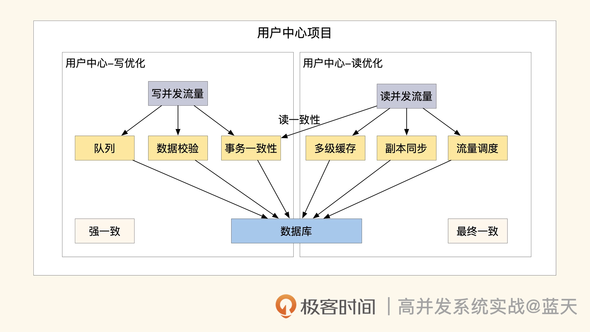

- 传统单体架构优化方式

上面这张图我为你梳理了传统单体架构的优化方式，从中我们很容易看出读写优化方向上的差异。

先看高并发里的写优化，常见的写操作需要使用队列做缓冲，还要保证数据的一致性。在一些特殊的业务场景中，为确保分布式事务的一致性，写操作服务器数量不能太多，因为参与事务协调的机器越多，速度越慢。

而读优化的方向主要是通过大量部署服务器来分摊请求压力，常见的策略是将高频率访问的数据做多副本缓存。由于读操作的服务会占用大量内存，数据层连接更多，再加上请求压力大，所以我们的部署也必须支持数据层和服务的动态扩容。

分析到这里我们发现，在单体架构里同时优化读和写两种操作时，很难在成本和性能之间找到一种平衡。

单体服务架构除了读写优化方向不一致的缺陷，数据库层面也有缺陷。如图所示，单体架构中的读和写的服务都依赖于同一个数据库，所以这种架构一套数据层的性能上限就是集群的性能上限。而且，共用一份数据库的习惯，会导致代码层和数据层不自觉地强绑定。一旦未来业务流量增加的话，我们需要扩容或更换数据层时就会很麻烦。

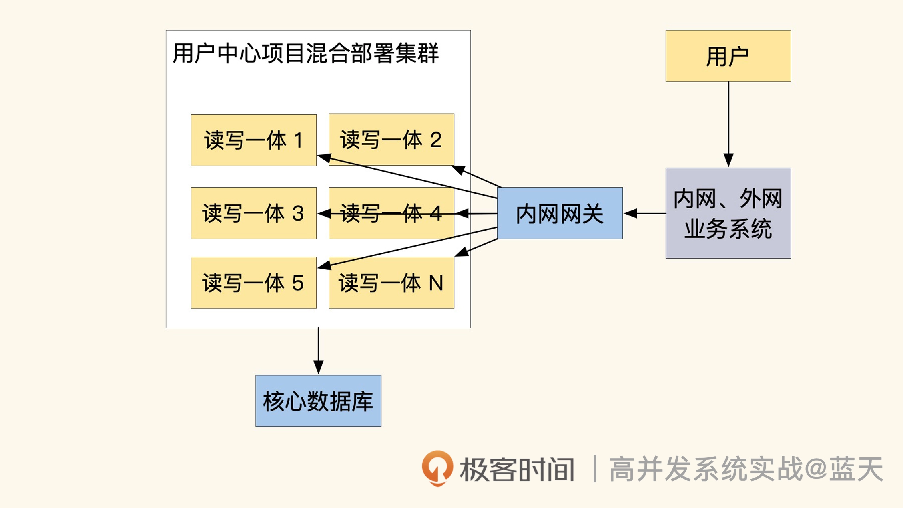

- 读写共用一份数据库

既然单体服务读写混合部署这么复杂，有没有更简单的解决方案呢？这时 CQRS 就能派上用场了。

## CQRS 的读写拆分策略

CQRS，全称是 Command Query Responsibility Segregation。它是一种分离应用程序中命令（Commands）和查询（Queries）责任的方式。对于 CQRS 的规范和详细理论，你感兴趣的话可以课后自学，这里我们把焦点放在读写拆分这方面。

CQRS 让我觉得最有趣的地方，就是把读和写分别拆分成不同项目这件事，可以说这很“微服务”。我们继续结合用户中心的案例来对比分析。

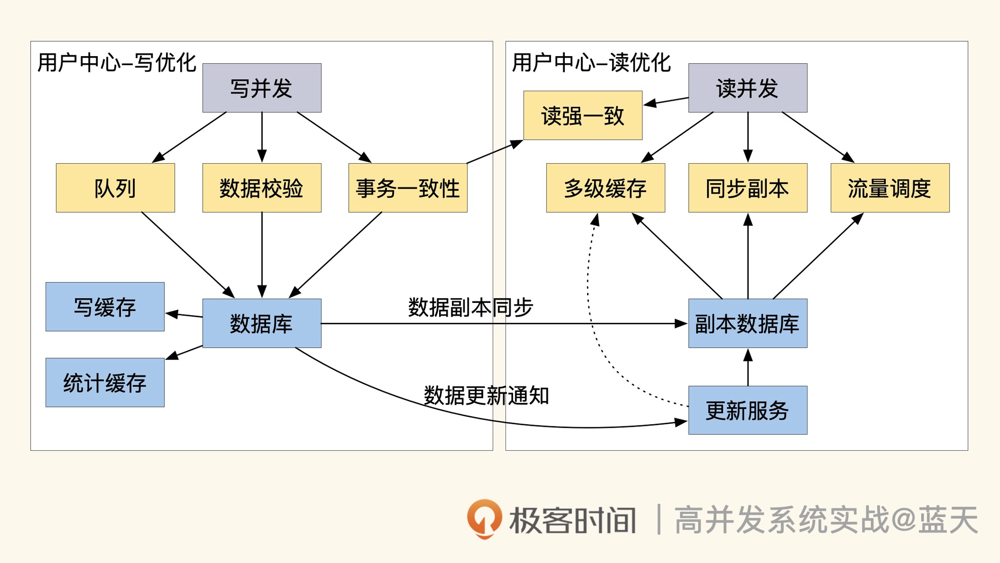

- 读写优化分离

对照示意图可以看到，我们按照高并发写入和高并发读取服务这两个类别，拆分了用户中心的业务，将其分别部署到两个独立的项目中。

拆分以后，读和写的优化就会变得更灵活、让我们的成本的投入更加精准。我们可以根据流量的变化调整服务器和基础支撑服务的规模，这大大节约了运维成本，减轻了服务压力。另外，拆分还有利于提升读写数据库性能，扩大辅助数据层的选择范围，方便我们选用一些特殊的数据层服务（比如 ElasticSearch、ClickHouse、NoSQL）。

如果你留心观察，就能在一些流行的分布式数据服务里看到类似拆分读写的实现。

稍微总结一下，CQRS 能帮我们实现读写优化分离部署，充分发挥读写优化混合的优势，让系统拥有灵活的扩容能力。我们还可以在此基础上，把通用的读写操作封装成标准模块，这样的标准封装有助于提升优化效率，当业务复用这些模块时，直接就会拥有动态扩容能力。

不过，读写拆分这种方式代价不小，除非是核心业务，否则不建议大规模使用这个方式。因为这些技巧对运维要求很高，需要运维配合更改基础组件的配置、调整相应的服务。

就拿拆分后的数据同步来说，我们一般会用队列实现，比如选择类似 binlog 的数据同步队列以及业务变更广播。通常这些同步不需要写代码，而是借助基础服务实现，但对于运维来说，如果没有基础服务修改的自动化工具，每次扩容都要人工调整，不光过程繁琐，而且很容易出错。

除了同步以外，很多业务场景还需要读强一致，拆分后的架构很难满足这个需求，这里推荐你建设一个类似于 Raft 的、读强一致的 Proxy。通过 Proxy 可以让我们业务轻松拿到最新的数据。

## 数据服务接口导致的多层依赖

高并发的业务常常很复杂，而 CQRS 比较适合拆分和优化数据接口，但对于复杂的业务接口我们还要做更多处理。想要理解这一点，先要审视一下我们的编程习惯。

很多人认为，把业务接口写成数据接口这个方式是衡量服务是否灵活的标准，甚至催生出RESTful 这种 API 设计思路，我们看一个例子。

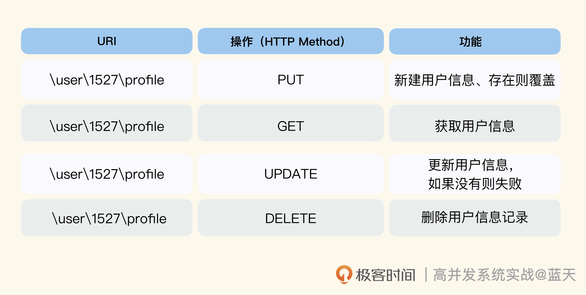

观察上面的网址，可以发现 RESTful 是围绕数据实体来设计的数据服务。这么做虽然方便快速迭代，但很容易让上层业务依赖底层的数据结构，而且接口的隔离性很差，修改的时候影响范围很大。

不仅如此，围绕数据实体去设计接口还会带来更多的问题。下图是一个常见的在线商城服务，可以看到每个具体业务应用（蓝色方块）都是通过拼合多个 Service 服务实现的。

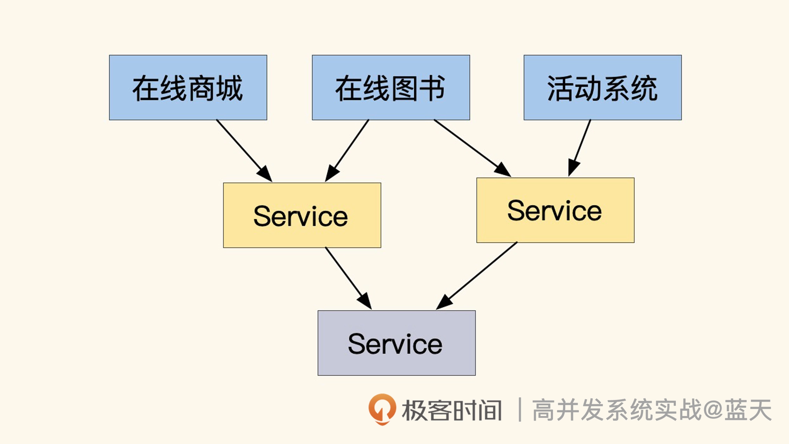

- 多层 MVC 项目依赖

这种结构日常运转没什么问题，但一旦流量增大，对 QPS 要求更高的时候，这个结构就会有大量的网络损耗，接口的请求耗时链路分析如下图。

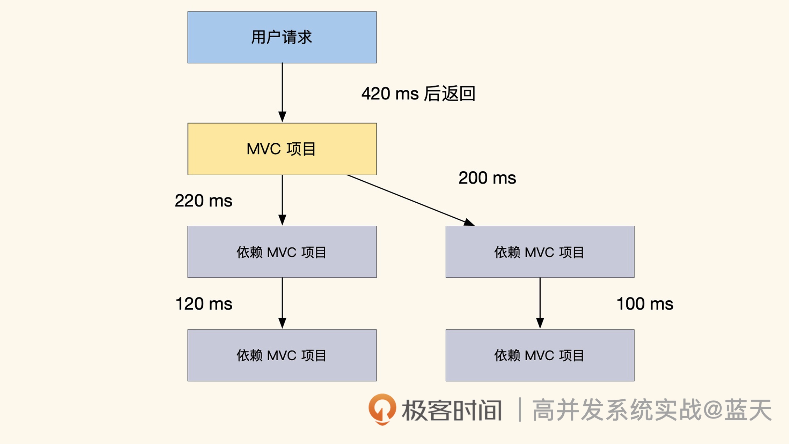

- 依赖越多，系统越慢

我们的接口总返回时间是 420ms，被请求的服务依赖两个 Service 服务，这两个服务又分别依赖一个服务，很明显这种依赖的关系消耗了大量的时间。在这种情况下，用缓存来降低底层服务接口调用次数可以提高接口的性能，但这种方式终究是只能优化一部分非强一致读的服务，而且可能会引发缓存混乱等维护难题。

我们再回想下，为什么我们写项目的时候都会自发地多封一层 Service，并将 Model 层设计成多层目录呢？

其实就是因为多层依赖的情况我们经常碰到，但是实体关系实现又很复杂，一层 Model 放不下，所以我们就会不自觉地这样优化。

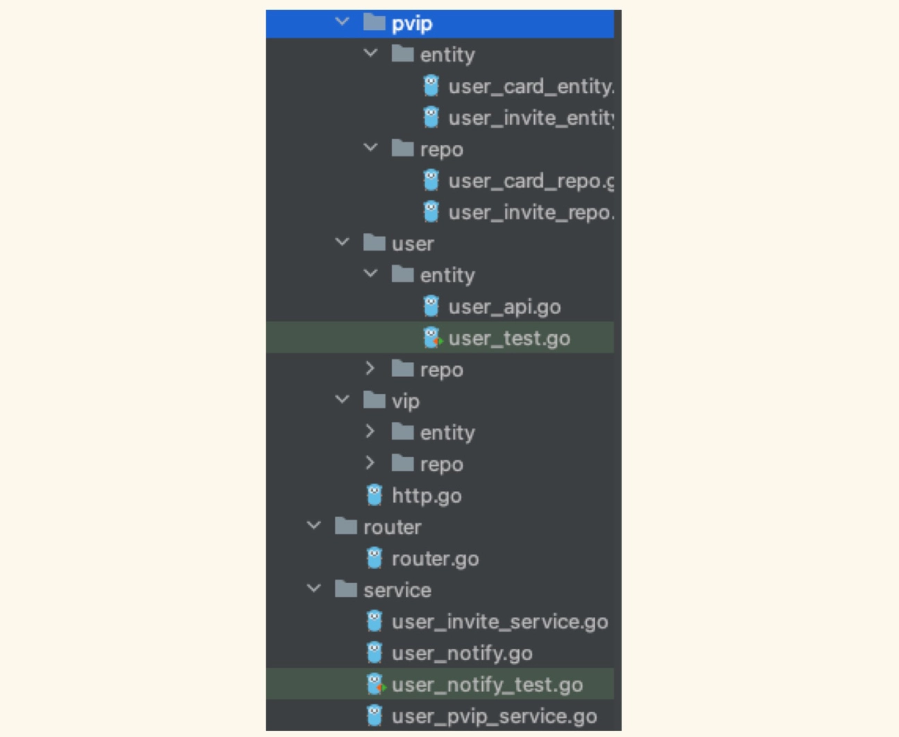

- 深层级的 Model 层和 Service 层

如果是大型系统，业务实体关系更多、更复杂，那么反映在代码上就会有更多的层级。当我们的系统复杂到一定程度，就会出现多层项目依赖问题，呈现出下图所示的“搭乐高”状态。

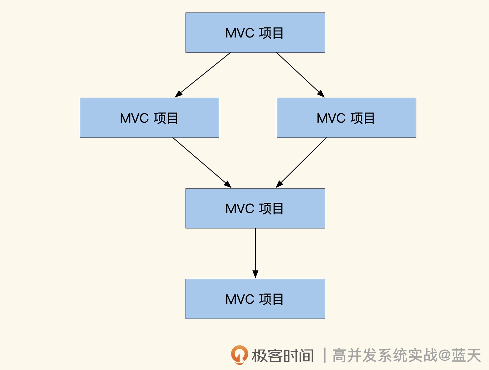

- 糟糕的多层项目依赖

可以说，这就是用数据实体思路设计接口的缺点，也是贫血模型的缺点。为了避免这种搭乐高的情况，项目初期我们会尽量将这个依赖在 Model 层内实现。但是内部如何分层、功能怎么拆分，并没有一个可参考的标准，所以团队之间总是各写各的，很难达成一致，后续优化和维护成本很高。

为了更好地解决多层依赖问题，我们来看看充血模型的解决方案。为了方便你理解，我们结合接口的实现直观对比一下。

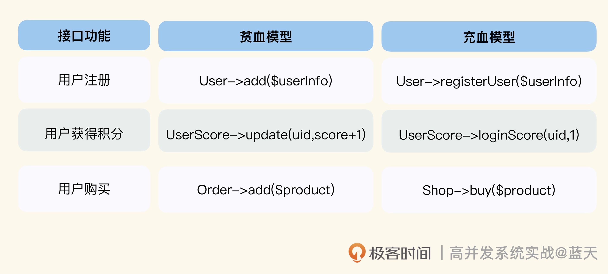

可以看到，和贫血模型直接写增删改查不同，充血模型通过拼合多个实体的功能直接提供业务服务。

同时，为了更好地拆分复杂的依赖实体关系，充血模型按业务领域划分了 Model 层，每个领域会包含更多的子领域，这会导致模型内实现有更多的分层。但是因为模型内的实体实现都是业务操作，这样项目之间接口只有业务依赖关系，而不是数据依赖。业务依赖关系的接口之间只有流程和事务的拼接，访问频率也不会那么高，可以很好地缓解系统压力。

## 微服务的平层设计

不过，即使我们使用了充血模型，仍然会有一些公共数据存在多层依赖的情况。为此，微服务做出了新尝试，直接去掉所有服务的层级，设计成大平层的架构。

如果你曾经翻过一些微服务资料，可能会疑惑微服务的设计为什么和我们的习惯差异这么大？比如几个小接口就能封装成一个项目，再比如服务之间的依赖不是树形而是星状。

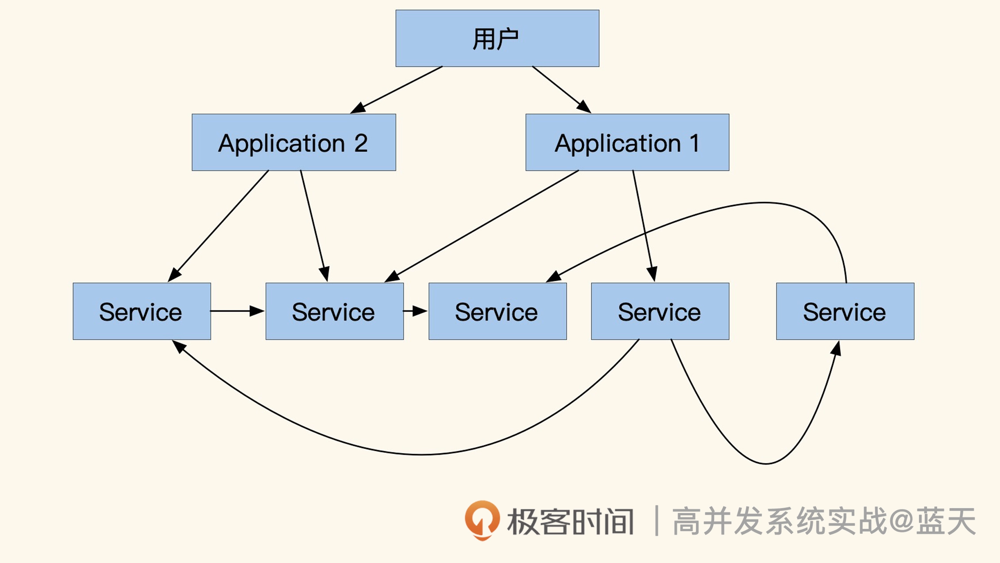

- 微服务没有层级，所有服务都是平级的

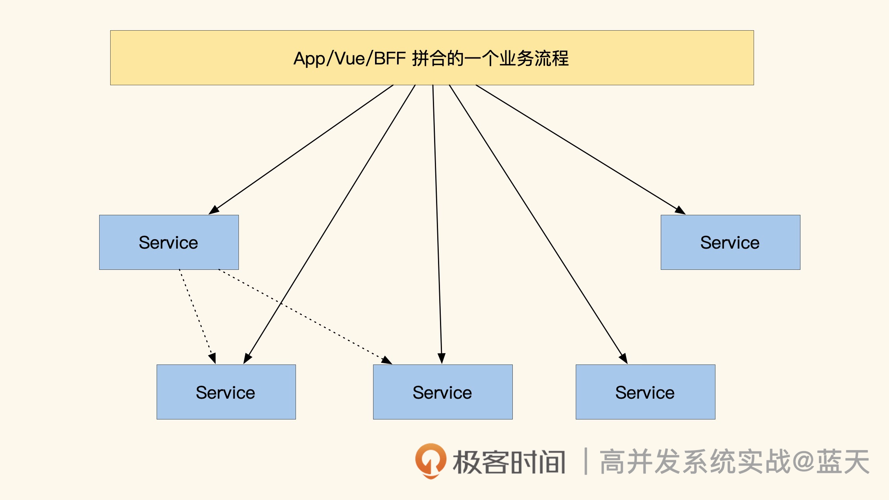

- 业务流程在前端项目内或 BFF 网关里拼合

这是因为，在微服务里一个 Service 就是一个独立部署的项目，同层 Service 服务之间没有上下层级关系，可以相互调用（虽然不推荐）。这和我们以往的横切习惯有很大不同，属于纵切拆分。

横切是按照依赖关系把服务划分为内网服务、外网服务，纵切可以理解成按业务服务切分，具体效果如图。

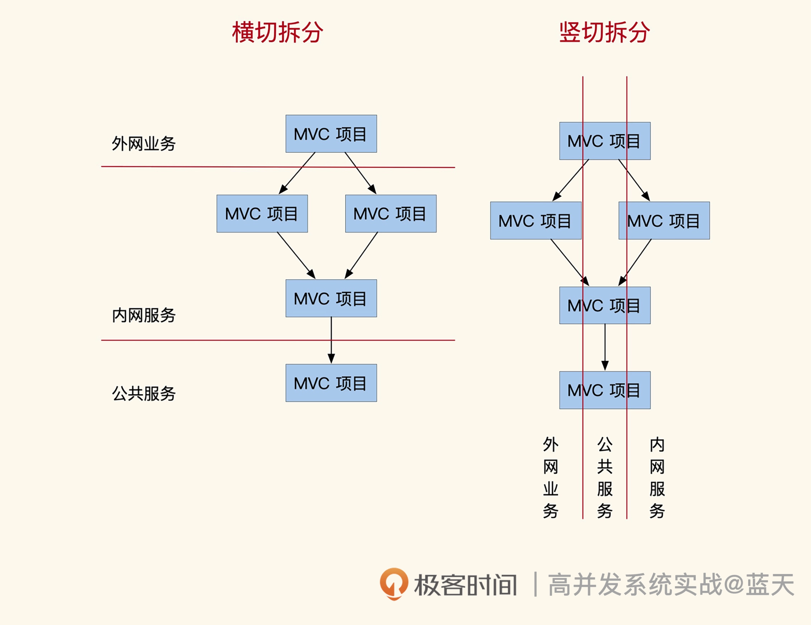

- 横切和纵切各有千秋

结合我们之前学的知识，不难发现横切的服务适合项目初期验证，复用性高，但是依赖关系复杂，性能优化很麻烦。而纵切的服务适合复杂业务，没有多层依赖的负担、性能更好，但是依赖关系都要在充血模型内部实现，还需要解决共用的数据问题，数据同步难度比较高，而且业务逻辑不好梳理。

纵切并不常见，但是最近流行的微服务和 DDD 都选择了纵切的方案。

## DDD 领域拆分

在解释 DDD 怎么实现纵切之前，我先简单给你解释一下什么是 DDD。不过这只是我的理解方式，欢迎你在留言区分享你的看法。

DDD 是一种按业务的视角拆分领域的技巧，能够帮助你和团队划分业务。DDD 要求团队通过充分交流讨论来达成共识，把业务梳理成多个领域和子领域。领域的边界，就是纵切的边界。

DDD 的每个领域内都是充血模型，同时这个领域内会尽量包含所有所需的依赖数据和实现。这样业务更隔离、修改更方便，性能优化更可控。

为了方便你理解，我们还是结合更熟悉的贫血模型做对比。

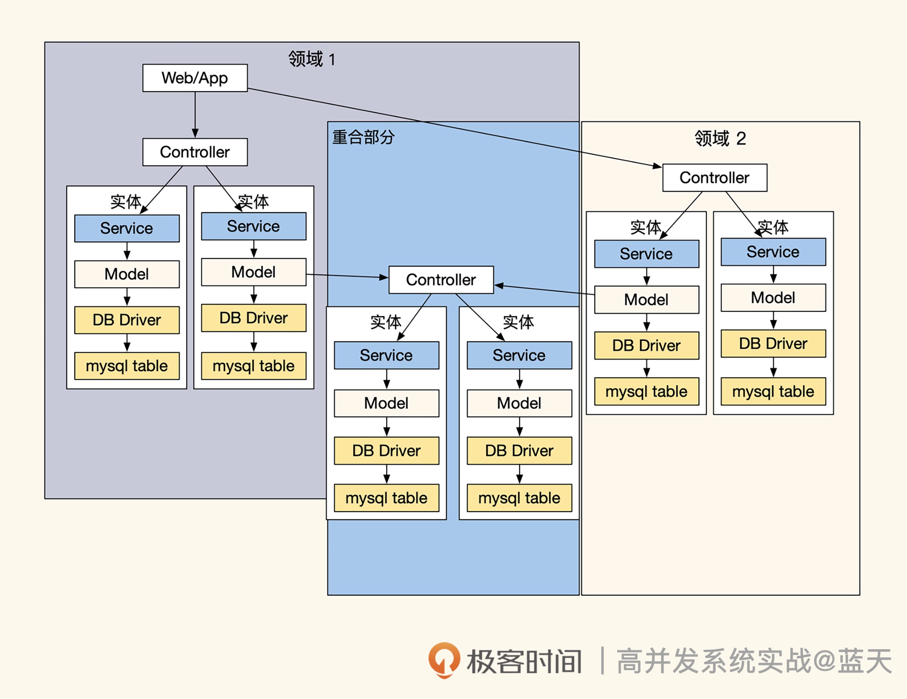

- 贫血模型 按实体数据拆分项目

从上图你可以清楚看到，项目是按照传统贫血模型的数据实体关系去拆分的，当很多实体服务都依赖一个服务实体时，这个服务就是公共服务（上图领域 1 和领域 2 重合部分）。

公共服务的并发类型（读多、写多）取决于调用方的使用场景，如果一个服务需要高并发写，另外一个服务需要高并发读，这时公共服务就需要同时做读写优化，那么还有什么其他方法吗？

DDD 里有一个重要概念叫值对象，它相当于公共服务实体数据的数据副本。当公共数据有更新时，会广播同步给所有依赖这个服务的数据，收到通知的服务会根据自己的需要来存储更新数据，当业务需要读取这个数据时，在本领域内获取即可。

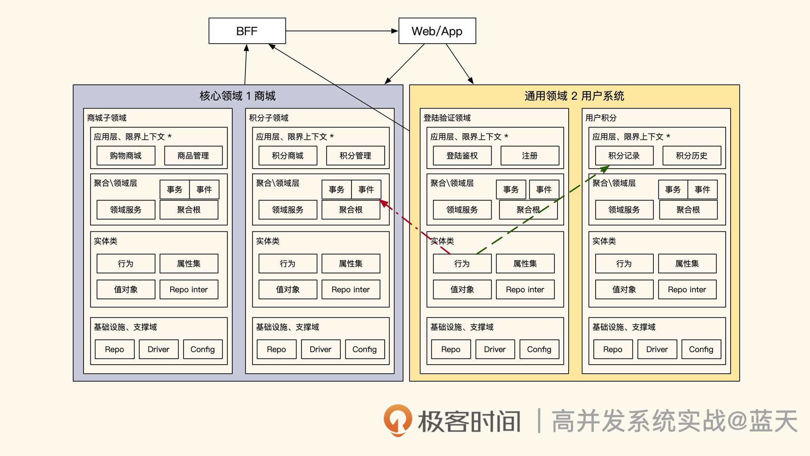

- DDD 领域分层效果

相比 CQRS 把一个实体服务拆分成读写项目的操作，值对象的方式更方便，因为依赖的服务只需要将值对象放在本地缓存，就实现了高并发读缓存服务。

而一些场景同时需要多个系统的数据时，我们可以结合这个数据同步广播做成一个公共服务，将多个系统的数据合并成一条数据，提供给特殊场景的服务查询使用。

你可能疑惑为什么传闻中 DDD 有那么多概念，我却只和你讨论了领域和值对象的问题，这是因为这两个概念对于项目拆分最有帮助。但实际 DDD 里面还有更多利器能够应对其他问题，如果你有兴趣的话，不妨在课后自行探索。

## 总结

好，这节课告一段落，我们总结一下。为什么现实中的业务系统很难做性能优化？

因为早期的业务系统是应激式地根据需求快速调整，我们习惯于把所有服务写成数据接口。虽然对于数据接口我们可以做读多、写多或者 CQRS 并发优化，但这些做法还是无法根本性地解决依赖问题。当业务逐渐稳定、流量不断增长时，系统性能的压力也更高了，这我们反思数据接口设计的合理性，毕竟依赖过多，性能提升非常有限。

为此，我们开始摸索如何减少服务依赖与层级。后来就有了更适合复杂业务系统的充血模型、微服务以及 DDD 出现。不同于传统模式的“横切”，微服务和 DDD 都采用了“纵切”的思路拆分依赖。其实两种思路并无优劣之分，只是适用场景不同。

最后，我把这节课的要点整理成了导图，供你复习回顾。

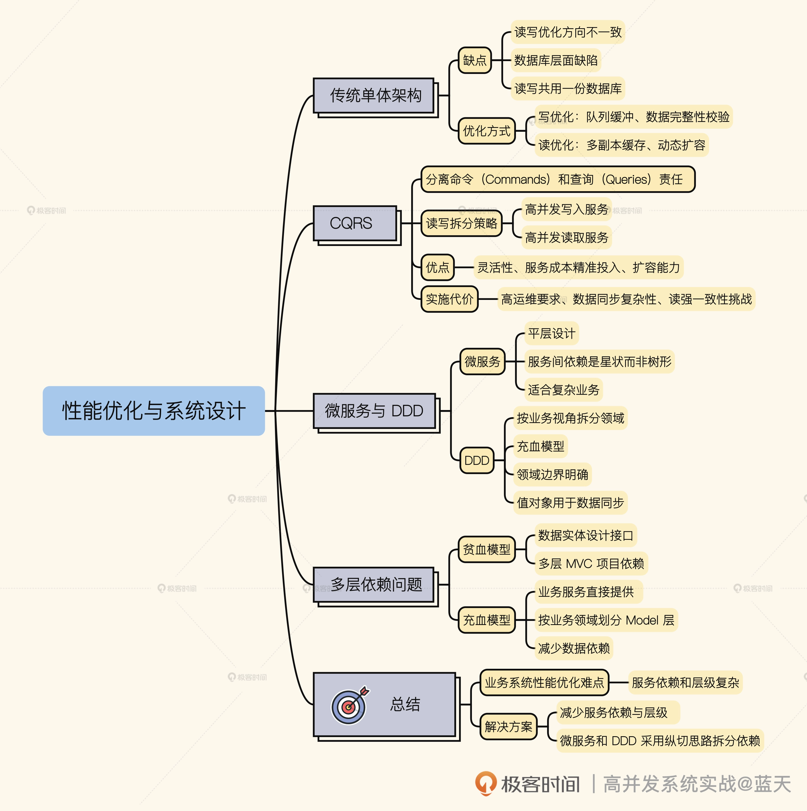

## 思考题

为什么说 CQRS 拆分数据接口很方便，却很难拆分业务接口呢？

欢迎你在留言区和我交流互动，也推荐你把今天的内容分享给身边更多朋友。
