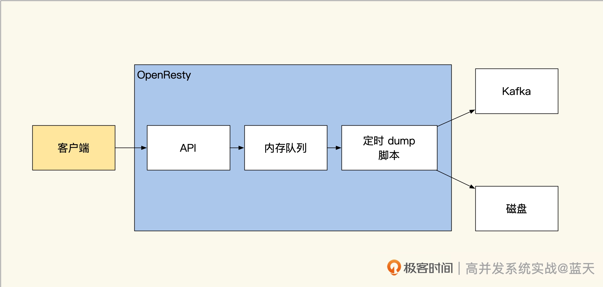
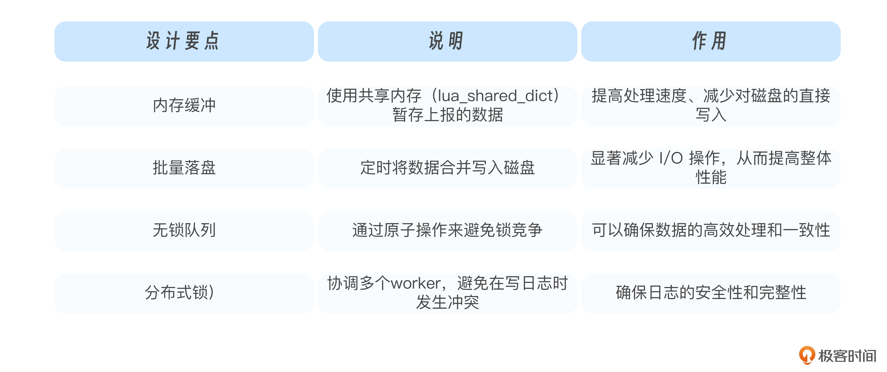

# 日志上传：如何高效接收海量上传的日志？

你好，我是徐长龙。

今天我们来探讨高并发系统中的一个核心挑战——如何高效接收海量上传的日志。

在广告监测和日志采集领域，我们需要实时汇聚来自客户端的日志数据，通过分析这些数据来优化客户服务。这就要求日志收集服务必须具备高性能的数据接收能力，同时还要兼顾成本效益，这构成了系统设计的主要矛盾。

## 传统方案面临的三大瓶颈问题

面对海量日志上传的业务需求，传统方案面临哪些瓶颈问题呢？我们先分析一下。

首先是磁盘 I/O 瓶颈。传统方式直接将请求写入磁盘，但受限于磁盘 IOPS 性能。机械硬盘每秒仅能支持 100-200 次操作，严重制约了系统并发性能。即便使用 SSD 固态硬盘，在面对数万 QPS 时仍然力不从心，并且这种频繁的写入磁盘操作对磁盘寿命影响极大。

相信你很容易想到使用内存聚合，降低磁盘压力的方案。的确，使用内存确实可以提升性能，但是不同的内存缓存实现差距很大。特别是在使用高级语言实现时，内存占用更加显著、在上万并发场景下，不合理的实现会消耗数十 GB 内存，而且性能不佳，还会大幅增加资源成本和维护难度。

另外还有并发写入磁盘问题。多进程同时写入同一文件时会引发锁竞争，这会导致数据错乱。如果错误的加锁会限制系统的写入性能，从而影响整体并发处理能力。

正因如此，实现一个低成本好维护高性能的日志接收系统其实并不容易。为解决这些问题，我将提供一种简单高效的解决方案供你参考。

## 方案设计与要点梳理

为应对上述挑战，我们需要构建一个高性能、低成本的日志接收系统，以高效处理海量请求。接下来我们会完成方案设计，实现每天处理超 10 亿用户行为事件（如点击与曝光）、峰值QPS 超过 5 万、支持数据实时落盘，并保障 99.9% 请求成功率。

该方案的核心技术选型为 OpenResty 结合 Lua，我们来看看这两个技术的主要优势。

OpenResty 基于 Nginx，继承了其高效的事件驱动架构，天然支持高并发请求处理。它内置了 Lua 脚本支持，使开发者能够灵活编写定制化逻辑，同时提供异步 I/O 机制，特别适用于密集网络与存储操作。此外，OpenResty 还集成丰富的扩展模块，涵盖缓存、负载均衡等常用功能，极大提升了开发效率和系统可扩展性。

Lua 语言则以简洁的语法和高效的执行性能著称，可大幅降低开发与维护成本。其轻量级特性和共享内存管理机制，进一步优化了资源使用和并发性能。OpenResty 配合 Lua 还具备良好的生态支持，包括活跃的社区、完善的文档，以及与其他数据库和消息队列系统的便捷集成能力。

通过 OpenResty 与 Lua 的有机结合，我们能够有效解决高并发日志接收中的性能、成本与稳定性问题，构建一个既高效又可靠的日志收集系统。



在我们的系统设计中，有几个关键设计要点（具体内容你可以查看后面的表格），来帮助我们构建一个高效、可靠的日志接收系统，满足高并发处理的需求。



## 实战代码讲解

接下来，我们将结合代码进行详细讲解，也推荐你实践一下，以便更好地体会这个方案的优势。这里需要你对 Lua 编程有一定的了解。如果还没有学过 Lua，可以借助 AI 学习一下，也可以在留言区交流讨论。

现在，让我们开始边读代码边讲解这个方案，一步步完成这个高效的日志接收系统。通过实际的代码示例，我们将深入探讨每个设计要点及其实现方式。

### 环境准备

我们将在 Ubuntu 环境下进行实战操作。

首先，你需要安装 OpenResty 的基础环境。可以使用以下命令。

```bash
sudo apt-get install openresty
```

接下来，安装 Lua 包管理器。

```bash
sudo apt-get install luarocks
```

然后，安装所需的 Lua 组件。

```bash
sudo luarocks install luafilesystem
sudo opm get ledgetech/lua-resty-http
sudo opm get openresty/lua-resty-lock
```

最后，重启 OpenResty 服务以确保所有更改生效：

```bash
sudo systemctl restart openresty
```

完成以上步骤后，环境准备工作就搞定了。

### Nginx 配置

接下来对 Nginx 进行配置，OpenResty 的主体还是通过 Nginx 提供服务的，Nginx 的配置对应的文件在 /Usr/Local/Openresty/Nginx/Conf/Nginx.conf 或/etc/openresty/ngxin/conf/nginx.conf 中。

下面就是我们的一个配置实现，这个配置会设置一个定时任务，定期将共享队列中的数据落到磁盘。除此之外，设置了一个域名和 api 地址为 report.example.com/report ，这个配置的脚本会将所有请求的 body 保存在队列中。具体代码是后面这样。

```javascript
http {
   # 设置Lua模块路径，下文的flush_handler.lua文件就是从这里加载的
   lua_package_path "/path/to/lua/scripts/?.lua;;";
   # 400MB共享内存用于队列
   lua_shared_dict report_queue 400m;
   # 写日志锁，写日志时是单线程append实现，性能更好
   lua_shared_dict file_locks 1m;
   # 上传请求body的大小限制
   client_max_body_size 10M;
   proxy_max_temp_file_size 10m;
   # 初始化worker进程
   init_worker_by_lua_block {
       local flush_handler = require "flush_handler"
       local function schedule()
           ngx.timer.at(5, flush_handler)  -- 每5秒执行落盘
       end
       schedule()
       ngx.log(ngx.INFO, "Flush handler initialized")
   }
   server {
       listen 80;
       server_name report.example.com;
       # 关闭访问日志减少I/O
       access_log off;
       error_log logs/error.log crit;
       location /report {
           client_max_body_size 10M;
           content_by_lua_file /path/to/lua/scripts/report.lua;
       }
   }
}
```

### 上报请求处理脚本 (report.lua)

下面我们讲解下接收请求的 Lua 脚本。当 Nginx 收到上传日志请求时，这个脚本会处理请求，具体来说，会将 body 内容解析出来，并保存在对应域名的内存队列内。这里不推荐你做太多解析操作，因为这会影响 QPS 性能。

```javascript
ngx.header.content_type = "application/json"
ngx.req.read_body()
local client_ip = ngx.var.remote_addr
local host = ngx.var.host or "default"
local body = ngx.req.get_body_data()
if not body then
   return ngx.exit(400)
end
if #body > 10 * 1024 * 1024 then
   return ngx.exit(413)
end
local shm = ngx.shared.report_queue
local entry_count = 0
for entry in body:gmatch("[^\n]+") do
   entry = entry:gsub("^%s*(.-)%s*$", "%1")
   if #entry > 10 and entry:sub(1,1) == "{" and entry:sub(-1) == "}" then
       local enriched_entry = string.format(
           '{"timestamp":%d,"client_ip":"%s","data":%s}',
           ngx.now() * 1000,
           client_ip,
           entry
       )
       local ok, err = shm:lpush(host, enriched_entry)
       if not ok then
           ngx.log(ngx.ERR, "队列写入失败: ", err)
           return ngx.exit(503)
       end
       entry_count = entry_count + 1
   end
end
if entry_count > 0 then
   ngx.say(string.format('{"code":0,"msg":"success","accepted":%d}', entry_count
else
   ngx.say('{"code":101,"msg":"no valid data"}')
end
```

### 定时落盘脚本 (Flush_handler.lua)

好，我们再来看看定时落盘脚本，它是前面在 Nginx 中定义的定时任务，每隔 5 秒就会执行一次，用途是将队列中的数据批量写入磁盘。

```sql
local resty_lock = require "resty.lock"
local lfs = require "lfs"
-- 确保目录存在（递归创建）
local function ensure_directory(dir)
   local current = ""
   for part in dir:gmatch("[^/]+") do
       current = current .. "/" .. part
       if not lfs.attributes(current) then
           local ok, err = lfs.mkdir(current)
           if not ok then
               ngx.log(ngx.ERR, "目录创建失败: ", current, " 错误: ", err)
               return false
           end
       end
   end
   return true
end
-- 批量写入文件
local function batch_write(file_path, entries)
   local file, err = io.open(file_path, "a")  -- 追加模式
   if not file then
       ngx.log(ngx.ERR, "文件打开失败: ", file_path, " 错误: ", err)
       return false
   end
   -- 批量写入优化性能
   local content = table.concat(entries, "\n") .. "\n"
   local ok, err = file:write(content)
   if not ok then
       ngx.log(ngx.ERR, "文件写入失败: ", file_path, " 错误: ", err)
       file:close()
       return false
   end
   file:close()
   return true
end
-- 主处理函数
local function handler(premature)
   if premature then return end
   local shm = ngx.shared.report_queue
   local now = ngx.now()
   local date_str = os.date("%Y-%m-%d", now)
   local hour_str = os.date("%H", now)
   -- 获取所有域名队列
   local keys, err = shm:get_keys(0)
   if not keys then
       ngx.log(ngx.ERR, "获取队列keys失败: ", err)
       goto reschedule
   end
   for _, domain in ipairs(keys) do
       -- 跳过系统key
       if domain ~= "file_lock"  then
           local queue_len = shm:llen(domain)
           if queue_len == 0 then goto continue end
           -- 获取分布式锁（按域名分区）
           local lock = resty_lock:new("file_locks", {
               timeout = 3000,   -- 3秒超时
               exptime = 10000   -- 10秒自动释放
           })
           local elapsed, err = lock:lock(domain)
           if not elapsed then
               ngx.log(ngx.WARN, "获取锁失败: ", domain, " 错误: ", err)
               goto continue
           end
           -- 批量取出数据（最多10000条）
           local entries = {}
           local pop_count = math.min(queue_len, 10000)
           for i = 1, pop_count do
               local entry = shm:rpop(domain)
               if entry then
                   table.insert(entries, entry)
               else
                   break
               end
           end
           -- 创建分级目录
           local log_dir = string.format(
               "/data/logs/%s/%s/%s",
               domain, date_str, hour_str
           )
           if not ensure_directory(log_dir) then
               lock:unlock()
               goto continue
           end
           -- 生成唯一文件名
           local file_name = string.format(
               "report_%s_%s_%s.log",
               os.date("%Y%m%d%H%M"),
               ngx.worker.pid(),
               ngx.now() * 1000
           )
           local file_path = log_dir .. "/" .. file_name
           -- 执行写入
           local ok = batch_write(file_path, entries)
           if not ok then
               -- 失败时回退数据
               for i = #entries, 1, -1 do
                   shm:lpush(domain, entries[i])
               end
           end
           lock:unlock()
       end
       ::continue::
   end
   ::reschedule::
   -- 5秒后重新执行
   ngx.timer.at(5, handler)
end
return handler
```

这个脚本会定期扫描各个域名对应的队列，如果队列内有日志，脚本会批量地读取队列日志并append 到对应文件日志内。

## 磁盘写入底层优化

通过我们的实现，成功降低了网络通讯带来的系统损耗，节省了系统内存和服务器数量，并通过内存合并优化了磁盘写入性能。那么，为什么需要优化磁盘写入呢？

首先，机械硬盘存在以下性能瓶颈。

- 寻道时间：约 10ms，即磁头移动到目标位置的时间。

- 随机 I/O 操作限制：每秒最多只能处理 100-200 次随机 I/O 操作。

- 顺序写入速度：可达 100MB/s 以上，但受限于随机操作的性能。

此外，大量上报系统还面临文件系统的一些缺点。

- 小文件问题：产生大量 inode（文件系统元数据），增加存储开销。

- 元数据操作消耗：创建和删除文件时，元数据操作消耗较大。

- 目录文件过多：导致查找效率下降，影响整体系统性能。

### 对应问题的优化策略

通过优化磁盘写入策略，我们可以有效应对这些挑战，提高系统的整体性能和可靠性。具体优化策略如下。

第一，设置日志批量写入 。如下代码所示，通过内存合并强化磁盘日志落盘的性能。

```
local content = table.concat(entries, "\n") .. "\n"
file:write(content) -- 单次写入代替多次小写入
```

第二，文件使用追加模式。追加模式的优势是减少磁头移动，同时避免文件覆盖操作。

```
local file = io.open(path, "a") -- 'a' 表示追加模式
```

第三，目录分级。比如后面这样的结构。

```
/data
 └── logs
     └── example.com
         └── 2023-06-25
             ├── 00   # 小时目录
             │   ├── report_202306250000_w1.log
             │   └── report_202306250005_w2.log
             └── 01
                 ├── report_202306250100_w1.log
                 └── ...
```

目录分级的好处包括以下几点。

- 避免单目录文件过多

- 提高文件系统效率

- 时间窗口分割

- 按小时组织目录、平衡文件数量和大小

## 生产环境最佳实践

为了确保服务的稳定性，最后我再分享四条小技巧。

### 1. 内存监控

由于使用了共享内存作为请求汇总，内存是稀缺资源。在某些情况下，可能会出现内存不足的情况。可以通过以下方式监控内存使用情况，及时发现并处理问题。

```
local free_bytes = shm:free_space()
if free_bytes < 10 * 1024 * 1024 then  -- 当剩余内存小于10MB时告警
   ngx.log(ngx.ALERT, "共享内存不足! 仅剩 "..free_bytes.." 字节")
end
```

### 2. 优雅降级

要求客户端对返回值进行检测，可以在服务端内存满时，暂时将数据保存在本地并定期重试，以提高服务的可用性，避免数据丢失。例如，处理队列溢出的逻辑：

```
if shm:llen(domain) > 50000 then
   ngx.log(ngx.WARN, "队列溢出: "..domain)
   return ngx.exit(503)  -- 返回服务不可用
end
```

### 3. 文件压缩归档

服务器磁盘空间有限，需定期对生成的日志文件进行压缩或删除，以释放空间。例如，可以设置定时任务，每小时压缩上一小时的日志：

```
# 每小时压缩上一小时日志
0 * * * * find /data/logs -name "*.log" -mmin +60 -exec gzip -f {} \;
```

### 4. 监控指标

监控队列中的数据数量和其他关键指标，可以帮助及时发现潜在问题。例如：

```
-- 记录关键指标
shm:incr("stats:total_entries", #entries)  -- 总条目数
shm:incr("stats:total_bytes", #content)    -- 总字节数
```

通过实施以上最佳实践，可以有效提高服务的稳定性和可用性，及时监控和处理潜在问题，确保系统高效运行。

## 总结

通过今天的课程，我们实现了一个高并发的上传系统方案，设计重点包括后面这四点。

- 高性能架构：基于 OpenResty 的高并发上传处理。

- 优化策略：内存缓冲 + 批量落盘的核心思想。

- 分布式协作：多 worker 协调处理。

- 磁盘优化：底层 I/O 性能提升技巧。

需要你把握的核心思想有三条。

- 用内存换 I/O：减少磁盘操作次数。

- 用批量换效率：合并小操作为大操作。

- 用分区换并发：分散处理避免冲突。

这种设计可扩展到各种高并发数据采集场景，比如日志收集系统、用户行为跟踪、IoT 设备数据处理以及实时监控系统

希望这个方案能够帮助大家在项目实践中，低成本地解决高并发上传的挑战！

### 思考题

```
内存映射文件优化：如何进一步优化使用 mmap 内存映射文件的性能？在绕过内核缓冲区
```

- 和减少数据拷贝次数的基础上，还有哪些措施可以提高与文件系统交互的效率？

2. WAL（Write-Ahead Logging）机制：在实现 WAL 机制时，除了确保数据不丢失和提供故障恢复能力外，还有哪些其他因素需要考虑？如何设计 WAL 机制以提高写入性能和恢复效率？

3. 数据压缩与传输：客户端在上传数据之前进行压缩的过程有哪些潜在的挑战？在服务端解压处理时，如何确保解压效率与系统性能之间的平衡？此外，是否有其他的方法可以进一步提升网络传输的效率？

期待你在留言区和我交流讨论。如果今天的内容对你有启发别忘了分享给身边更多朋友。
