# 贝叶斯推断与过滤垃圾邮件

阮一峰 / 2013-03-29

本文是《黑客与画家》第 8 章“防止垃圾邮件的一种方法”的通俗解释，详细讲解了相关概念和过滤垃圾邮件的算法细节。

## 什么是贝叶斯推断

贝叶斯推断是一种统计学方法，用来估计统计量的某种性质。它是贝叶斯定理的应用。英国数学家托马斯·贝叶斯（Thomas Bayes）在 1763 年发表的一篇论文中，首先提出了这个定理。

贝叶斯推断与其他统计学推断方法截然不同。它建立在主观判断的基础上，也就是说，你可以不需要客观证据，先估计一个值，然后根据实际结果不断修正。正是因为它的主观性太强，曾经遭到许多统计学家的诟病。

贝叶斯推断需要大量的计算，因此历史上很长一段时间无法得到广泛应用。只有计算机诞生以后，它才获得真正的重视。人们发现，许多统计量是无法事先进行客观判断的，而互联网时代出现的大型数据集，再加上高速运算能力，为验证这些统计量提供了方便，也为应用贝叶斯推断创造了条件，它的威力正在日益显现。

## 贝叶斯定理

要理解贝叶斯推断，必须先理解贝叶斯定理。后者实际上就是计算“条件概率”的公式。

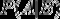

所谓条件概率，就是指在事件

- 发生的情况下，事件发生的概率，用来表示。

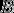

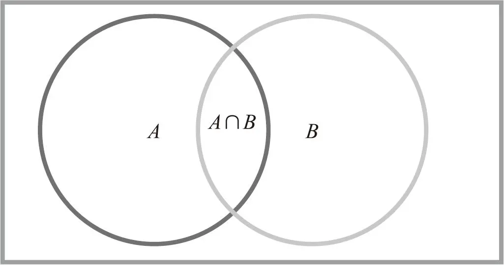

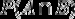

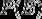

从上图可以清楚地看到在事件

- 发生的情况下，事件发生的概率就是除以

：

由此可以得到

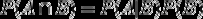

同理可得

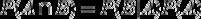

综合以上两式可得

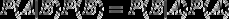

即

这就是条件概率的计算公式。

## 全概率公式

由于后面要用到，所以除了条件概率以外，这里还要推导全概率公式。

假定样本空间

- 是两个事件与的和。

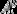

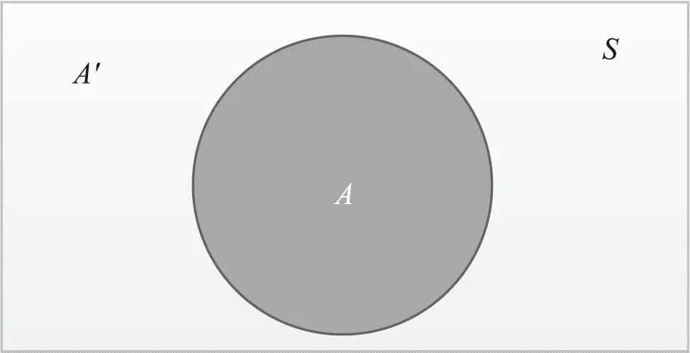

上图中，圆内部分是事件

- ，方框内圆外部分是事件，它们共同构成了样本空间。

在这种情况下，事件

- 可以划分成两个部分。

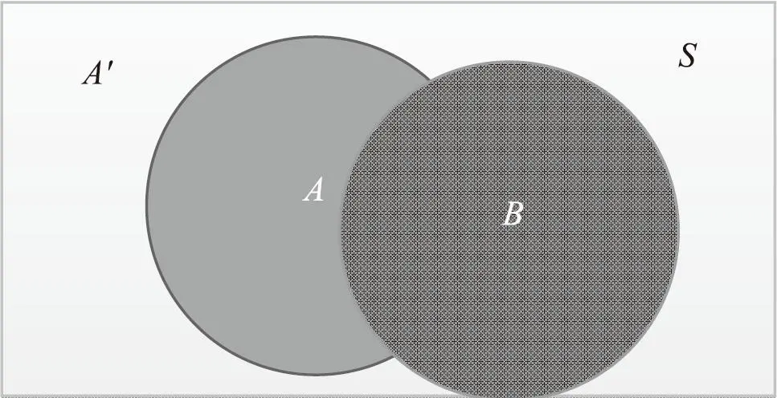

即

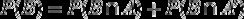

在上一节的推导当中，已知

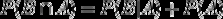

所以可得

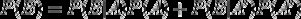

这就是全概率公式。它的含义是，如果

- 和构成样本空间的一个划分，那么事件的概

率，就等于

- 和的概率分别乘以对这两个事件的条件概率之和。

将这个公式代入上一节的条件概率公式，就得到了条件概率的另一种写法：

## 贝叶斯推断的含义

对条件概率公式进行变形，可以得到如下形式：

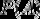

- 称为“先验概率”，即在

我们把

- 事件发生之前，我们对事件发生概率的一个判断。

- 称为“后验概率”，即在事件发生之后，我们对事件发生概率的重新评估。

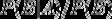

- 称为“可能性函数”，这是一个调整因子，使得预估概率更接近真实概率。

所以，条件概率可以理解成下面的式子：

后验概率＝先验概率×调整因子

这就是贝叶斯推断的含义。我们先预估一个先验概率，然后加入实验结果，看这个实验到底是增强了还是削弱了先验概率，由此得到更接近事实的后验概率。

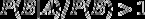

在这里，如果可能性函数

- ，意味着先验概率被增强，事件发生的可能性

变大；如果可能性函数 =1，意味着

- 发生的可能性；如果可能性函数事件无助于判断事件

<1，意味着先验概率被削弱，事件

- 发生的可能性变小。

## 【例子】水果糖问题

为了加深对贝叶斯推断的理解，我们看两个例子。

第一个例子。有两个一模一样的碗，一号碗有 30 颗水果糖和 10 颗巧克力糖，二号碗有水果糖和巧克力糖各 20 颗。现在随机选择一个碗，从中摸出一颗糖，发现是水果糖。请问这颗水果糖来自一号碗的概率有多大？

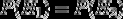

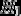

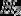

我们假定，

- 表示一号碗，表示二号碗。由于这两个碗是一样的，所以

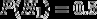

，也就是说，在取出水果糖之前，这两个碗被选中的概率相同。因此，

- ，我们把

这个概率就叫作先验概率，即没有做实验之前，来自一号碗的概率是 0.5。

再假定，

- 表示水果糖，所以问题就变成了在已知的情况下，来自一号碗的概率有多大，即

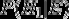

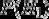

求

- 。我们把这个概率叫作后验概率，即在事件发生之后，对的修正。

根据条件概率公式，得到

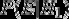

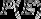

- 等于 0.5，为一号碗中取出水果糖的概率，等于 0.75，那么求出

已知，就可以得到答案。根据全概率公式，因为

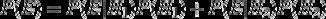

所以

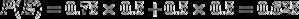

将数值代入原方程，得到

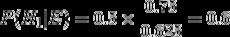

这表明，来自一号碗的概率是 0.6。也就是说，取出水果糖之后，

- 事件的可能性得到了增

强。

## 【例子】假阳性问题

第二个例子是一个医学的常见问题，与现实生活关系紧密。

已知某种疾病的发病率是 0.001，即 1 000 个人中会有 1 个人得病。现有一种试剂可以检验患者是否得病，它的准确率是 0.99，即在患者确实得病的情况下，它有 99% 的可能呈现阳性。它的误报率是 5%，即在患者没有得病的情况下，它有 5% 的可能呈现阳性。现有一个病人的检验结果为阳性，请问他确实得病的可能性有多大？

- 为 0.001。这就是先验概率，即没有做试验之前，我们预计

假定

- 事件表示得病，那么

的发病率。再假定

- 事件表示阳性，那么要计算的就是。这就是后验概率，即做了试

验以后，对发病率的估计。

根据条件概率公式，有

将数值代入上式，得到

- 约等于 0.019。也就是说，即使检验呈现阳性，病人得

我们得到了一个惊人的结果，病的概率，也只是从 0.1% 增加到了 2% 左右。这就是所谓的“假阳性”，即阳性结果完全不足以说明病人得病。

为什么会这样？为什么这种检验的准确率高达 99%，但是可信度却不到 2%？答案与它的误报

- 1

率太高有关。

有兴趣的朋友，还可以算一下“假阴性”问题，即检验结果为阴性，但是病人确实得病的概率有多大。然后考虑一下，“假阳性”和“假阴性”哪一个才是医学检验的主要风险。

## 什么是贝叶斯过滤器

垃圾邮件是一种令人头痛的顽症，困扰着所有互联网用户。

正确识别垃圾邮件的技术难度非常大。传统的垃圾邮件过滤方法主要有“关键词法”和“校验和法”等。前者的过滤依据是特定的词语；后者则是计算邮件文本的校验和，再与已知的垃圾邮件进行对比。它们的识别效果都不理想，而且很容易规避。

2002 年，保罗·格雷厄姆提出使用贝叶斯推断过滤垃圾邮件。他说，这样做的效果，好得不可思议。1 000 封垃圾邮件可以过滤掉 995 封，且没有一个误判。

另外，这种过滤器还具有自我学习的功能，会根据新收到的邮件不断调整。收到的垃圾邮件越多，它的准确率就越高。

## 建立历史资料库

贝叶斯过滤器是一种统计学过滤器，建立在已有的统计结果之上。所以，我们必须预先提供两组已经识别好的邮件，一组是正常邮件，另一组是垃圾邮件。

我们用这两组邮件，对过滤器进行“训练”。这两组邮件的规模越大，训练效果就越好。保罗·格雷厄姆使用的邮件规模，是正常邮件和垃圾邮件各 4 000 封。

“训练”过程很简单。首先，解析所有邮件，提取每一个词。然后，计算每个词语在正常邮件和垃圾邮件中的出现频率。比如 sex 这个词，在 4 000 封垃圾邮件中，有 200 封包含这个词，那么它的出现频率就是 5%；而在 4 000 封正常邮件中，只有 2 封包含这个词，那么出现频率

- 2

就是 0.05%。

有了这个初步的统计结果，过滤器就可以投入使用了。

## 贝叶斯过滤器的使用过程

现在，我们收到了一封新邮件。在未经统计分析之前，我们假定它是垃圾邮件的概率为

- 3

50%。

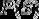

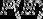

- 表示垃圾邮件（spam），表示正常邮件（healthy）。因此，

我们用

- 和的先验概

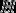

率都是 50%。

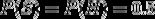

然后，对这封邮件进行解析，发现其中包含了 sex 这个词，请问这封邮件属于垃圾邮件的概率有多高？

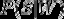

- 表示 sex 这个词，那么问题就变成了如何计算

我们用

- 的值，即在某个词语（）

已经存在的条件下，垃圾邮件（

- ）的概率有多大。

根据条件概率公式，马上可以写出

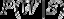

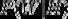

上式中，

- 和表示这个词语在垃圾邮件和正常邮件中分别出现的概率。这两

个值可以从历史资料库中得到，对 sex 这个词来说，上文假定它们分别等于 5% 和 0.05%。

- 的值都等于 50%。所以，马上可以计算

另外，前面说过

- 和的值：

因此，这封新邮件是垃圾邮件的概率等于 99%。这说明，sex 这个词的推断能力很强，将50% 的先验概率一下子提高到了 99% 的后验概率。

## 联合概率的计算

做完上面一步，请问我们能否得出结论，这封新邮件就是垃圾邮件？

回答是不能。因为一封邮件包含很多词语，一些词语（比如 sex）说这是垃圾邮件，另一些说这不是。你怎么知道以哪个词为准？

- 4

保罗·格雷厄姆的做法是，选出这封信中

- 最高的 15 个词，计算它们的联合概率。

所谓联合概率，就是指在多个事件发生的情况下，另一个事件发生的概率有多大。比如，已知

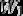

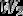

- 和是两个不同的词语，它们都出现在某封电子邮件之中，那么这封邮件是垃圾邮件的概

率，就是联合概率。

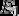

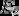

在已知

- 和的情况下，无非就是两种结果：垃圾邮件（事件）或正常邮件（事件

）。

事件

- 垃圾邮件

其中，

- 、和垃圾邮件的概率分别如下：

事件

- 垃圾邮件

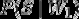

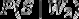

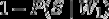

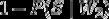

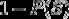

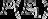

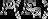

- 5

假定所有事件都是独立事件

- ，那么就可以计算和：

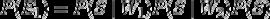

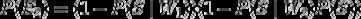

又由于在

- 和已经发生的情况下，垃圾邮件的概率等于：

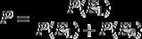

即

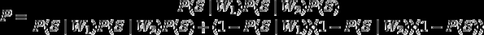

- 等于 0.5 代入，得到

将

这就是联合概率的计算公式。

## 最终的计算公式

将上面的公式扩展到 15 个词的情况，就得到了最终的概率计算公式：

一封邮件是不是垃圾邮件，就用这个式子进行计算。这时我们还需要一个用于比较的阈值。保罗·格雷厄姆的阈值是 0.9，概率大于 0.9，表示 15 个词联合认定，这封邮件有 90% 以上的可能属于垃圾邮件；概率小于 0.9，就表示是正常邮件。

有了这个公式以后，一封正常的邮件即使出现 sex 这个词，也不会被认定为垃圾邮件了。

[1]：如果误报率从5%降为0.5%，请问病人得病的概率会变成多少？[2]：如果某个词只出现在垃圾邮件中，保罗·格雷厄姆就假定它在正常邮件中的出现频率是1%，反之亦然。这样做是为了避免概率为

- 0。随着邮件数量的增加，这个结果会自动调整。

[3]：有研究表明，用户收到的电子邮件中，80%是垃圾邮件。但是，这里仍然假定垃圾邮件的先验概率为50%。[4]：如果有的词是第一次出现，无法计算，保罗·格雷厄姆就假定这个值等于0.4。因为垃圾邮件用的往往都是某些固定的词语，所以

- 如果你从来没见过某个词，它多半是一个正常的词。

[5]：严格地说，这个假定不成立，但是这里可以忽略。
